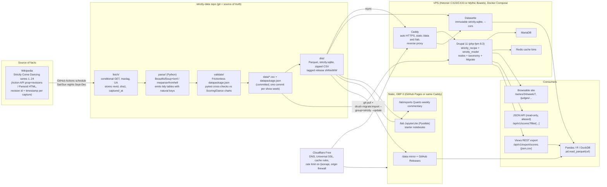

# Architecture and hosting

How the Strictly Come Dancing results database gets from Wikipedia to a Drupal site, a static open dataset and a Pandas notebook, and where it should live. This is the architecture and hosting companion to the data model; the entity and table definitions themselves live in the data-model document and are only summarised here.

Research basis: the Drupal, API, hosting, traffic and local-development research summarised here, `docs/data-access-options.md` (Wikipedia access, licensing, live-series change tracking) and `docs/wikipedia-source-analysis.md` (parser findings). Entity names and key grammar follow `docs/data-model-v2.md`, which is authoritative where this document's shorthand differs. Prices were checked on 8 November 2026 and will drift; see the caveats in section 5.

Contents

1. [Recommended architecture](#1-recommended-architecture)
2. [Drupal modelling decisions](#2-drupal-modelling-decisions)
3. [API options for Pandas use](#3-api-options-for-pandas-use)
4. [Ingestion pipeline](#4-ingestion-pipeline)
5. [Hosting options](#5-hosting-options)
6. [Traffic strategy in four layers](#6-traffic-strategy-in-four-layers)
7. [Domain and TLS layout](#7-domain-and-tls-layout)
8. [Local development: DDEV and Python side by side](#8-local-development-ddev-and-python-side-by-side)
9. [Phased roadmap](#9-phased-roadmap)

---

## 1. Recommended architecture



### One-page explanation

**The dataset in git is the source of truth; Drupal is derived from it.** Wikipedia's per-series pages are the only primary source. A Python job fetches each page with its revision id, sha1 and capture time (the MediaWiki Action API `prop=revisions` call, or the Parsoid HTML endpoint whose `content-revision-id` header gives the same provenance), parses the weekly score tables, couples tables, judges' votes lists and scoring-chart legends, and emits the flat, tidy tables with natural keys defined in `docs/data-model-v2.md` §10: `series`, `format_rules`, `weeks`, `episodes`, `panel_seats`, `results_rounds`, `people`, `couples`, `couple_partnerships`, `couple_weeks` (one row per couple per week with its status), `performances`, `judge_marks` (one row per judge mark), `dance_off_votes` (one row per judge line in a votes list), plus `lookups/*.csv` for every enumeration. Every row carries a `source_capture_id` that resolves to page, revision id and capture time. Derived values (per-performance totals, averages, "first 10 of the series") are never stored alongside the primary facts; they are recomputed in Pandas, in Views aggregation or in a separate cross-check table that the validation step diffs against the Wikipedia "Scoring chart".

The parser output is committed as CSV with a Frictionless `datapackage.json` describing schemas, primary and foreign keys and enum constraints. A CI build turns the CSVs into Parquet, a single `strictly.sqlite` and a zipped CSV bundle, and tags a release per show week (`s24w07`). That release is what every downstream consumer reads:

- **Drupal 11** loads it with Migrate (`migrate_source_csv`), keyed on the natural keys so a re-run updates in place. Drupal provides the browsable fan-facing site (Views pages per series, week, couple and judge), the record-level **JSON:API** (read-only, aliased through JSON:API Extras) and a handful of **Views REST export** displays that give one-call flat JSON and CSV. The content types, vocabularies, bundle classes, Views and migrations are packaged as a **Drupal Recipe** (`kitperform/strictly_recipe`) so another Kit Perform site can `composer require` and `drush recipe` it.
- **Static `/data`** mirrors the release files (also on GitHub Releases) so Pandas, R and DuckDB users never page through an API: `pd.read_parquet("https://strictly.kitperform.science/data/scores.parquet")` is the whole analysis interface.
- **JupyterLite at `/lab`** runs Pandas in the browser (Pyodide) against the same files, with starter notebooks for the TV-style questions. **Quarto** renders weekly commentary notebooks (Pandas and R) to `/lab/reports` in CI.
- **Datasette** serves the SQLite file in immutable mode for ad-hoc SQL over HTTP and a free JSON API, for analysts who want SQL rather than Drupal or Pandas.
- **Cloudflare Free** sits in front of everything: DNS, TLS, cache-everything rules for anonymous HTML/JSON/data, a rate limit on `/jsonapi/*`, and the origin firewalled to Cloudflare's IP ranges.

The Drupal stack and Datasette run in one Docker Compose file (Caddy, php-fpm 8.3, MariaDB, Redis, Datasette) on a small VPS costing roughly GBP 6-12 a month; the static side costs nothing. If the VPS is not wanted in year one, the same Recipe runs locally in DDEV and a static snapshot of the Drupal site (Tome) goes to GitHub Pages for GBP 0, with live JSON:API as the only thing lost.

Why this shape: it gives real Drupal content types, entity references, Views and Recipe reuse, while making Drupal replaceable and never a bottleneck. A Wikipedia correction or a parser fix is one re-run away and flows to every consumer identically. The analysis side never depends on Drupal uptime, and every historical corner case in the anomaly register (bottom-three weeks, excused couples, casting votes, scheduled-but-unscored performances, 3/4/5-judge panels, two-night weeks) is a row or a term in the dataset, not a branch in code.

---

## 2. Drupal modelling decisions

**Scale first.** A regex count over the 24 wikitexts finds about 364 couples, roughly 2,800 performance rows and roughly 11,200 individual judge marks (a lower bound; 3,500 and 14,000 are sensible ceilings). The widest Drupal field table, `node__field_mark`, is therefore around 14,000 rows. This is tiny for MariaDB. Entity-reference joins in Views are fine at this size; the single known weak spot is reverse reference relationships ("entities referencing this node"), which lack an index in core, so public Views are built forwards from the fact node or an index is added in a small update hook. Expect sub-50 ms uncached queries; caching strategy, not schema, governs performance.

### Entity type per model object

| Model object | Drupal construct | Why |
|---|---|---|
| Series, FormatRule, Week, Episode, PanelSeat, ResultsRound, Person, SeriesPerson, Couple, CouplePartnership, CoupleWeek (status row), Performance, PerformanceMusic, Song, JudgeMark (one per judge mark), DanceOffVote, SourceCapture, Discrepancy (full list in `docs/data-model-v2.md` §9) | **Node content types** | Views, JSON:API, Pathauto, Migrate destinations, revisions, Search API, permissions and every contrib module already work. `/jsonapi/node/judge_mark` exists with no code. A Recipe can ship node types as plain config. Unwanted base fields (body, promote, sticky, comments) are simply not added to the bundles; `title` is generated in `preSave()` (for example `S21 W3 - Ellie & Vito - Charleston - Craig: 8`). |
| Dance (hierarchy Ballroom / Latin / Other), Theme, Round, ResultStatus (safe, bottom two, bottom three, eliminated, withdrew, excused, immune, not competing, already exited), ExitReason, PerformanceKind, EliminationMechanism, ScoringScale, Venue, JudgeRole (head, guest, casting-vote) | **Taxonomy vocabularies** | Low-cardinality lookups with a label and perhaps a description or a colour. Taxonomy gives free hierarchy, free Views filters and `/jsonapi/taxonomy_term/{vocab}`. The series 24 scoring-chart legend literally says "Week 6 had the bottom three couples competing" and "Excused from competition for the week", so the status list is data and can grow without a deploy. |
| Validation and helpers (mark within scale, judge must be on that series' panel, `$performance->getTotal()`) | **Bundle classes** (`hook_entity_bundle_info_alter()` setting `$bundles['node']['score']['class']`) in a small `strictly_model` module | Core since Drupal 9.3; the modern replacement for "custom entity because I need behaviour". No ECK needed. |
| Person vs Celebrity / Professional / Judge | One `person` node bundle with role data held in `couple`, `series_person`, `panel_seat` and a `person_alias` table, rather than separate bundles | A person can be pro, judge and celebrity across their career (Anton Du Beke is pro then judge). Identity is a curated slug assigned once (`karen-hauer`); the Wikipedia article title is a mutable attribute and former titles, display names and vote-list surnames are alias rows (Karen Clifton = Karen Hauer). The Drupal feasibility review rejected keying on the article title because page moves would orphan nodes. |

### Things deliberately not used

- **Paragraphs.** Paragraphs are owned by a parent and are not first-class, addressable, filterable things. A score must be citable ("the last time a judge gave a 2 was series 12") and filterable in JSON:API and Views across the whole corpus. Paragraphs would make `filter[judge]` across all performances awkward and double the join depth. The one defensible use (a per-episode "notes" block) is left out; notes become enumerated codes or a `source_note` text field.
- **ECK or hand-written custom entities.** ECK 2.1.0 does support Drupal 11, and a hand-written `ContentEntityType` gives the leanest schema (one base table, no field tables), but either costs PHP, Views glue and more Migrate and JSON:API edge cases, and buys nothing below about a million rows. ECK stays as a fallback if node overhead ever bothers anyone.
- **Stored totals and averages.** Not stored on nodes. Computed in Views aggregation, in SQL for the static export, or in Pandas. The exceptions are facts Wikipedia itself states in the Couples table: `couple.final_placing` and the exit episode.
- **Polymorphic references.** Each reference field targets one bundle. Where the model needs "a score belongs to a performance; a performance belongs to an episode and a couple", those are three plain entity reference fields, which Views, JSON:API `?include=` and Migrate `migration_lookup` all understand.

### Recipe packaging: `kitperform/strictly_recipe`

- `recipe.yml` with `type: Content type`, an `install:` list (node, taxonomy, field, jsonapi, jsonapi_extras, views, pathauto, migrate_plus, migrate_tools, migrate_source_csv), `config/` holding the exported `node.type.*`, `field.storage.*`, `field.field.*`, `taxonomy.vocabulary.*`, `views.view.*`, `jsonapi_extras.jsonapi_resource_config.*` and the migration YAMLs, and `config: actions:` to grant anonymous `access content` and set JSON:API read-only.
- `content/` carries the seed lookup terms (dances, rounds, statuses, performance kinds) exported with Default Content 2.x (`drush dce` / `drush dcer`); core also has `php core/scripts/drupal content:export`.
- Apply with `drush recipe <path>` (Drush 13+) or `php core/scripts/drupal recipe <path>`. Composer `type: drupal-recipe`; Drupal 11.2+ projects unpack recipes automatically. Recipes are stable in Drupal 11.1+; current core is 11.4.x, with 11.5 / 12.0 due in December 2026.
- The `strictly_model` module (bundle classes, constraints, title generation) ships beside the recipe so Kit Perform reuse is `composer require kitperform/strictly_recipe && drush recipe ...`.

---

## 3. API options for Pandas use

| Option | What it gives | Fit for Pandas | Verdict |
|---|---|---|---|
| **Core JSON:API** + JSON:API Extras / Defaults | Zero-config `/jsonapi/node/{bundle}`, spec filtering, sorting, sparse fieldsets, `?include=`, offset paging. Extras aliases resources and fields (`/api/v1/scores`, `judge` not `field_judge`), disables user/file resources, sets default includes and page limits. | Moderate. Hard cap of **50 items per page** (`OffsetPage::SIZE_MAX`): 14k scores = 280 requests, 3.5k performances = 70. Relationships arrive as `{type,id}` stubs plus an `included` array, so a DataFrame needs a 30-line flatten (`json_normalize` + merge on id). `jsonapi_page_limit` can raise the cap but is minimally maintained and conflicts with Extras. | **Keep** as the canonical record-level API and for the browsable site and any future JavaScript front end. Not the bulk path. Enable `jsonapi` + `jsonapi_extras`, read-only, aliased, default includes `score -> performance -> couple -> episode`. |
| **Views REST export** (core `rest` + `serialization`, optional `csv_serialization`) | A Views display returning exactly the configured flat columns (series, week, couple, celebrity, pro, dance, judge, mark, total, status) as JSON or CSV; pager set to "all items". | Excellent: `pd.read_json(".../api/v1/export/scores.json")` or `pd.read_csv(".../scores.csv")` in one call; 14k rows is about 3 MB. | **Keep** a small set (5-7 displays: scores, performances, couples, couple_weeks, episodes, dance_off_votes, judges_panel, people). Must be tag-cached: an uncached 14k-row export takes 1-2 s. |
| JSON:API Views (contrib) | Any Views display at `/jsonapi/views/{view}/{display}` with exposed filters as query params, JSON:API envelope kept. | Still pages by default; thinner maintainer base. | **Skip** unless exposed-filter parity with the JSON:API envelope is needed later. |
| **Static dataset** (CSV + Parquet + SQLite + `datapackage.json` on GitHub and `/data/`) | The parser's canonical tables and build artefacts, versioned per week. | Ideal: `pd.read_csv(url)`, `pd.read_parquet(url)`, `sqlite3.connect` after one download, DuckDB over HTTP; R via `read.csv`, `arrow`, `RSQLite`. No pagination, no rate limits, reproducible notebooks. | **Keep: this is the primary analysis interface.** Not live between imports, which is fine because results change once a week. |
| **Datasette** over `strictly.sqlite` | Browsable tables, arbitrary SQL, read-only JSON API (`/strictly/scores.json?_shape=array`, `.csv?_stream=on`), `?_ttl=` cache headers. Datasette 0.65.x stable; pin it, the 1.0 API shape is still alpha. | Very good for SQL-first analysts and R users; one small container (~100 MB RAM). | **Keep** on the VPS as the ad-hoc SQL layer. Some overlap with JSON:API is acceptable; different audience. |
| Views Data Export (batch CSV/XLSX/JSON files) | Drush-driven batch export from the same Views. | Very good as a producer of files. | **Optional.** Only if exports should be produced *from Drupal*. The recommended pipeline generates exports from the canonical dataset instead, so this is skipped. |
| GraphQL Compose on GraphQL 5.x | Generated GraphQL schema over entities. Compose is still alpha. | Poor-to-moderate: nested shapes are the opposite of a DataFrame; no native reader; POST bodies defeat CDN caching. | **Skip** for now. Revisit only for a React or Next front end. |

Guidance for the README and the `/docs` page: *for whole-table pulls use `/data/` or Datasette; use JSON:API for single-record lookups and filtered queries*. If bulk JSON:API use still appears in logs, lower the Cloudflare rate limit rather than grow the server.

---

## 4. Ingestion pipeline

**Wikipedia -> Python parser -> canonical CSV in git -> Drupal Migrate, run idempotently.** Not direct JSON:API writes, not Feeds.

### 4.1 Fetch

- Fetch raw wikitext through the Action API (`action=query&prop=revisions&rvslots=main&rvprop=ids|timestamp|sha1|content`, several titles per call, `maxlag=5`, descriptive User-Agent) and/or the Parsoid HTML (`/api/rest_v1/page/html/{title}`, whose `data-mw` attributes name the same templates and whose `content-revision-id` header gives provenance). Which of the two is the parser's primary input is a parser decision recorded in the data-model and parser documents; the architecture only requires that every capture is stored with `revid`, `sha1`, `timestamp` and `captured_at`, and that both forms can be fetched for a given old revision (`oldid=` / `/page/html/{title}/{revid}`) for back-testing.
- Change probe: poll `prop=info` (about 500 bytes) or REST `/page/summary` and compare `lastrevid` with the stored value. Conditional GETs (`If-None-Match`, `If-Modified-Since`) return 304 when nothing changed, so an idle poll costs nothing.
- Store captures as `data/wikipedia/wikitext/024/<revid>.wikitext` (and the HTML equivalent). Storing every revision of a live series is affordable (about 800 revisions x 60 KB = 50 MB) but storing only revisions whose *parsed output* changes keeps the repo small and loses no provenance.

### 4.2 Parse into canonical tables

Natural, stable, human-readable keys alongside surrogate ids, because natural keys are what make Migrate idempotent and the exports joinable without UUIDs:

- `series.key = S24`
- `week.key = S24W07`
- `episode.key = S24W07-P` (first performance broadcast of the week; `-R` only when a separate results broadcast is evidenced; `-N2`/`-S2` for second nights and shows)
- `results_round.key = S24R07` (`S21R11-12` when one decision spans two weeks)
- `couple.key = S24-lawrence-robb` (series + celebrity slug, so it survives a change of professional)
- `performance.key = S24W07-P-lawrence-robb-tango`
- `judge_mark.key = S24W07-P-lawrence-robb-tango-j3` (seat position, not judge name, so guest and replacement judges need no special case)
- `couple_week.key = S24W07-lawrence-robb`
- `dance_off_vote.key = S24R07-shirley-ballas`

The full grammar, with deterministic UUIDs derived from these keys, is in `docs/data-model-v2.md` §3 and §9.

Corner cases the parser must emit as data, not special-case code (all observed on the live series 24 page):

1. Week 8 exists before it airs: nine rows with empty Scores and Result cells and only some dances filled. Emit the performance rows with `status = scheduled` and no score rows; model episode completeness as a status (`scheduled / scores_in / results_in / verified`).
2. Week 7 states "Shirley Ballas had the casting vote" and lists four judges' votes to save. Emit four `dance_off_vote` rows and record Ballas as `casting_vote_holder` on the `results_round` (with a `casting_vote_pivotal` flag that is only true for a genuine split).
3. The scoring-chart legend says Week 6 had the bottom three competing and another week had a couple excused. Emit `result_status` values `bottom_three` and `excused` on `couple_week`, and the actual mechanism and at-risk group size on the `results_round`.
4. Guest, absent and rotating judges and 3-, 4- and 5-judge panels across series 1-24. Emit one `judge_mark` row per judge who actually scored, each bound to a `panel_seat` row (episode, seat position, judge, role, whether scoring, whom they replaced and why) so "Craig's first 10 of the series" is a query.

### 4.3 Validate

- Frictionless `datapackage.json`: schemas, primary and foreign keys, enum constraints for statuses, mark range per scoring scale.
- A pytest suite that re-derives the "Scoring chart", "Average chart" and "Dance chart" from the fact rows and diffs them against the parsed versions of those tables. This catches parser drift when editors restyle a table. Also assert: Couples-table status order equals elimination order; bottom two/three equals dance-off participants; judges' majority equals the eliminated couple.
- During a Saturday edit burst Wikipedia tables are often half-edited. Debounce: accept a snapshot as stable only when no new revision has arrived for about 10 minutes, and keep serving the previous good revision if validation fails.

### 4.4 Build and release (GitHub Actions)

- Workflow: fetch -> parse -> validate -> build `dist/` (Parquet, `strictly.sqlite`, zipped CSV, `datapackage.json` with `version` and `sources[]` listing the Wikipedia revision ids used).
- Schedule during the series (September-December): every 15 minutes from 18:00 to 23:59 UK time on Saturday and Sunday, hourly Monday to Friday; daily off-season; older series weekly (series 1 had 24 revisions in two years). The scheduled run opens a pull request only when the data changed; merging after eyeballing the diff is the human check. Tag releases `s24w07`.
- GitHub Pages deploy of `/data`, `/lab` (JupyterLite build) and `/lab/reports` (Quarto) from the same workflow.

### 4.5 Load into Drupal with Migrate

- One migration per table (`strictly_people`, `strictly_series`, `strictly_episodes`, `strictly_couples`, `strictly_judge_panel`, `strictly_performances`, `strictly_scores`, `strictly_couple_weeks`, `strictly_dance_off_votes`, plus one per taxonomy), `source: plugin: csv` (`migrate_source_csv` 3.x), `ids: [key]`, `migration_lookup` for references, `entity:node` / `entity:taxonomy_term` destinations, `migration_dependencies` to order them.
- Idempotency: Migrate's map table keys on the natural key, so `drush migrate:import strictly_scores --update` updates existing nodes in place and creates new ones. `track_changes: true` on the source means only rows whose hash changed are rewritten (14k hashes is cheap). `--sync` deletes nodes whose source row has disappeared (a Wikipedia correction removing a wrongly attributed dance).
- Weekly deploy on the VPS: `git pull` the dataset, `drush migrate:import --group=strictly --update` (about 90 seconds for the whole corpus, a few seconds for one week), then purge Cloudflare. A cron job or a GitHub Actions deploy step (SSH) runs it after each tagged release.
- The migration YAMLs live in the Recipe's `config/` so the import definition travels with the schema.

### 4.6 Why not the alternatives

- **Direct JSON:API writes** would need auth, CSRF handling, UUID bookkeeping for idempotency and 280+ POST/PATCH round trips, and would lose rollback and `--sync`. Migrate gives all of that for free.
- **Feeds** is stable and fine for editors uploading CSVs in the UI, but its update semantics are weaker (GUID-based, no `migration_lookup` chains, no dependency ordering) and it does not ship in a Recipe as cleanly.

### 4.7 Versioning and licensing

Git is the version store (one commit per show week, tag per show). Drupal node revisions give the audit trail of what changed on the site. The structured facts are released under CC0 1.0 (or CC BY 4.0): scores, dances, dates and results are facts and the Wikimedia Terms of Use waive database rights on them. Any quoted Wikipedia prose (footnote wording, episode intros) is CC BY-SA 4.0 and either normalised into enumerated codes (preferred) or held in a clearly labelled `source_note` field with page URL and revision id. Code under MIT. Not legal advice; see `docs/data-access-options.md` §4 for the reasoning.

---

## 5. Hosting options

Indicative prices as checked on 8 November 2026, converted at roughly EUR 1 = GBP 0.87 and USD 1 = GBP 0.79, inc. 20% VAT where stated. Hetzner repriced in June 2026 and its cost-optimised CX line showed "currently unavailable" on the day it was checked; Mythic Beasts publishes only "from" prices; DigitalOcean cut prices in February 2026. Treat every figure as plus or minus a few pounds and confirm on the order page before committing.

| Option | Indicative GBP/month | Drupal | Python side | Ops burden | Verdict |
|---|---|---|---|---|---|
| **Hetzner Cloud CX23 (2 vCPU/4 GB) or CX33 (4 vCPU/8 GB), Falkenstein/Helsinki, Docker Compose + Caddy** | ~6-10 inc. VAT if CX stock is available; ~21 for the regular-performance CPX22 if not | Yes | Yes (Datasette, optional Voila/Streamlit, static JupyterLite/Quarto) | Medium: OS updates, image bumps, backups (Storage Box ~EUR 3.81 or snapshot add-on at 20% of server price) | **Recommended primary** on price/performance. EU location is immaterial behind Cloudflare. |
| **Mythic Beasts VPS (London/Cambridge, UK company)** | ~6 (1 GB) to ~12-15 (4 GB) inc. VAT; confirm on order page | Yes (2-4 GB tier; 1 GB is too tight) | Yes | Medium; UK support, GBP billing, IPv6-first | **Best UK option**; choose over Hetzner for GBP billing and UK support at a few pounds more. |
| DigitalOcean Basic Droplet, London | ~5 (1 GB) / ~10 (2 GB) + VAT; 2 GB is the realistic minimum | Yes | Yes | Medium | Fine fallback, especially with an existing account; less RAM per pound. |
| Fasthosts VPS (UK) | 1-8 intro, 15+ on renewal for 4 GB | Yes | Yes | Medium plus contract friction | Not recommended: teaser pricing and 12-month lock-in. |
| Pantheon | 0 for a sandbox (no custom domain, no production); ~43+ for Basic | Yes, superbly | No (PHP/Node only) | Low | Skip for production; use the free sandbox as a disposable demo target for the Recipe. |
| Upsun (Platform.sh Flex) | ~25-45 after the first-project incentive | Yes, first-class | Yes (the only PaaS here that runs Datasette beside Drupal) | Low | Best "no servers" option if GBP 30-40 a month is preferable to running Docker. |
| DrupalForge / DevPanel | 0 for dev/demo; production = own cloud bill | Yes (dev/demo) | No | Low | One-click community demo of the Recipe only. |
| Cloudways (managed DO) | ~9-12 + VAT | Yes (generic PHP app) | No | Low-medium | Acceptable middle ground; loses to Upsun on Python and to Hetzner on cost. |
| Acquia Cloud | 110+ | Yes | No | Low | Skip: wrong price class. |
| **GitHub Pages + Cloudflare Free (static side)** | 0 | No (unless static via Tome) | Static only: JupyterLite, Quarto HTML, CSV/Parquet/SQLite downloads | Very low | **Keep alongside whichever Drupal host is chosen.** |

### Recommended primary: VPS + Docker Compose + Caddy

One Compose project on a Hetzner CX23/CX33 (or a Mythic Beasts 2-4 GB VPS): `caddy` (automatic HTTPS, serves `/data` and `/lab` statically, reverse-proxies `/datasette`), `php-fpm` 8.3, `mariadb` 10.11/11, `redis`, `datasette`. The dataset repo is checked out beside it and mounted read-only at `/var/www/data`, the same path DDEV uses locally. Roughly GBP 6-12 a month all in, plus GBP 0 for the static side. Backups: nightly `mysqldump` to object storage or a Hetzner Storage Box, though the database is fully reproducible from the dataset and the Recipe, so a lost server costs an hour, not data.

### GBP 0 fallback: static Drupal via Tome + GitHub Pages

Skip the VPS entirely in year one. Run Drupal only locally in DDEV with the identical Recipe and Migrate pipeline, and publish a static snapshot of the site with the `tome` module (or `wget --mirror`, including `/jsonapi` responses saved as `.json` files) to GitHub Pages or Cloudflare Pages at `strictly.kitperform.science`. The dataset, Quarto reports and JupyterLite go to GitHub Pages at `/data` and `/lab`. The Drupal modelling and browsable front end are kept; live JSON:API filtering is the only loss, and the static JSON:API dump plus DuckDB-WASM or sql.js in the browser covers most of it. The upgrade path is `docker compose up` on a VPS when live JSON:API is wanted.

---

## 6. Traffic strategy in four layers

Honest estimate, low confidence on exact numbers: Strictly launches draw 5.5-7.8 million overnight viewers. An unmarketed hobby results database might see tens to low hundreds of visitors a day, a few thousand on results nights if a Reddit or X thread links it, and a viral link could mean 50-100 requests a second for an hour. That is nothing for cached pages and fatal for uncached Drupal on two vCPUs. The design rule: *everything anonymous must be a cache hit at Cloudflare or at Drupal's Internal Page Cache, and analysts must never need Drupal for bulk pulls.*

**Layer 1: Drupal.** Internal Page Cache, Dynamic Page Cache and BigPipe on (core). `system.performance` page max-age set long (a day): cache tags invalidate on node save, and the weekly `drush mim` touches exactly the right `node:` and `node_list` tags. CSS/JS aggregation on. Redis (or APCu only) for cache bins so MariaDB is not the cache store. JSON:API read-only. JSON:API responses carry cache tags and hit Dynamic Page Cache; Internal Page Cache has historically missed JSON:API because of request-format mismatch, so verify `X-Drupal-Cache` and `X-Drupal-Dynamic-Cache` headers on 11.4 and lean on Cloudflare for `/jsonapi` if misses persist. Views REST exports use tag-based caching so the 14k-row export is built once per data release.

**Layer 2: Cloudflare Free in front.** Orange-cloud the A/AAAA records; Full (strict) TLS. Cloudflare does not cache HTML or JSON by default, so add Cache Rules (Free plan allows 10): (1) `strictly.kitperform.science/*` for requests without a `SESS*` cookie -> eligible for cache, edge TTL 1 hour, respect origin max-age; bypass on `SESS` cookie or paths `/user`, `/admin`, `/node/*/edit`, `/batch`, `/cron`; (2) `/jsonapi/*` and `/api/*` -> cache, edge TTL 10-60 minutes; (3) `/data/*` -> cache 1 day, `Cache-Control: immutable` on versioned filenames; (4) `/lab/*` -> cache 1 day. Purge via the `cloudflare` or `purge` + `cloudflarepurger` modules so tag invalidations become edge purges, or simply purge everything from the deploy script (a few hundred pages). Turn on Always Online, Brotli, HTTP/3 and basic bot fight mode; add the one free Rate Limiting rule on `/jsonapi/*` at about 60 requests per 10 seconds per IP.

**Layer 3: keep analysts off Drupal.** Every bulk table exists as CSV/Parquet/SQLite at `/data/` (Cloudflare-cached, mirrored on GitHub Releases) and in Datasette (immutable, `?_ttl=3600`). The README and the `/docs` page say so. Pandas users then make one request, not 280.

**Layer 4: origin hygiene.** Caddy serves static assets with `Cache-Control`; php-fpm `pm = ondemand` with 8-10 children on 4 GB; MariaDB `innodb_buffer_pool_size` 512 MB (the whole database is under 200 MB); cron via `drush cron` from the host, not poor-man's cron; firewall allowing 80/443 only from Cloudflare IP ranges plus SSH from known IPs, so nobody bypasses the CDN. The VPS then idles under 5% CPU and a results-night spike is absorbed at the edge. The remaining uncached traffic is one authenticated editor session.

---

## 7. Domain and TLS layout

Single apex `strictly.kitperform.science` on Cloudflare Free DNS (the `kitperform.science` zone is presumably already there; otherwise delegate the subdomain with NS records or CNAME each host).

**Recommended: one origin, path-based.** Keeping the lab, data and APIs on the same origin avoids every CORS problem for JupyterLite fetching `/data/*.parquet` and for browser JavaScript calling `/api/v1/*`.

| Path | Served by | Content |
|---|---|---|
| `/` | Drupal | Browsable front end: `/series/24`, `/series/24/week/7`, `/couples/s24-cach-maddie`, `/judges/craig-revel-horwood/tens` |
| `/jsonapi/*` -> aliased `/api/v1/{series,episodes,couples,performances,scores,couple-weeks,dance-off-votes,people,dances,...}` | Drupal JSON:API + Extras | Record-level read API |
| `/api/v1/export/{scores,performances,...}.{json,csv}` | Drupal Views REST export | Flat one-call tables |
| `/docs` | Drupal node | API and dataset documentation, licence and attribution |
| `/data/` | Caddy static (rsynced from the release) or a cached reverse proxy to GitHub Releases | CSV, Parquet, SQLite, `datapackage.json` |
| `/lab/` and `/lab/reports/` | Caddy static | JupyterLite and Quarto reports |
| `/datasette/` | Caddy `reverse_proxy :8001` | Datasette |

**Optional host-based split** if preferred: `data.strictly.kitperform.science` -> GitHub Pages (CNAME `kitperform.github.io`); `lab.strictly.kitperform.science` -> GitHub Pages JupyterLite build; `sql.strictly.kitperform.science` -> Datasette. If split, run Datasette with `--cors`, rely on GitHub Pages' default `Access-Control-Allow-Origin: *` for static assets, and add the site to Drupal's `cors.config` in `services.yml` only if a JavaScript client on another host will call JSON:API.

**TLS.** Cloudflare Universal SSL at the edge (free, auto-renewing), HSTS on at the edge. At the origin, either Caddy's automatic Let's Encrypt (works when proxied with Full (strict) as long as ACME HTTP-01 is allowed through) or, simpler, a 15-year Cloudflare Origin CA certificate loaded into Caddy (`tls /etc/caddy/origin.pem /etc/caddy/origin.key`), which also lets the origin firewall admit only Cloudflare IPs.

**Staging.** `stage.strictly.kitperform.science` as a second Compose project on the same VPS, behind Cloudflare Access (free tier) and `noindex`.

---

## 8. Local development: DDEV and Python side by side

Two sibling repositories: `strictly-data` (fetch, parse, validate, export; Python) and `strictly-site` (Drupal project; the Recipe either in `recipes/strictly_recipe` or as a Composer path repository during development). DDEV v1.24+ with the `drupal11` project type, Drupal 11.4, PHP 8.3.

```sh
# --- Python side (strictly-data) ---
cd strictly-data
python3.12 -m venv .venv && source .venv/bin/activate
pip install pandas pyarrow duckdb beautifulsoup4 lxml mwparserfromhell wikitextparser frictionless pytest jupyterlab jupyterlite-core jupyterlite-pyodide-kernel
make fetch        # Action API / Parsoid captures with revid + timestamp
make parse        # canonical CSV + datapackage.json into data/
make validate     # frictionless validate + pytest cross-checks
make export       # dist/: Parquet, strictly.sqlite, zipped CSV

# --- Drupal side (strictly-site) ---
mkdir strictly-site && cd strictly-site
ddev config --project-type=drupal11 --docroot=web --php-version=8.3
ddev start
ddev composer create-project drupal/recommended-project
ddev composer require drush/drush drupal/jsonapi_extras drupal/migrate_plus drupal/migrate_tools drupal/migrate_source_csv drupal/pathauto drupal/redis
ddev composer require --dev drupal/default_content:^2.0@beta
ddev add-on get ddev/ddev-redis
ddev drush site:install minimal --account-name=admin --account-pass=admin -y
ddev drush recipe ../strictly_recipe        # Drush 13+; or: ddev exec php core/scripts/drupal recipe ../strictly_recipe
ddev drush mim --group=strictly --update     # loads /var/www/data/*.csv (mounted below)
ddev launch $(ddev drush uli)

# --- Analysis side ---
cd ../strictly-data
jupyter lite build --contents notebooks --output-dir ../strictly-site/web/lab   # static lab into the docroot
quarto render reports/ --output-dir ../strictly-site/web/lab/reports            # weekly commentary
jupyter lab   # native Jupyter on the Mac, against data/*.parquet and https://strictly-site.ddev.site/jsonapi/...
```

Mount the dataset into the DDEV web container so the Migrate source path is identical in DDEV and production (`.ddev/docker-compose.data.yaml`):

```yaml
services:
  web:
    volumes:
      - ../strictly-data/data:/var/www/data:ro
```

Run Datasette beside DDEV (`.ddev/docker-compose.datasette.yaml`):

```yaml
services:
  datasette:
    image: datasetteproject/datasette
    command: datasette -i /data/strictly.sqlite --cors -h 0.0.0.0 -p 8001
    volumes:
      - ../strictly-data/dist:/data:ro
    expose: ["8001"]
    environment:
      - HTTP_EXPOSE=8001:8001
      - HTTPS_EXPOSE=8002:8001
```

so `https://strictly-site.ddev.site:8002` serves Datasette locally. DDEV's mkcert CA is trusted by the system, so `requests` against the DDEV JSON:API works from native Jupyter for integration tests.

Notes: recipes unpack automatically for projects started on Drupal 11.2+ (`composer drupal:recipe-unpack` otherwise). Commit `config/sync` from `drush cex` to diff against the Recipe's `config/`. A top-level `Makefile` ties the targets together: `fetch parse validate export` (Python), `import` (`ddev drush mim --group=strictly --update`), `lab` (JupyterLite build), `reports` (Quarto). Production is the same Compose shape minus DDEV: Caddy + php-fpm 8.3 + MariaDB + Redis + Datasette with the dataset repo checked out beside it.

---

## 9. Phased roadmap

### Phase 0: parser and dataset (no Drupal yet)

Build `strictly-data`: fetch with provenance, parse all 24 series into the canonical tables with natural keys, validate, export, publish to GitHub Releases.

**Done means:** every one of the 257 anomalies in the register is representable in the emitted tables without a code special case (each anomaly maps to a row, a term or a rule-table entry, and a test asserts it); `frictionless validate` passes; the Scoring, Average and Dance charts regenerate exactly from the fact rows for every series; every row carries `source_revid` and `captured_at`; `pd.read_parquet` on the release loads each table in one call; the scheduled GitHub Actions workflow opens a PR when the live series page changes and a week of series 24 has gone through it end to end.

### Phase 1: Drupal Recipe locally

Build `kitperform/strictly_recipe` and `strictly_model` in DDEV; migrations load the Phase 0 dataset; Views pages, JSON:API aliases and Views REST exports exist.

**Done means:** `ddev drush recipe` on a clean `minimal` install followed by `drush mim --group=strictly --update` produces a site with the full corpus; re-running the import changes nothing (map table hashes stable); `--sync` after deleting a source row deletes the node; `/api/v1/scores?filter[judge.key]=revel_horwood&filter[mark]=10&sort=performance.episode.key` returns the correct first 10 of a series; `/api/v1/export/scores.csv` round-trips to the same DataFrame as the Parquet; the `score` bundle class rejects a mark outside the episode's scoring scale and a judge not on that series' panel.

### Phase 2: publish static (GBP 0)

Dataset, JupyterLite and Quarto reports on GitHub Pages under `/data` and `/lab`; a Tome static snapshot of the DDEV Drupal site (including `/jsonapi` responses as `.json`) on GitHub Pages or Cloudflare Pages at `strictly.kitperform.science`; Cloudflare DNS and TLS in place.

**Done means:** the domain resolves and serves the browsable site, `/data`, `/lab` and `/docs` over HTTPS; a starter notebook in the browser lab loads `/data/scores.parquet` and answers "first 40 ever in week 3"; the weekly CI run regenerates and redeploys everything with no manual step beyond merging the data PR; the licence and attribution text is on the site; total running cost is GBP 0 (domain already owned).

### Phase 3: live VPS

Hetzner or Mythic Beasts VPS, Docker Compose (Caddy, php-fpm, MariaDB, Redis, Datasette), Cloudflare cache rules, rate limit and origin firewall, deploy hook from the data release.

**Done means:** live JSON:API and Views REST exports answer from the VPS with `X-Drupal-Cache`/`cf-cache-status` showing hits for anonymous requests; a tagged data release triggers `git pull` + `drush mim --update` + Cloudflare purge without a login; Datasette serves the same release at `/datasette`; a load test at 100 requests a second against cached paths leaves origin CPU under 20%; nightly backups restore cleanly to a second Compose project (`stage.`); monthly bill confirmed against the estimate in section 5 and recorded here.

---

### Sources

## Sources

Wikipedia access and licensing sources are listed at the end of `docs/data-access-options.md`. Local evidence: `data/wikipedia/wikitext/series_24.wikitext` (Scoring chart legend: 'Week 6 had the bottom three couples competing', 'Excused from competition for the week'; Week 7: 'Shirley Ballas had the casting vote'; Week 8: nine rows with empty Scores/Result) and `prototypes/count_rows.py` (about 364 couples, 2,800 performances and 11,200 judge marks as a lower bound). Checked on 8 November 2026:

- https://www.drupal.org/docs/core-modules-and-themes/core-modules/jsonapi-module/pagination (JSON:API 50-item max; pointer to JSON:API Page Limit)
- https://www.drupal.org/project/jsonapi_page_limit (minimally maintained; conflicts with jsonapi_extras)
- https://www.drupal.org/project/jsonapi_extras (8.x-3.28, 19 Dec 2025, ^9.5||^10||^11; JSON:API Defaults submodule)
- https://www.drupal.org/project/jsonapi_views/releases/8.x-1.2 (9 Aug 2026; cache header and D10/11 fixes)
- https://www.drupal.org/project/views_data_export/releases/8.x-1.10 (15 May 2026, ^9||^10||^11)
- https://www.drupal.org/project/graphql_compose (3.0.0-alpha3, 21 May 2026, ^10.3||^11) and https://www.thedroptimes.com/node/70339 (GraphQL 5.0.0 stable)
- https://www.drupal.org/project/migrate_plus/releases (6.0.11 with Drupal 12/Drush 14 support), https://www.drupal.org/project/migrate_source_csv/releases (8.x-3.10, Drupal 12 fixes)
- https://drupalize.me/tutorial/track-changes-source-data-during-migration and https://www.drupal.org/node/3104105 (track_changes vs --update vs highwater; --sync behaviour)
- https://www.drupal.org/project/eck/releases/2.1.0 (19 Mar 2026, ^9.4||^10||^11)
- https://www.drupal.org/node/3191609 and https://www.drupal.org/docs/create-custom-content-types-with-bundle-classes (bundle classes since Drupal 9.3, hook_entity_bundle_info_alter)
- https://project.pages.drupalcode.org/distributions_recipes/recipe_author_guide.html (recipe.yml structure, content/ directory, Default Content 2.x export)
- https://www.drupal.org/node/3527502 (drush recipe [path], Drush 13+; php core/scripts/drupal recipe)
- https://www.drupal.org/project/default_content (2.0.0-beta1, 12 Jan 2026, ^9.1||^10||^11)
- https://www.drupal.org/node/3533854 (core content:export CLI change record)
- https://www.drupal.org/core/release-cycle and https://www.thedroptimes.com/node/70355 (Drupal 11.4.0 week of 22 Jun 2026; 11.5/12.0 week of 7 Dec 2026)
- https://www.drupal.org/project/feeds and https://www.thedroptimes.com/node/45511 (Feeds stable Jan 2025)
- https://www.drupal.org/node/3009596 and https://www.drupal.org/node/2929428 (JSON:API Internal Page Cache misses / cacheability history)
- https://www.drupal.org/node/2351057 (missing index on reverse entity-reference Views relationship)
- https://docs.ddev.com/en/stable/users/quickstart/ (drupal11 project type; Drupal CMS recipe-unpack; DDEV 1.25+)
- https://docs.ddev.com/en/stable/users/extend/custom-compose-files/ and https://docs.ddev.com/en/stable/users/extend/additional-services/ (docker-compose.*.yaml for extra services)
- https://www.hetzner.com/cloud/cost-optimized/ (CX23 EUR 5.99, CX33 EUR 8.99, all 'currently unavailable' on 8 Nov 2026) and https://www.hetzner.com/cloud/regular-performance/ (CPX22 EUR 19.99)
- https://privatedevops.com/news/hetzner-june-2026-cloud-price-increase-what-to-do (June 2026 Hetzner repricing)
- https://www.mythic-beasts.com/servers/virtual (from GBP 4.90/mo ex VAT; London x3 + Cambridge)
- https://docs.digitalocean.com/products/droplets/details/pricing/ and https://costbench.com/changelog/digitalocean-price-decrease-2026-02/ ($4/$6/$12 Basic Droplets)
- https://www.fasthosts.co.uk/blog/cheapest-vps-in-the-uk/ (VPS 1 GBP 1 intro; renewal step-ups)
- https://pantheon.io/plans/pricing (free Silver workspace = 2 sandboxes, no custom domain; site plans from $55)
- https://upsun.com/pricing/ (EUR 9/project, EUR 10/user, per-second resources, PHP and Python runtimes)
- https://www.devpanel.com/?p=7589 and DrupalForge FAQ (free disposable/saved dev sites)
- https://comparedge.com/tools/cloudways/pricing and https://bloggersideas.com/cloudways-pricing ($11-14 DO 1GB)
- https://www.cloudflare.com/plans/free/ and https://developers.cloudflare.com/cache/concepts/default-cache-behavior/ (HTML/JSON not cached by default; 512 MB max) and https://developers.cloudflare.com/cache/how-to/cache-rules/ (Free plan 10 Cache Rules)
- https://jupyterlite.readthedocs.io/en/stable/quickstart/deploy.html (GitHub Pages deploy; jupyterlite-core 0.8.2 / pyodide-kernel 0.8.3)
- https://pyodide.org/en/stable/usage/packages-in-pyodide.html (pandas 3.0.2, numpy 2.4.6, duckdb 1.5.1, polars 1.33.1, pyarrow 22)
- https://pypi.org/project/datasette/ (0.65.5 stable 17 Sep 2026; 1.0a41) and https://docs.datasette.io/en/latest/json_api.html (_shape, _size, --cors, _ttl)
- https://docs.streamlit.io/deploy/streamlit-community-cloud/manage-your-app (12 h sleep; limits may change)
- https://www.thepinknews.com/2026/09/28/strictly-come-dancing-2026-ratings-viewers/ , https://www.nationalworld.com/news/strictly-come-dancing-loses-a-million-viewers-4782871 , https://jerseyeveningpost.com/morenews/entertainment/2023/09/17/strictly-come-dancing-2023-launch-show-sees-surge-in-tv-viewers/ (launch overnights 5.5-6.2 M)

