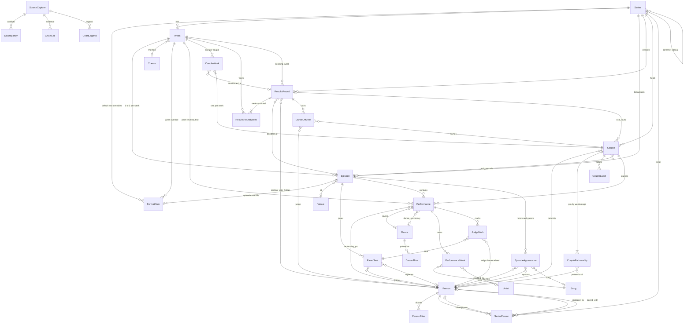

# Strictly Come Dancing results database — data model v2 (repaired)

Status: v2.1, 9 November 2026. Synthesised from three candidate designs (Design 1 "relational purist", Design 2 "Drupal-first", Design 3 "commentary-first"), three judges' reports, a representability check of all 257 anomalies in `docs/wikipedia-anomaly-register.md`, a queryability review of the commentary statements, and a Drupal feasibility review. Every confirmed gap from those three reviews is closed in this revision; the changes are itemised in §11 (decisions log) and §13 (verification record). Where a gap cannot be closed by the model, the coverage matrix (§7) says so.

Evidence base: `docs/wikipedia-anomaly-register.md` (A001–A257), `docs/series-summaries.md`, `docs/wikipedia-source-analysis.md`, `docs/architecture-and-hosting.md`, `docs/data-access-options.md`, the user's `data-model.md` and `data-modelling-thinking.md`, and the captured pages under `data/wikipedia/series/0NN/` (HTML) and `data/wikipedia/wikitext/` (wikitext with revision ids in `MANIFEST.csv`).

## 1. Purpose and design principles

The database holds everything the English Wikipedia series pages (series 1–24) state about Strictly Come Dancing results — judges' marks, performances, couples' weekly status, dance-off votes, and the format rules in force — so that Pandas/R can generate TV-style commentary ("Craig's first 10 of the series", "first 40 ever in week 3", "last time a judge gave a 2 was series 12", "the winner had the lowest judges' total in the final for the fourth year running"), Drupal 11 can publish the data as content with JSON:API, and a tidy CSV/Parquet dataset can live in git.

Six rules govern the model. Each is restated from the brief with its design consequence.

1. **Declarative.** Every historical corner case is a row, an enumeration value or a rule-table row; no loader or query branches on a series or week number. Two devices make this true. (a) A **rule table** (`FormatRule`: one default row per series plus per-week and per-episode override rows) is kept separate from an **actuals table** (`ResultsRound`: what actually decided each exit), so "rule ≠ actual" (S14 W2 cancelled dance-off, S7 W13 no dance-off, S20 W8 withdrawal) is visible data rather than an exception. (b) **Enumerations whose values carry behaviour attributes** (`is_exit`, `is_round_exit`, `counts_in_average`, `is_scoring`, `awards_points`, `chart_colour`) are held in one `EnumValue` registry that cites the anomaly ids justifying each value. Adding a `bottom_four` is a row in that registry plus (in Drupal) a regenerated vocabulary term or `list_string` allowed value shipped as a Recipe update — see §9 for the precise meaning of "data change" on the Drupal side.
2. **Provenance.** Every row carries a `PROV` group: `source_capture_id` (page + revision id + capture time), `source_locator` (where on the page), `source_kind` ∈ {stated, inferred, inherited, editorial, disputed} and `note`. Values the page *states* are never merged with values the loader *derives*: derived values live in analysis extracts (`d_*` columns) or Drupal `field_d_*` fields rewritten on every import; two conflicting primary values are kept side by side in `Discrepancy`, each with its own locator; the page's own derivable tables (Scoring chart, Average chart, Dance chart) are parsed into `ChartCell` as regression evidence only.
3. **Stable identity.** `Person` is keyed on a curated ASCII `slug` assigned once and never changed; the Wikipedia article title is an attribute, and every former title, display name, vote-list surname and typo is a `PersonAlias` row with a context, an optional series and a kind. `Couple` identity is (series, celebrity) and the couple key is `{series}-{celebrity_slug}`, so it survives professional changes (held in `CouplePartnership` week ranges) and label changes (held in `CoupleLabel`). Every table has a surrogate `*_id` and a unique human-readable `*_key` (`S24W07`, `S24-lawrence-robb`, `S24R06`). Keys are never built from presentational strings (chart labels, row positions, episode kinds) because those move between revisions.
4. **Analysis-friendly.** Four tidy fact tables at four grains — `JudgeMark` (one row per judge mark), `Performance` (one row per routine per performer per episode), `CoupleWeek` (one row per couple per week, including weeks after exit), `DanceOffVote` (one row per judge line in a votes list) — plus `ResultsRound` (one row per decision). The flat extracts pre-join the dimensions and carry the ordering columns, so each commentary statement is a filter and a sort over one `pd.read_parquet`.
5. **Drupal-mappable.** Every entity is a node type or a taxonomy vocabulary; every relationship is a forward entity reference (fact bundles also carry forward references to series/week/episode/couple so Views never needs reverse relationships); no polymorphic FK (`Discrepancy` and `ChartCell` address rows by table name + natural key strings, optionally with a node reference because all subjects are nodes); no composite-only key; every field storage name is ≤ 32 characters and belongs to exactly one enumeration; UUIDs are deterministic functions of the natural key.
6. **Parsimony.** No entity without evidence in the register. Where a thing has no attributes of its own it is an enumeration column, not a table (`CompetitionRound` → `Week.round_stage`; `DanceOff` → `ResultsRound` fields + `DanceOffVote`). Closed, attribute-free enumerations are `list_string` fields in Drupal; enumerations with attributes, hierarchy or open-endedness are vocabularies.

Declared denormalisations (validated on every build, never edited by hand): `Performance.week_id` (= `Episode.week_id` when the episode is known), `JudgeMark.judge_person_id` and `JudgeMark.seat_position` (= `PanelSeat`), and the forward `series_id`/`week_id`/`couple_id` references on fact bundles in Drupal.

Conventions used in this document: "the page" means the Wikipedia series page for the series in question; "stated" means the page says it in a table cell or a sentence; "inferred" means the loader deduced it from the shape of the page by a rule written in this document; "editorial" means a curator supplied it and the page does not say it.

## 2. Entity overview

**Series** — a numbered series (S1–S24) or a special (Christmas, charity, anniversary), with its dates, home venue, page title, ingest status and, for a special, the numbered series it belongs to. Format rules are *not* columns here; they live in `FormatRule` so that per-week overrides share one shape.

**FormatRule** — the rule table. One default row per series plus override rows keyed to a week or to a single episode (Show 1 of a two-show final). Columns: elimination mechanism, dance-off used, at-risk group size, vote direction, casting-vote mode, rank-tie policy, combined-total tie-break, showdance scored, default scoring judges/scale, whether the week has an elimination, and which part of the field competes (`field_subset`: all, half A/B, male or female celebrities). Resolution is per column: episode row, else week row, else series row; the resolved rule is published as `derived/effective_rules.csv` and imported into Drupal as `field_d_*` columns on `episode`.

**Week** — the competition unit Wikipedia calls "Week N": number, round stage (regular/quarter-final/semi-final/final/special), theme, raw heading (nullable for weeks that exist only as scheduled dates), dance brief, lifecycle status. A week has 1–3 episodes and is counted by one or more results rounds.

**Episode** — one broadcast (the user's "Episode", restricted to that meaning): launch, preview, performance show, results show, combined show, Night 1/2, Show 1/2, compilation, special. Owns air date (with its source and, when postponed, the original date), whether a Ratings row lists it, venue, charity tie-in, ratings, the stated scoring scale, and the judging panel. The episode key never encodes the episode kind (`-P` for the first performance broadcast of a week whether or not it carried results; `-R` only when a separate results broadcast is evidenced).

**PanelSeat** — who sat in which seat of a given performance episode, in the order the parenthesised marks are listed; role (regular, head, guest additional, guest replacement, non-scoring guest, remote non-scoring, **absent**), whether scoring, whom they replaced, **why the regular judge was away**, and the surname label used in that week's votes list. An absent regular judge is a row (role `absent`, no seat), so absences and their reasons are facts, not inferences from missing rows.

**ResultsRound** — one elimination/placing decision (or explicit non-decision). Carries the Wikipedia column label ("1+2", "11+12", "Show 1"), the mechanism that actually decided it, the number of couples whose competition ended by it (`exit_count`, counted over the `is_round_exit` status attribute so third/fourth places in two-show finals count and final placings do not), the at-risk group size, dance-off status, vote direction, the casting-vote holder and whether the casting vote was *pivotal*, whether votes were published and whether the public vote of a carried week also counted. The weeks whose scores counted are linked through `ResultsRoundWeek`. A week can hold two rounds (S13 final: Show 1 exit and final placing) and a round can span weeks (S1 1+2, S21 11+12, S23 9+10, S6 13+14).

**Person** — one canonical human (or, for musical guests only, a performing act), keyed on a curated slug, with the Wikipedia article title as an attribute, nullable family name (mononyms) and gender (optional, editorial; needed for no stored fact since `FormatRule.field_subset` and `Couple.couple_kind` carry the S5/S6/S18 facts).

**PersonAlias** — every other string that denotes a person on any page: former article titles ("Karen Clifton"), display names ("Christine Bleakley", "Judge Rinder"), vote-list surnames ("Revel Horwood" vs "Horwood", "Du Beke"), typos; each scoped to a context and to a series or `any`, and the series is part of the key.

**SeriesPerson** — the roster: a person's role in a series with a roster status, a week range, a **reason** (for withdrawals, absences and pre-series exits), display name in that series, who they replaced/were replaced by/were paired with, and an event date. A person may have several rows per role per series (Lauren Oakley S22: unpartnered W1–6, partnered W7–13; Aliona Vilani S11: left June, returned September). Pre-series replacements live here, not as couples.

**Couple** — a celebrity's entry in a series as listed in the Couples table: key `{series}-{celebrity_slug}`, chart label, per-series display names, couple kind (mixed/same-sex), final placement with tie flag and verbatim place label, exit kind/ordinal (integer + shared flag + verbatim "10th & 11th")/week/round/episode/date/date kind/timing/reason, raw status text.

**CouplePartnership** — which professional danced for the couple over which weeks: original, temporary substitute, permanent replacement, pre-week-1 replacement, pre-series-only pairing, with reason. Ranges never overlap; a returning original pro gets a further row.

**CoupleLabel** — every row-header string that denotes the couple ("Anita & Brendan" weekly W9 only; "JB & Amy/Lauren" in charts; "Greame & Lauren" typo), by table context and week range.

**CoupleWeek** — fact table: one row per couple per week of its series from week 1 to the final (so the scoring-chart grid is a pivot of it). `participation_status` and `result_status` are separate enumerations, with independent `at_risk`, `danced_off` and `bye_granted` booleans, a link to the deciding round, absence reason, affected party and absence scope (whole week / performance only / results show only).

**Performance** — fact table: one performer (a couple, or a couple-less group such as the professionals or the troupe) dancing one routine on one episode, or — when the page gives only the week — in one week. Kind (individual, fusion, showdance, group scored/points/unscored, marathon, instant), selection role, status (performed, partial, not performed, scheduled), scoring mode (judge marks, judge total only, rank points, awarded points, unscored, not performed, pending), the stated total and number of marks, the raw score cell, points value, dance (+ secondary for fusion; nullable when not stated), raw dance/music text, theme reference, running order, performing professional. Key `{episode}-{celebrity_slug}-{dance_slug}`.

**PerformanceMusic / Song / Artist** — one row per song credited to a performance (multi-song cells; one song shared by two couples; songs "from *Grease*" with no artist). The artist is credited on `PerformanceMusic`, not on `Song`, so a song's key does not change when an artist is linked later.

**JudgeMark** — fact table: one judge's mark on one performance, bound to a `PanelSeat` (and denormalised to the judge person and seat position). No rows exist for unscored, points-only, total-only or not-performed routines; "No scores received" never becomes 0.

**DanceOffVote** — fact table: one judge line in a "Judges' votes to save/eliminate" list: judge, couple named, vote kind (cast or hypothetical "did not vote, but would have…"), whether the casting-vote parenthetical is present, list position, raw text. Direction (save/eliminate) comes from the round.

**Dance / DanceAlias / Theme / Venue** — lookups with attributes (dance family, printed aliases as rows, theme reference kind, city).

**SourceCapture** — one fetched revision of one Wikipedia page: title, page id, revid, revision timestamp, sha1, capture time, format (wikitext/Parsoid/legacy HTML), file path, parser version, is-current flag.

**Discrepancy** — two primary values (or a primary value and a derivation) disagree; both values, both locators, both capture ids (or the derivation name) and a resolution are kept. A three-way disagreement is two rows.

**ChartCell / ChartLegend** — raw parse of the derivable Wikipedia tables and of each page's `{{legend}}` list (colour → meaning, per capture), with row and column indices so re-ordering and colspan drift are recordable; kept in the data repo for regression, not imported to Drupal.

**EnumValue** — the registry of every enumeration value with label, sort order, behaviour attributes and the anomaly ids that motivated it; seeds Drupal vocabularies/`list_string` allowed values and the Pandas lookup CSVs.

**EpisodeAppearance** (tier 2, schema complete, ingest deferred) — presenters, stand-in and absent presenters (with whom they replaced and why), musical guests (with the song performed), dance guests, mentors and tribute subjects per episode.

Every table except the enumerations also carries `source_capture_id → SourceCapture` (omitted from the diagram for legibility).

## 3. Entities and fields

### 3.1 Conventions

**Types.** `int`, `text`, `bool`, `date`, `datetime`, `decimal(p,s)`, `enum(NAME)` (a value from the named enumeration in §4, stored as text and validated against `EnumValue`), `fk(Table)`.

**Natural key convention.** Every table has `*_id int PK` (surrogate; Drupal nid/tid) and `*_key text UNIQUE` (human-readable, ASCII, stable forever). Slugs are NFC → strip diacritics → lowercase → non-alphanumerics to `-` → collapse repeats. A key is built only from other keys and from identity facts (series number, week number, celebrity slug, dance slug, seat position); never from chart labels, row positions or episode kinds, because those change between revisions and a changed key is a delete-and-recreate in Drupal.

| entity | pattern | examples |
|---|---|---|
| Series | `S{nn}`; specials `SP-{KIND}-{yyyy}` (`XMAS`, `CIN`, `SR`, `ANNIV`) | `S24`, `S01`, `SP-XMAS-2019`, `SP-CIN-2011` |
| Week | `{series}W{nn}` | `S24W07`, `S06W13` |
| Episode | `{week}-{code}` or `{series}-{code}`; codes `P` first (or only) performance broadcast of the week, whether or not it also carried the results; `R` a separate results broadcast evidenced by a Ratings row or a results-dated Couples cell; `N1`/`N2` two performance nights; `S1`/`S2` two shows of a final; `L` launch; `PV` preview; `C{n}` compilation; `X` special | `S24W07-P`, `S24W07-R`, `S08W11-N1`, `S13W13-S2`, `S01W05-P`, `S06-L`, `S05-PV` |
| PanelSeat | `{episode}-j{seat}`; non-scoring or absent `{episode}-jx{n}` | `S12W03-P-j3`, `S23W03-P-jx1`, `S15W05-P-jx1` |
| FormatRule | `{series}-FR`, `{week}-FR`, `{episode}-FR` | `S24-FR`, `S24W06-FR`, `S13W13-S1-FR` |
| ResultsRound | `{series}R{ww}`; multi-week `{series}R{w1}-{w2}`; two decisions in one week suffix `a`/`b` | `S24R06`, `S21R11-12`, `S06R13`, `S06R13-14`, `S13R13a`, `S13R13b` |
| ResultsRoundWeek | `{round}|{week}` | `S21R11-12|S21W11` |
| Person | curated slug (`person_key = slug`); unlinked people `unlinked-{slug}` | `craig-revel-horwood`, `dev-dj`, `karen-hauer`, `unlinked-andrew-cuerden` |
| PersonAlias | `{slug}|{context}|{alias}|{series or any}` | `karen-hauer|any|Karen Clifton|any`, `craig-revel-horwood|vote_list|Revel Horwood|S24` |
| SeriesPerson | `{series}-{slug}-{role}`; further rows for the same role `-2`, `-3` in order of `first_week` | `S18-anton-du-beke-judge`, `S22-lauren-oakley-professional`, `S22-lauren-oakley-professional-2` |
| Couple | `{series}-{celebrity_slug}` | `S24-lawrence-robb`, `S22-jb-gill`, `S17-emma-barton`, `S14-robert-rinder` |
| CouplePartnership | `{couple}-P{n}` in order of `week_from` | `S22-jb-gill-P2` |
| CoupleLabel | `{couple}|{context}|{label}` | `S22-jb-gill|weekly|JB & Lauren` |
| CoupleWeek | `{week}-{celebrity_slug}` | `S24W06-lawrence-robb` |
| Performance | `{episode}-{celebrity_slug}-{dance_slug}`; week-level routine `{week}-{celebrity_slug}-{dance_slug}`; couple-less routine `{episode}-{performer_group}-{dance_slug}`; same dance twice by one performer in one episode `-2`; no dance named yet `-tbd{n}` (re-keyed when named; see §3.15) | `S24W06-P-lawrence-robb-tango`, `S13W13-S1-georgia-may-foote-showdance`, `S07W01-rav-wilding-merengue`, `S08-L-pros-quickstep`, `S24W08-P-cach-mercer-tbd1` |
| PerformanceMusic | `{performance}-{song_slug}`; same song twice `-2` | `S22W07-P-jb-gill-couples-choice-treasure` |
| JudgeMark | `{performance}-j{seat}` | `S24W06-P-lawrence-robb-tango-j3` |
| DanceOffVote | `{round}-{judge slug}` | `S24R06-motsi-mabuse` |
| Dance / Theme / Venue / Artist | slug | `cha-cha-cha`, `movie-week`, `blackpool-tower-ballroom`, `prince-musician` |
| DanceAlias | `{dance}|{alias}` | `cha-cha-cha|Cha-cha` |
| Song | `song:{title slug}:{wiki title slug or 'none'}` | `song:i-love-to-boogie:none`, `song:uptown-funk:uptown-funk` |
| SourceCapture | `enwiki:{Page_Title}:r{revid}:{format}` | `enwiki:Strictly_Come_Dancing_series_24:r1384551432:wikitext` |
| Discrepancy | `{table}|{natural_key}|{field}|{n}` | `Performance|S06W14-P-tom-chambers-showdance|stated_total|1` |
| EnumValue | `{enum}:{code}` | `result_status:bottom_three` |

Rules about keys that the reviews made necessary:

- **Couple key from identity, not label.** The celebrity slug comes from the Couples-table link target (`docs/wikipedia-source-analysis.md` §4 confirms this is the only stable identifier). `chart_label` and the week-1 professional are fields and `CoupleLabel` rows. The couple `S22-jb-gill` keeps its key when the chart label becomes "JB & Amy/Lauren".
- **Performance key from the dance, not the row position.** Editors re-order rows inside a couple's rowspan group; a positional `-1/-2` would silently swap Rumba and Showdance and every mark beneath them. No couple dances the same dance twice in one episode in S1–S24, so `-2` is reserved and a build check fails on any collision it did not expect. Scheduled rows with no dance yet (`-tbd1`) are documented as *expected* re-keys; they carry no marks, so the re-key costs one node.
- **Episode key never encodes the kind.** Adding a "Week 4 results" Ratings row to a page that lacked one creates one new `-R` node and re-points `decided_at_episode_id`/`exit_episode_id`; nothing is renamed.
- **Person key is the slug.** Article moves (`Karen Clifton` → `Karen Hauer`) change `wiki_title` and add a `wiki_redirect` alias; the slug is frozen by a test that diffs `people.csv` slugs against the previous release. The rare slug correction goes through `key_renames.csv` (old_key, new_key, reason), applied to the migrate map before import (§9).
- **UUIDs.** Every Drupal entity's UUID is `uuid5(strictly-namespace, key)`, so a delete-and-recreate is invisible to JSON:API consumers.

**PROV column group** (on every table except `EnumValue`, `ChartLegend`, `ChartCell`, `DanceAlias`, which carry only `source_capture_id`):

| field | type | null | meaning | example |
|---|---|---|---|---|
| source_capture_id | fk(SourceCapture) | no | the page revision + capture the row was read from | `enwiki:Strictly_Come_Dancing_series_24:r1384551432:wikitext` |
| source_locator | text | no | where on the page: section, table ordinal, row label, column label, or `prose:para N` | `section=Week 6: Halloween Week; table=1; row=Lawrence & Jowita; col=Result` |
| source_kind | enum(SOURCE_KIND) | no | stated / inferred / inherited / editorial / disputed | `stated` |
| note | text | yes | curator or loader note, paraphrased (never copied prose) | `no-elimination inferred from absence of Result column (A170)` |

Rules: `source_kind=inferred` requires that the rule used is one written in this document (the rules are collected in §3.22). `source_kind=editorial` means the value was supplied by a curator and is not on the page; it requires a `note`, and it requires a `Discrepancy` row only when it *overrides* a value the page does state. `source_kind=disputed` requires a `Discrepancy` row with `resolution=both_kept_unresolved`.

### 3.2 Series

| field | type | null | meaning | example |
|---|---|---|---|---|
| series_id | int PK | no | surrogate | 24 |
| series_key | text UQ | no | natural key | `S24` |
| series_kind | enum(SERIES_KIND) | no | numbered / christmas_special / charity_special / other_special | `numbered` |
| series_number | int | yes | 1..24; null for specials | 24 |
| parent_series_id | fk(Series) | yes | for a special, the numbered series whose year it belongs to (S19 lead: "a Christmas special"); null for numbered series | `S19` |
| label | text | no | display label | `Series 24` |
| wiki_title | text | no | source page (specials: the specials list page) | `Strictly Come Dancing series 24` |
| year_start | int | no | calendar year of first episode (not unique: 2004 has S1 and S2) | 2026 |
| launch_date | date | yes | launch/preview show | 2026-09-19 |
| first_live_date | date | yes | first competitive episode; null for a special not yet parsed | 2026-09-26 |
| final_date | date | yes | the final's date as stated by the page (the Ratings table pre-fills it for a live series); the Episode row's `status=scheduled` carries the provisionality | 2026-12-19 |
| infobox_first_aired / infobox_last_aired | date | yes | as stated (S5–S7 differ from launch_date) | 2026-09-19 |
| infobox_num_episodes | int | yes | as stated (may disagree with Ratings: S18) | 12 |
| home_venue_id | fk(Venue) | yes | TV Centre ≤S10, Elstree ≥S11; null for a special until parsed | `elstree-studios` |
| status | enum(SERIES_STATUS) | no | complete / in_progress / announced / referenced_not_ingested | `in_progress` |
| couples_count_stated / weeks_count_stated | int | yes | from infobox/prose; cross-checked against rows | 15 / 13 |
| PROV | | | | |

### 3.3 FormatRule (rule table)

Resolution for a given episode E in week W of series S, per column: value from the row with `episode_id=E` if non-null, else from the row with `week_id=W`, else from the series default row. Null in an override means "inherit".

| field | type | null | meaning | example |
|---|---|---|---|---|
| format_rule_id | int PK | no | | |
| format_rule_key | text UQ | no | | `S24W06-FR` |
| series_id | fk(Series) | no | | `S24` |
| week_id | fk(Week) | yes | null = series default | `S24W06` |
| episode_id | fk(Episode) | yes | set only for a one-show override (Show 1 of a two-show final) | `S13W13-S1` |
| elimination_mechanism | enum(ELIMINATION_MECHANISM) | yes | the rule in force | `ranking_points_dance_off` |
| dance_off_used | bool | yes | | true |
| at_risk_group_size | int | yes | 2 normally; 3 for S24 W6 | 3 |
| vote_direction | enum(VOTE_DIRECTION) | yes | save / eliminate | `eliminate` |
| casting_vote_mode | enum(CASTING_VOTE_MODE) | yes | none / head_judge / rotating | `rotating` |
| rank_tie_policy | enum(RANK_TIE_POLICY) | yes | how tied judges' totals share rank points (policy only; where it was read is `source_kind`) | `shared_points_dense` |
| combined_tie_break | enum(COMBINED_TIE_BREAK) | yes | how a tie on combined judges' + public points resolves: public_vote_precedence / unstated | `public_vote_precedence` |
| showdance_scored | enum(YES_NO_DISPUTED) | yes | S1 yes; S2–S5 no; S6 disputed; S7+ yes | `yes` |
| default_scoring_judges | int | yes | 4; 3 for S18 | 4 |
| default_scale_max | int | yes | 40; 30 for S18 | 40 |
| week_has_elimination | bool | yes | override only: false for opening carry-over weeks, S6 W13, S21 W11, S23 W9 | false |
| field_subset | enum(FIELD_SUBSET) | yes | which couples compete this week: all (default) / half_a / half_b / male_celebrities / female_celebrities (S4 W1–2, S5 W1–2, S6 W1–2, S7 W1–2) | `male_celebrities` |
| PROV | | | | |

`field_subset` is the declarative home for "only the male celebrities performed this week" (A033, A043) and the split launches (A027, A055); the per-couple consequence is `CoupleWeek.participation_status ∈ {group_only, not_scheduled}` with `result_status=exempt`. `Person.gender` is therefore not needed to state any page fact.

### 3.4 Week

| field | type | null | meaning | example |
|---|---|---|---|---|
| week_id | int PK | no | | |
| week_key | text UQ | no | | `S24W07` |
| series_id | fk(Series) | no | | `S24` |
| week_number | int | no | 1-based; specials use 1 | 7 |
| round_stage | enum(ROUND_STAGE) | no | regular / quarter_final / semi_final / final / special (the user's CompetitionRound) | `regular` |
| theme_id | fk(Theme) | yes | from the H3 heading suffix; null until the heading exists | `halloween-week` |
| heading_raw | text | yes | null for a week that exists only as a Ratings date (live series); such a row has `source_kind=inferred`, `source_locator` = the Ratings row | `Week 6: Halloween Week` |
| dance_brief_raw | text | yes | Dance-chart bullet for the week | `One unlearned dance and Samba-thon` |
| lifecycle_status | enum(WEEK_LIFECYCLE) | no | scheduled / scores_in / results_in / verified (live series) | `verified` |
| PROV | | | | |

No `has_elimination` column: whether and how a week's results were decided is read from `ResultsRound`/`ResultsRoundWeek`; a week with no round of its own is a carry-over week.

### 3.5 Episode (one broadcast)

| field | type | null | meaning | example |
|---|---|---|---|---|
| episode_id | int PK | no | | |
| episode_key | text UQ | no | | `S08W11-N1` |
| series_id | fk(Series) | no | | `S08` |
| week_id | fk(Week) | yes | null for launch/preview/compilation | `S08W11` |
| episode_kind | enum(EPISODE_KIND) | no | launch / preview / performance / results / performance_and_results / compilation / special — a field, never part of the key | `performance` |
| sub_label | enum(EPISODE_SUB_LABEL) | no | none / night1 / night2 / show1 / show2 | `night1` |
| sequence_in_week | int | yes | broadcast order within the week | 1 |
| label_raw | text | yes | Ratings row label | `Week 11 (Night 1)` |
| listed_in_ratings | bool | no | the Ratings table has a row for this broadcast; false only for an episode evidenced elsewhere (never fabricated: see rule E1 in §3.22) | true |
| air_date | date | yes | from Ratings `{{dts}}` + infobox year; any weekday (S20 Fri/Sat/Sun/Mon) | 2010-12-10 |
| air_date_source | enum(AIR_DATE_SOURCE) | yes | ratings_table / couples_table / infobox / prose / editorial | `ratings_table` |
| original_air_date | date | yes | the date first scheduled when the page states a postponement (S20 launch: 17 Sep 2022, aired 23 Sep) | null |
| reschedule_reason_text | text | yes | paraphrase of the stated reason for the postponement | null |
| status | enum(EPISODE_STATUS) | no | aired / scheduled / cancelled | `aired` |
| venue_id | fk(Venue) | yes | Blackpool, Wembley, …; null = series home venue (source_kind=inherited when filled) | `blackpool-tower-ballroom` |
| charity_beneficiary | text | yes | stated charity tie-in for this broadcast ("Children in Need", S9 W8 and S10 W7 Wembley shows) | null |
| scale_max_stated | int | yes | as stated by the page (chart header footnote "50-point scale", "30-point scale") — a primary fact validated against 10 × scoring seats | 50 |
| rating_millions | decimal(5,2) | yes | Ratings table | 9.57 |
| rank_bbc_one / rank_all_uk | int | yes | | 1 / 1 |
| share_pct | decimal(4,1) | yes | column absent in S17 | 38.6 |
| PROV | | | | |

### 3.6 PanelSeat

| field | type | null | meaning | example |
|---|---|---|---|---|
| panel_seat_id | int PK | no | | |
| panel_seat_key | text UQ | no | | `S12W03-P-j3` |
| episode_id | fk(Episode) | no | performance episodes; results episodes only for non-scoring appearances (S18 Bruno) | `S12W03-P` |
| person_id | fk(Person) | no | | `donny-osmond` |
| seat_position | int | yes | 1..5 = position in "NN (a, b, c, d, e)"; null when not scoring or absent | 3 |
| panel_role | enum(PANEL_ROLE) | no | regular / head / guest_additional / guest_replacement / non_scoring_guest / remote_non_scoring / absent | `guest_additional` |
| is_head_judge | bool | no | separate from role (head judge sits 3rd in S1–S17, 2nd in S18) | false |
| is_scoring | bool | no | false for Erivo S23 W3, Tonioli S18 results shows, every `absent` row | true |
| replaces_person_id | fk(Person) | yes | on a guest_replacement row: the regular judge replaced (Jennifer Grey→Len Goodman, Ribeiro→Tonioli, Erivo→Horwood/Mabuse, Du Beke→Mabuse) | null |
| absence_reason | enum(ABSENCE_REASON) | yes | on an `absent` row: why the regular judge was away (S15 W5 Tonioli scheduling_conflict; S16/S17 W5 Tonioli scheduling_conflict; S18 W4–5 Mabuse covid_contact_or_travel; S19 W9 Horwood covid_positive; S19 W10 Mabuse covid_contact_or_travel) | null |
| vote_label | text | yes | surname as printed in that week's votes list | `Osmond` |
| PROV | | | | |

Every regular judge of the series who is not on the panel of a performance episode gets an `absent` row (`{episode}-jx{n}`, `is_scoring=false`, `seat_position` null) whether or not a guest replaced them; "weeks Craig was absent" is then `panel_role=absent`, and absent-and-replaced vs absent-not-replaced is the presence of a `guest_replacement` row with `replaces_person_id` pointing at the same person. Series-level panels are *also* rows: every performance episode gets its seats (constant panels are generated by the loader from the series-level order sentence with `source_kind=inherited`; per-week override sentences give `stated` rows).

### 3.7 ResultsRound

| field | type | null | meaning | example |
|---|---|---|---|---|
| results_round_id | int PK | no | | |
| round_key | text UQ | no | | `S21R11-12` |
| series_id | fk(Series) | no | | `S21` |
| round_kind | enum(ROUND_KIND) | no | standard / intermediate_final_exit / final_placing / no_decision | `standard` |
| label | text | no | the Wikipedia column label the round is shown under | `11+12` |
| deciding_week_id | fk(Week) | no | week in which the outcome was announced | `S21W12` |
| decided_at_episode_id | fk(Episode) | yes | results (or combined) episode; null while pending | `S21W12-R` |
| elimination_mechanism_actual | enum(ELIMINATION_MECHANISM) | no | what actually decided it | `ranking_points_dance_off` |
| exit_count | int | no | number of couples whose competition ended by this decision = count of `CoupleWeek` rows bound to the round whose `result_status` has `is_round_exit=yes` (eliminated, third, fourth); 0 for `final_placing` rounds (placings are not exits) and `no_decision`; withdrawals never count | 1 |
| at_risk_group_size_actual | int | yes | 2 or 3; null when no at-risk group announced | 2 |
| dance_off_status | enum(DANCE_OFF_STATUS) | no | held / not_in_format / not_held_by_format / cancelled_injury / cancelled_withdrawal / cancelled_scoring_error / not_applicable | `held` |
| vote_direction | enum(VOTE_DIRECTION) | yes | save / eliminate | `save` |
| casting_vote_person_id | fk(Person) | yes | head judge (S5–S7, S10–S22; source_kind=inherited) or the named judge (S23–S24; stated) | `shirley-ballas` |
| casting_vote_used | bool | yes | the holder's vote was *pivotal*: removing it from the cast votes leaves the outcome without a strict majority. True for a 4-judge 2–2 (A183, A248, A255), for a 3-judge 1–1 + head (A194 S18 W6–8), false for 3–1, 3–0, 2–0 and for every round where the holder's line is hypothetical (A165) | false |
| casting_vote_inferred | bool | no | true when the page records plain votes with no casting-vote parenthetical and `casting_vote_used` was derived by the pivotal rule | false |
| votes_recorded | bool | no | false when the page carries no votes list (S1–S4, S8–S9, cancelled dance-offs) | true |
| votes_carried_over | bool | yes | for a round spanning weeks: the public vote of the earlier week(s) also counted (S19 1+2 stated true; S20–S24 1+2 stated scores only → false; S1/S8/S12 unstated → null) | null |
| combined_reason | enum(COMBINED_REASON) | no | single_week / opening_weeks_format / withdrawal_carry_over / scoring_error_carry_over / vote_rollover_final | `withdrawal_carry_over` |
| PROV | | | | |

**ResultsRoundWeek** (link; in Drupal a multi-value ordered entity reference `field_weeks` on `results_round`): `results_round_week_id`, `results_round_week_key` (`S21R11-12|S21W11`), `results_round_id`, `week_id`, `seq`.

### 3.8 Person

| field | type | null | meaning | example |
|---|---|---|---|---|
| person_id | int PK | no | | |
| person_key | text UQ | no | = `slug`; curated, ASCII, assigned once, never changed | `karen-hauer` |
| slug | text UQ | no | same value; kept as a separate column for Pathauto and for readers of the CSVs | `karen-hauer` |
| person_kind | enum(PERSON_KIND) | no | person / act (a band credited as a musical guest, tier 2 only) | `person` |
| identity_basis | enum(IDENTITY_BASIS) | no | wikipedia_title / unlinked_name | `wikipedia_title` |
| wiki_title | text | yes | current article title (NFC); mutable; former titles are `wiki_redirect` aliases | `Karen Hauer` |
| canonical_name | text | no | current preferred name | `Karen Hauer` |
| given_name | text | yes | | `Karen` |
| family_name | text | yes | null for mononyms (Lulu, Goldie, HRVY) | `Hauer` |
| gender | enum(GENDER) | yes | female / male / unstated; optional and `source_kind=editorial` with a note; no page fact depends on it (see §3.3 `field_subset`, §3.11 `couple_kind`) | `female` |
| PROV | | | | |

### 3.9 PersonAlias

| field | type | null | meaning | example |
|---|---|---|---|---|
| person_alias_id | int PK | no | | |
| person_alias_key | text UQ | no | includes the series scope | `craig-revel-horwood|vote_list|Revel Horwood|S24` |
| person_id | fk(Person) | no | | `craig-revel-horwood` |
| alias | text | no | | `Revel Horwood` |
| alias_kind | enum(ALIAS_KIND) | no | wiki_redirect / former_name / display_name / stage_name / label_token / vote_list_surname / typo | `vote_list_surname` |
| context | enum(LABEL_CONTEXT) | no | where the alias is used | `vote_list` |
| series_id | fk(Series) | yes | null (= `any` in the key) when the string is unambiguous in every series; set when the same string means different people in different series or when the page evidence is series-specific | `S24` |
| PROV | | | | |

Convention: an alias is stored once with `series_id` null unless ambiguity requires a per-series row. "Revel Horwood" and "Horwood" both resolve to one person in every series, so each is one `any` row; the per-series spelling actually used in a votes list is a fact on `PanelSeat.vote_label`, not on the alias.

### 3.10 SeriesPerson (roster)

| field | type | null | meaning | example |
|---|---|---|---|---|
| series_person_id | int PK | no | | |
| series_person_key | text UQ | no | | `S23-dani-dyer-celebrity` |
| series_id | fk(Series) | no | | `S23` |
| person_id | fk(Person) | no | | `dani-dyer` |
| role | enum(SERIES_PERSON_ROLE) | no | celebrity / professional / judge / presenter / troupe_dancer | `celebrity` |
| roster_status | enum(ROSTER_STATUS) | no | see §4 | `paired_withdrew_pre_week1` |
| display_name_in_series | text | yes | as credited on that page | `Camilla Sacre-Dallerup` |
| is_head_judge | bool | no | series-level head-judge designation (role=judge) | false |
| replaces_person_id | fk(Person) | yes | Kelvin Fletcher replaces Jamie Laing | null |
| replaced_by_person_id | fk(Person) | yes | Dani Dyer → Amber Davies | `amber-davies` |
| paired_with_person_id | fk(Person) | yes | launch pairing that never competed (Dani Dyer → Nikita Kuzmin; Aliona Vilani → Johnny Ball) | `nikita-kuzmin` |
| reason | enum(ABSENCE_REASON) | yes | why the person withdrew, departed, was absent or could not be partnered (Laing injury, Nairn medical_advice, Dyer injury, Windsor injury, Dowden S21 injury, Zoe Ball S12 stand-in personal) | `injury` |
| reason_text | text | yes | paraphrase | `fractured ankle in training` |
| event_date | date | yes | announcement/withdrawal/joining/departure date | 2025-09-23 |
| first_week_id / last_week_id | fk(Week) | yes | the week range this status applies to (Oakley unpartnered W1–6; Du Beke judge W4–5) | |
| PROV | | | | |

Rows are one per (series, person, role, status range). A person may have several rows per role per series (`-2`, `-3` suffixes), so join/leave/return events each have a row: Aliona Vilani S11 has `departed_pre_series` (event 2013-06-01) and a second row `competed` with `replaces_person_id=natalie-lowe` (event 2013-09-02). Lauren Oakley S22 has `unpartnered` W1–6 and `partnered_mid_series` W7–13. Ian Waite S8 has `troupe_only` and the substitution is a `CouplePartnership` row (a roster query for "pros who never competed" therefore checks `CouplePartnership`, not only the roster). Anton Du Beke S18 has `professional/competed` and `judge/substitute` W4–5; Johannes Radebe S24 has `professional/moved_to_other_role` and `presenter/regular`.

### 3.11 Couple

| field | type | null | meaning | example |
|---|---|---|---|---|
| couple_id | int PK | no | | |
| couple_key | text UQ | no | `{series}-{celebrity_slug}` | `S22-jb-gill` |
| series_id | fk(Series) | no | | `S22` |
| celebrity_person_id | fk(Person) | no | identity = (series, celebrity) | `jb-gill` |
| chart_label | text | no | label used in the Scoring chart (presentational; may change between revisions) | `JB & Amy/Lauren` |
| celebrity_display_name | text | no | per-series display | `JB Gill` |
| professional_display_name | text | no | per-series display of the week-1 pro | `Amy Dowden` |
| couple_kind | enum(COUPLE_KIND) | no | mixed / same_sex | `mixed` |
| notability_text | text | yes | Couples-table Notability | `JLS singer` |
| final_placement | int | yes | integer place; ties share it (three 2nds, no 3rd); null while competing | 2 |
| place_is_shared | bool | no | | true |
| place_label_raw | text | yes | verbatim | `Co-runners-up` |
| exit_kind | enum(EXIT_KIND) | no | eliminated / withdrew / finalist / in_competition | `finalist` |
| exit_ordinal | int | yes | N in "Eliminated Nth"; null for withdrawals/finalists; for a shared ordinal ("10th & 11th") both couples get the lower integer with `exit_ordinal_is_shared=true` (the page states no order between them) | null |
| exit_ordinal_is_shared | bool | no | A076, A089 | false |
| exit_ordinal_text | text | yes | verbatim | `10th & 11th` |
| exit_week_id | fk(Week) | yes | | `S22W13` |
| exit_round_id | fk(ResultsRound) | yes | the decision that placed/eliminated them; null for withdrawals | `S22R13` |
| exit_episode_id | fk(Episode) | yes | set by rule C1 (§3.22): for eliminated/finalist the round's `decided_at_episode_id`; for a withdrawal only when `exit_timing` names a broadcast (Tony Adams `S20W08-R`, La Voix `S23W09-P`); otherwise null | `S22W13-P` |
| exit_date | date | yes | date in the Couples-table status cell | 2024-12-14 |
| exit_date_kind | enum(EXIT_DATE_KIND) | yes | results_episode / performance_episode / combined_episode / announcement / unknown — derived by rule C2 (§3.22) from `exit_episode_id → Episode.episode_kind`, else `announcement` | `combined_episode` |
| exit_timing | enum(EXIT_TIMING) | yes | withdrawals only; the time the withdrawal was *announced* relative to the exit week's broadcasts (whether the couple still danced is `CoupleWeek.participation_status`): before_live_show / during_live_show_before_dancing / after_dancing_before_results / during_results_show / between_final_shows / before_final | null |
| exit_reason | enum(ABSENCE_REASON) | yes | withdrawals only | null |
| exit_affected_party | enum(AFFECTED_PARTY) | yes | celebrity / professional / both (Nicola & Katya: professional) | null |
| status_raw | text | yes | verbatim status cell | `Co-runners-up on 14 December 2024` |
| PROV | | | | |

### 3.12 CouplePartnership

| field | type | null | meaning | example |
|---|---|---|---|---|
| couple_partnership_id | int PK | no | | |
| couple_partnership_key | text UQ | no | | `S22-jb-gill-P2` |
| couple_id | fk(Couple) | no | | `S22-jb-gill` |
| pro_person_id | fk(Person) | no | | `lauren-oakley` |
| week_from / week_to | int | no | inclusive week numbers; `0–0` for `pre_series_only`; the last row of a couple runs to the couple's exit week (or the current week of a live series) | 7 / 7 |
| partnership_kind | enum(PARTNERSHIP_KIND) | no | original / substitute_temporary / replacement_permanent / replacement_pre_week1 / pre_series_only | `substitute_temporary` |
| reason | enum(ABSENCE_REASON) | yes | why the previous pro was absent | `illness` |
| reason_text | text | yes | paraphrase | `Dowden ill for Week 7; Oakley stood in` |
| PROV | | | | |

Conventions (rule P1, §3.22): ranges of one couple never overlap and are contiguous from week 1 to the exit week; a returning original pro gets a further `original` row (Alex Scott S17: P1 Neil 1–5 original, P2 Kevin 6–7 substitute_temporary, P3 Neil 8–11 original with `source_kind=inferred` because the page states only "(Weeks 6–7)"); one `reason` per row, so a stand-in that became a takeover is two rows (JB Gill S22: P2 Oakley 7–7 substitute_temporary/illness, P3 Oakley 8–13 replacement_permanent/injury). Build check 11 enforces non-overlap and contiguity; check 4 (performing pro ∈ covering partnership) therefore needs no precedence rule.

### 3.13 CoupleLabel

| field | type | null | meaning | example |
|---|---|---|---|---|
| couple_label_id | int PK | no | | |
| couple_label_key | text UQ | no | | `S09-anita-dobson|weekly|Anita & Brendan` |
| couple_id | fk(Couple) | no | | `S09-anita-dobson` |
| label | text | no | | `Anita & Brendan` |
| context | enum(LABEL_CONTEXT) | no | weekly / scoring_chart / average_chart / dance_chart / vote_list / couples_table / any | `weekly` |
| week_from / week_to | int | yes | | 9 / 9 |
| is_typo | bool | no | `Greame & Lauren`, `Julian & Janette` | false |
| PROV | | | | |

### 3.14 CoupleWeek (fact: one row per couple per week)

| field | type | null | meaning | example |
|---|---|---|---|---|
| couple_week_id | int PK | no | | |
| couple_week_key | text UQ | no | | `S20W08-tony-adams` |
| couple_id | fk(Couple) | no | | `S20-tony-adams` |
| week_id | fk(Week) | no | | `S20W08` |
| participation_status | enum(PARTICIPATION_STATUS) | no | competed / competed_unscored / group_only / not_scheduled / bye / absent_withdrawn / exited / pending. `competed_unscored` only when *every* routine of the week was unscored (S6 W10 John Sergeant); a scored week with an unscored showdance is `competed` | `competed` |
| result_status | enum(RESULT_STATUS) | no | safe / bottom_two / bottom_three / eliminated / withdrew / carried_forward / no_elimination / exempt / winner / runner_up / third / fourth / pending / not_applicable | `withdrew` |
| results_round_id | fk(ResultsRound) | yes | the round announced in this week that the couple was part of (rule W1: set for every row whose week has a deciding round and whose couple was still active at that round's announcement, including `withdrew` rows — Tony Adams → `S20R08`, John Sergeant → `S06R10`; null for carried_forward/exempt/exited/pending and for withdrawals announced before a week with no round) | `S20R08` |
| at_risk | bool | no | announced in the bottom group this week (true for Tony Adams although result=withdrew; true for S8/S9 bottom twos with no dance-off) | true |
| danced_off | bool | no | actually performed in a dance-off | false |
| bye_granted | bool | no | the page states a bye was granted for this week, whatever happened next (La Voix S23 W9: `bye_granted=true`, `participation_status=absent_withdrawn`) | false |
| absence_reason | enum(ABSENCE_REASON) | yes | byes, withdrawals, no-shows, pro absences | `injury` |
| affected_party | enum(AFFECTED_PARTY) | yes | celebrity / professional / both | `celebrity` |
| absence_scope | enum(ABSENCE_SCOPE) | yes | set whenever `absence_reason` is set: whole_week / performance_only / results_show_only (Amy Dowden S22 W6: results_show_only; W7: whole_week) | `whole_week` |
| status_raw | text | yes | verbatim Result cell or chart legend meaning | `Withdrew` |
| PROV | | | | |

Rows exist for every couple that reached week 1, for every week of the series up to the final (the dark-grey filler is `exited`/`not_applicable`; future weeks of a live series are `pending`/`pending`). The partner of record per week and the partnership kind are derived from `CouplePartnership` into the exports (`d_pro_slug`, `d_partnership_kind`), not stored. There is deliberately no `eliminated ⇒ at_risk` constraint: S8/S9 double eliminations with no bottom two are `eliminated` with `at_risk=false`.

### 3.15 Performance (fact: one row per performer per routine per episode)

| field | type | null | meaning | example |
|---|---|---|---|---|
| performance_id | int PK | no | | |
| performance_key | text UQ | no | | `S23W10-P-karen-carney-cha-cha-cha` |
| episode_id | fk(Episode) | yes | null only for a routine the page places at week grain in a multi-episode week (S7 W1/W2 group merengue: the prose says "this week", the dance chart spans both nights) | `S23W10-P` |
| week_id | fk(Week) | no | = episode.week_id when the episode is known (declared denormalisation); the only placement when it is not | `S23W10` |
| performer_group | enum(PERFORMER_GROUP) | no | couple / pro_group / troupe | `couple` |
| couple_id | fk(Couple) | yes | required when `performer_group=couple`; null for pro-group and troupe routines (S8 troupe list, S15 launch tribute) | `S23-karen-carney` |
| performing_pro_person_id | fk(Person) | yes | the pro who danced (row label); validated against `CouplePartnership`; null for couple-less routines | `carlos-gu` |
| couple_label_raw | text | yes | row header as printed | `Karen & Carlos` |
| sequence_in_episode | int | no | nth routine of this performer in this episode/week, in table order | 2 |
| running_order | int | yes | the performer's position among the performers of the episode's table (couple-level; rule R1 §3.22); the chronology of a second routine relative to other couples' first routines is unknown and not asserted; null for marathon rows (listed in finishing order) | 7 |
| group_key | text | yes | shared by all rows whose points or group routine are ranked or danced together in one episode: group routines, marathons **and instant dances** (so per-week ranking is `groupby(group_key)` for every points kind) | `S23W10-P-G2` |
| performance_kind | enum(PERFORMANCE_KIND) | no | individual / fusion / showdance / group_scored / group_points / group_unscored / marathon / instant | `instant` |
| selection_role | enum(SELECTION_ROLE) | no | why this dance | `instant` |
| performance_status | enum(PERFORMANCE_STATUS) | no | performed / performed_partial / not_performed / scheduled | `performed` |
| scoring_mode | enum(SCORING_MODE) | no | judge_marks / judge_total_only / rank_points / awarded_points / unscored / not_performed / pending | `rank_points` |
| stated_total | int | yes | the "NN" before the parentheses, as stated; validated = Σ marks when marks exist | null |
| n_marks_stated | int | yes | count of parenthesised marks; null for `judge_total_only` | null |
| score_cell_raw | text | yes | the Scores cell verbatim after markup stripping (`"No scores received"`, `""`, `"5"`, `"42 (8, 9, 8, 9, 8)"`) — keeps encoding differences between captures of an identical fact | `1` |
| points_value | int | yes | points added to the week total; **higher is better** in every case; for marathons the value is also the order of elimination (1 = first out … n = last standing, stated); for the S23 instant dance the page gives numbers without stating the direction, so the ranking direction is `source_kind=inferred` (points are added to the total) | 1 |
| dance_id | fk(Dance) | yes | null when the page does not state a style: scheduled rows and planned-but-not-danced rows that name only an icon and a song (Stefan Dennis S23 W5) | `cha-cha-cha` |
| dance_secondary_id | fk(Dance) | yes | fusion routines (S10 W10) | null |
| dance_raw | text | yes | cell text; null when the cell is blank or absent | `Cha-cha-cha` |
| theme_reference_text | text | yes | Film / Musical / Icon / Country / BBC programme cell: the routine's themed reference (about the routine) | null |
| theme_reference_wiki_title | text | yes | | null |
| music_raw | text | yes | whole Music cell | |
| PROV | | | | |

Scheduled rows for a live series (rule L1, §3.22): a `Performance` row is emitted only when the page's weekly table has a non-empty Dance or Music cell for the couple; a fully blank row yields no `Performance` (the `CoupleWeek` row `pending/pending` is the record that the couple is expected to dance). A row with music but no dance is `…-tbd1` with `dance_id` null; it is re-keyed to the dance slug when the dance appears, and this is the one documented, expected re-key.

### 3.16 PerformanceMusic, Song, Artist

**PerformanceMusic**: `performance_music_id`, `performance_music_key` (`{performance}-{song_slug}`), `performance_id`, `seq`, `song_id`, `artist_id` (nullable: "from *Grease*", film scores), `source_work_text`, `source_work_wiki_title` (the inline "— from *Spectre*" credit: about the song, as opposed to `Performance.theme_reference_*`, which is about the routine; the two may coincide and are unioned by `v_song_sources`, §8), `raw_text`, PROV.

**Song**: `song_id`, `song_key` (`song:{title_slug}:{wiki_title_slug or none}`), `title`, `wiki_title` (nullable), PROV. The artist is *not* on `Song`: "Eye of the Tiger" credited to Survivor in one week and uncredited in a Film-week table is one Song. First-time linking of a previously unlinked song (`none` → wiki title) is a documented re-key.

**Artist**: `artist_id`, `artist_key`, `name`, `wiki_title` (nullable), PROV. A song credited to several artists gets several `PerformanceMusic` rows with the same `song_id`.

### 3.17 JudgeMark (fact: one row per judge mark)

| field | type | null | meaning | example |
|---|---|---|---|---|
| judge_mark_id | int PK | no | | |
| judge_mark_key | text UQ | no | | `S12W03-P-frankie-bridge-paso-doble-j3` |
| performance_id | fk(Performance) | no | | `S12W03-P-frankie-bridge-paso-doble` |
| panel_seat_id | fk(PanelSeat) | no | must belong to the performance's episode and be a scoring seat | `S12W03-P-j3` |
| judge_person_id | fk(Person) | no | declared denormalisation (= seat.person_id) | `donny-osmond` |
| seat_position | int | no | declared denormalisation (= seat.seat_position) | 3 |
| mark | int | no | 1..10 (0 allowed structurally, flagged) | 10 |
| PROV | | | | |

### 3.18 DanceOffVote (fact: one row per judge line)

| field | type | null | meaning | example |
|---|---|---|---|---|
| dance_off_vote_id | int PK | no | | |
| dance_off_vote_key | text UQ | no | | `S24R06-motsi-mabuse` |
| results_round_id | fk(ResultsRound) | no | | `S24R06` |
| judge_person_id | fk(Person) | no | resolved via the deciding week's `PanelSeat.vote_label`, then `PersonAlias` | `motsi-mabuse` |
| couple_id | fk(Couple) | no | couple named (to save or to eliminate per round.vote_direction) | `S24-lawrence-robb` |
| vote_kind | enum(VOTE_KIND) | no | cast / hypothetical_not_cast | `hypothetical_not_cast` |
| is_casting_vote_stated | bool | no | the parenthetical "…as head judge, made the final decision…" is present | false |
| list_position | int | no | bullet order | 4 |
| judge_label_raw | text | no | | `Mabuse` |
| raw_text | text | no | | `Did not vote, but would have voted to eliminate Lawrence & Jowita.` |
| PROV | | | | |

### 3.19 Lookups with attributes

| table | fields |
|---|---|
| Dance | dance_id, dance_key, name, dance_family enum(DANCE_FAMILY), wiki_title, PROV. Includes Showdance, Couple's choice (unspecified), Contemporary, Theatre/Jazz, Street/Commercial, American Smooth, Argentine tango, Charleston, Lindy Hop, Rock 'n' roll, Mambo, Swing, Merengue, Rueda, Salsa, Viennese waltz. An instant dance has `dance_id` = the style drawn (Karen & Carlos S23 W10: cha-cha-cha) and `selection_role=instant` |
| DanceAlias | dance_alias_id, dance_alias_key (`{dance}|{alias}`), dance_id, alias (`Cha-cha`, `Contemp.`, `Swing-a-thon`), is_typo, source_capture_id. Alias resolution is a table lookup, not parser code |
| Theme | theme_id, theme_key, name, theme_reference_kind enum(THEME_REFERENCE_KIND), is_location_theme bool (Blackpool Week), wiki_title, PROV |
| Venue | venue_id, venue_key, name, city, wiki_title, PROV |

### 3.20 Provenance and cross-check store

**SourceCapture**: source_capture_id, source_capture_key, wiki_title, page_id, revid, parent_revid, rev_timestamp, captured_at, sha1, format enum(CAPTURE_FORMAT), file_path, parser_version (git tag of the parser), is_current bool, licence_note (`CC BY-SA 4.0`).

**Discrepancy**:

| field | type | null | meaning |
|---|---|---|---|
| discrepancy_id / discrepancy_key | | no | `{table}|{natural_key}|{field}|{n}` |
| table_name, natural_key, field_name | text | no | the fact addressed (strings, not a polymorphic FK) |
| subject_node_id | fk(node) | yes | Drupal only: optional reference to the subject node (all subjects are nodes, so one reference field with several allowed bundles) |
| value_a | text | no | |
| source_capture_a_id | fk(SourceCapture) | no | |
| locator_a | text | no | where in capture A the value sits (`section=Ratings; row=Week 5`) |
| value_b | text | no | |
| value_b_origin | enum(VALUE_ORIGIN) | no | capture / derived / editorial |
| source_capture_b_id | fk(SourceCapture) | yes | required when `value_b_origin=capture`; may equal capture A (A004: Ratings row vs Couples cell of the same revision) |
| locator_b | text | yes | where in capture B the value sits, or the view name when derived (`v_performance_total`) |
| resolution | enum(DISCREPANCY_RESOLUTION) | no | prefer_a / prefer_b / both_kept_unresolved / editorial |
| note | text | yes | |

A disagreement with three witnesses (A048: weekly table, scoring chart and Average chart of one live capture) is two rows (`…|1` a vs b, `…|2` a vs c), each with its own locators.

**ChartCell** (data repo only): chart_cell_id, chart_cell_key, source_capture_id, chart_kind enum(CHART_KIND), row_index, col_index (0-based positions in the rendered grid, so row-order drift and colspan sub-columns are recordable: A108, A015), row_label_raw, couple_id (nullable), col_label_raw, cell_text_raw, bgcolor_norm, font_colour_norm (hex or CSS variable name; S24 highest/lowest colouring), flags (dagger, double_dagger, strike, rowspan, colspan, efn name), mapped_participation_status, mapped_result_status.

**ChartLegend** (data repo only): chart_legend_id, source_capture_id, colour_norm, meaning_text, mapped_participation_status, mapped_result_status, scope enum(CHART_KIND). Regeneration (`v_scoring_chart`) colours a cell from the *capture's* legend when it has one, falling back to `EnumValue.chart_colour`, so a 2024 capture that lacks a "Fourth place" legend row is compared on its own terms.

**EnumValue**: enum_name, code, label, description, sort_order, introduced_series_id (nullable), evidence_anomaly_ids (text), plus attribute columns used by the registry: is_exit, is_round_exit, is_final_placing, placement_rank, still_competing, chart_colour, counts_in_average, awards_points, is_group, is_scoring, uses_dance_off, uses_public_vote, uses_judges_points, is_repeat.

**EpisodeAppearance** (tier 2; schema complete): episode_appearance_id, key (`{episode}-{slug}-{role}`), episode_id, person_id (nullable for unlinked acts), appearance_role enum(APPEARANCE_ROLE) (presenter / musical_guest / dance_guest / mentor / tribute_subject), appearance_status enum(APPEARANCE_STATUS) (present / stand_in / absent), replaces_person_id fk(Person) (Corbett for Forsyth; Winkleman for Daly), absence_reason enum(ABSENCE_REASON) (Forsyth influenza S7 W9, flu S11 W2), song_id fk(Song) (nullable) and song_raw (the song a musical guest performed), display_name_raw, PROV. A regular presenter's absence is an `absent` row, so "not loaded" and "did not appear" are distinguishable; the loader generates `present` rows for the series' regular presenters on every episode with `source_kind=inherited`, as `PanelSeat` does for judges.

### 3.21 Build-time integrity checks (never merges)

1. `Σ JudgeMark.mark = Performance.stated_total` and `count(JudgeMark) = n_marks_stated` where `scoring_mode=judge_marks`. Where `scoring_mode=judge_total_only` there are no marks and the check is skipped; `stated_total` is still validated ≤ `d_scale_max`.
2. `JudgeMark.panel_seat.episode_id = Performance.episode_id` and the seat `is_scoring`; `judge_person_id`/`seat_position` equal the seat's.
3. `Episode.scale_max_stated`, when present, = 10 × count(PanelSeat where is_scoring); the derived scale is published as `d_scale_max`.
4. `Performance.week_id = Episode.week_id` when `episode_id` is set; `performing_pro_person_id` ∈ the single `CouplePartnership` row covering the week (`week_from ≤ week ≤ week_to`).
5. `count(CoupleWeek where results_round_id=R and result_status.is_round_exit) = R.exit_count` for every round; for `round_kind=final_placing`, `exit_count=0` and every bound row has `is_final_placing` or is `withdrew`.
6. Set of `CoupleWeek.at_risk=true` for R ⊇ couples named in `DanceOffVote` for R; under `vote_direction=save` the couple with the fewest cast votes (or the casting-vote target on a tie) is the eliminated one; under `eliminate` the most-named couple is.
7. `casting_vote_used` is true iff the holder's vote is `cast` and removing it leaves no strict majority among the remaining cast votes for the outcome (pivotal rule); `casting_vote_inferred` is true iff `casting_vote_used` is non-null and no `DanceOffVote.is_casting_vote_stated` is true for the round.
8. `Couple.final_placement` order is consistent with exit order; a withdrawn couple is placed immediately below the lowest-placed couple whose exit was decided in the same week, or — when no exit was decided that week (AJ Odudu, S19 W13; Nigel Harman, S21 W11) — immediately below the lowest-placed couple whose exit was decided in the next deciding round, or below the lowest-placed finalist when the week is the final.
9. `ChartCell` regenerated-vs-parsed equality per capture for scoring, average and dance charts; every difference becomes a `Discrepancy`.
10. Every `CoupleLabel`/`PersonAlias`/`DanceAlias` resolves to exactly one entity per series; unresolved labels fail the build.
11. `CouplePartnership` ranges of one couple do not overlap and are contiguous from week 1 to the exit (or current) week; `pre_series_only` rows are `0–0`.
12. No two `Performance` rows share a key; a `-2` suffix is produced only by an explicit allow-list (empty for S1–S24).
13. Drupal generator lint: every field storage name ≤ 32 characters; every `list_string` storage is bound to exactly one enumeration.
14. `PanelSeat`: for every performance episode, each series-level regular judge has exactly one row (seated or `absent`); every `guest_replacement.replaces_person_id` matches an `absent` row on the same episode.
15. `SeriesPerson` rows for one (series, person, role) have non-overlapping week ranges.

### 3.22 Loader rules referenced by `source_kind=inferred`

| rule | statement |
|---|---|
| **E1 episodes** | One `Episode` per Ratings row. A `-R` episode is created only when evidenced by a Ratings row, or when the Couples table states an exit date that differs from the week's performance date and no Ratings row explains it (then `listed_in_ratings=false`, `air_date_source=couples_table`, `source_kind=inferred`). When the Couples-table exit date equals the performance date and no results row exists, the `-P` episode has `episode_kind=performance_and_results` with `source_kind=inferred` (S2 W1/W4, S3 W1/W5, S4 W6). Nothing else is fabricated. |
| **E2 night 2** | A second performance night that also carried the results keeps code `N2` with `episode_kind=performance_and_results`; a second final show that also carried the results keeps `S2` likewise. No `-R` is minted beside an `N2`/`S2` that already carries the results. |
| **C1 exit episode** | `Couple.exit_episode_id` = the exit round's `decided_at_episode_id` for eliminated/finalist couples; for withdrawals it is set only when `exit_timing` names a broadcast (during_live_show_before_dancing → the performance episode; after_dancing_before_results / during_results_show → the results or combined episode); otherwise null. |
| **C2 exit date kind** | `exit_date_kind` = the `episode_kind` of `exit_episode_id` mapped to performance_episode / results_episode / combined_episode; `announcement` when `exit_episode_id` is null and the date is stated; `unknown` when no date is stated. The stated date coinciding with a broadcast date never by itself binds a withdrawal to that broadcast (Jimmy Tarbuck S4 W3: 21 Oct 2006 is the show date, but the couple did not appear, so `announcement`). |
| **W1 round binding** | `CoupleWeek.results_round_id` is set for every couple still active at the moment the week's round was announced (so `withdrew` rows of a couple that was in the line-up that night bind to the round; a couple whose withdrawal was announced before the show does not). |
| **W2 participation** | Table encoding beats generic prose. A couple whose dance-chart cell is dark-grey and whose scoring-chart cell is `{{NA}}` with no group row is `not_scheduled`; a group row makes it `group_only`. When prose says "all non-dancing couples performed a group dance" but the dance chart has no group cell for one of them (Jimmy Tarbuck S4 W2), the row is `not_scheduled` and a `Discrepancy` records the prose. |
| **W3 unscored** | `participation_status=competed_unscored` only when no routine of the week carries judge marks (every routine is `unscored`, `not_performed` or points-only); a week with any judge-marked routine is `competed`, whatever else was unscored (S2–S5 showdances). |
| **P1 partnerships** | See §3.12: non-overlapping, contiguous rows; the original pro's return is a further `original` row with `source_kind=inferred`. |
| **R1 running order** | `running_order` is the performer's ordinal among the performers of the episode table (1 = first row group). Within a multi-routine week it says nothing about which routine was danced when; chronology queries sort by `(air_date, sequence_in_week, running_order, sequence_in_episode)` and this is published as `d_perf_seq`. |
| **L1 live rows** | Scheduled `Performance` rows are emitted only for non-empty Dance or Music cells (§3.15). |
| **S1 scheduled weeks** | A `Week` whose only evidence is a Ratings date has `heading_raw` null, `lifecycle_status=scheduled`, `source_kind=inferred`; its `round_stage` is `regular` until a heading says otherwise. |
| **K1 casting holder** | S5–S22: `ResultsRound.casting_vote_person_id` = the series head judge, `source_kind=inherited`; S23–S24: the judge named in the week's prose, `stated`. |
| **A1 absent judges** | Every series-level regular judge without a seat on a performance episode gets a `PanelSeat` row with `panel_role=absent`; the reason comes from the week's or the lead prose when stated, else null. |

## 4. Enumerations

Each value is a row in `EnumValue` with the anomaly ids shown. Attribute columns are listed where the enumeration carries behaviour. Values marked † are provisional (no verified page evidence yet). Where this revision moved an anomaly from one value to another, the old citation has been removed so that no anomaly is cited under two mutually exclusive values.

**SERIES_KIND**: numbered (A007, A074); christmas_special (A012, A140, A216); charity_special (A012, A091 — the charity *week* inside a numbered series is `Episode.charity_beneficiary`, not this value); other_special† (A216 20th anniversary).

**SERIES_STATUS**: complete; in_progress (A257); announced; referenced_not_ingested (a special named on a series page whose own page has not been parsed: A140, A216).

**ROUND_STAGE** (CompetitionRound): regular; quarter_final (A005, A081); semi_final (A005, A195 — week number varies); final (A006, A151); special (A012).

**WEEK_LIFECYCLE**: scheduled, scores_in, results_in, verified (A257).

**EPISODE_KIND**: launch (A051, A084, A168, A234); preview (A038); performance (A009); results (A009, A039, A085, A143, A219); performance_and_results (A009, A069); compilation (A197); special (A012, A216).

**EPISODE_SUB_LABEL**: none; night1, night2 (A055, A075, A076, A087, A099, A109, A119, A129, A148); show1, show2 (A063, A077, A090, A100, A112, A121, A132).

**EPISODE_STATUS**: aired; scheduled (A257); cancelled. A postponement is `original_air_date` + `reschedule_reason_text` on an aired episode (A227), not a status.

**AIR_DATE_SOURCE**: ratings_table (A009, A143); couples_table (A014); infobox (A007); prose (A227); editorial (A004).

**FIELD_SUBSET**: all; half_a, half_b (A027 S4 W1/W2, A055 S7 W1/W2); male_celebrities, female_celebrities (A033 S5 W1/W2, A043 S6 W1/W2; S6 W3/W4 are half_a/half_b).

**PANEL_ROLE** — attribute `is_scoring`: regular (yes); head (yes) (A040, A165); guest_additional (yes) (A061, A122); guest_replacement (yes) (A092, A174, A180, A191, A203, A211); non_scoring_guest (no) (A243); remote_non_scoring (no) (A198); absent (no) (A166 Tonioli S15 W5; A174, A180 Tonioli; A191 Mabuse; A203 Mabuse; A211 Horwood).

**PARTICIPATION_STATUS** — attribute `chart_colour`: competed (A011, A018 — scored week with unscored showdance is `competed`); competed_unscored (lightgray "No scores received" for every routine of the week: A045); group_only (table-na with a group row: A027, A033, A043, A055, A056); not_scheduled (table-na, no group row: A034, A030 Jimmy Tarbuck S4 W2 by rule W2); bye (fff383: A066, A079, A114, A156, A181, A207, A209, A210, A223, A232, A236, A244, A252, A254); absent_withdrawn (lightgreen blank: A030, A037, A057, A154, A184, A192, A205, A208, A230, A233, A245, A246); exited (darkgray: A010, A072, A141); pending (A257).

**RESULT_STATUS** — attributes `is_exit`, `is_round_exit`, `is_final_placing`, `placement_rank`, `still_competing`, `chart_colour`:

| code | is_exit | is_round_exit | final | rank | still_competing | colour | evidence |
|---|---|---|---|---|---|---|---|
| safe | no | no | no | | yes | none | A142 |
| bottom_two | no | no | no | | yes | lightblue | A008, A040, A082, A096, A115, A125, A152 |
| bottom_three | no | no | no | | yes | lightblue | A253 |
| eliminated | yes | yes | no | | no | f4c7b8 | A014, A076, A089 |
| withdrew | yes | no | no | | no | lightgreen | A030, A037, A045, A057, A154, A184, A192, A205, A208, A226, A233, A245, A246 |
| carried_forward | no | no | no | | yes | none | A001, A075, A087, A099, A109, A119, A129, A134, A148, A160, A170, A202, A230, A246 |
| no_elimination | no | no | no | | yes | none | A046 |
| exempt | no | no | no | | yes | fff383 / table-na | A027, A033, A043, A066, A207 (active couple not in this week's vote: bye, group_only, not_scheduled) |
| winner | yes | no | yes | 1 | no | gold | A006 |
| runner_up | yes | no | yes | 2 | no | silver | A100, A138, A164, A172, A196, A224, A231, A240 |
| third | yes | yes | yes | 3 | no | tan | A018, A077, A090 (A205 AJ Odudu is `withdrew`; her placement 3 is on `Couple.final_placement` only) |
| fourth | yes | yes | yes | 4 | no | d1c571 (typo dlc571) | A100, A112, A121, A132 |
| pending | no | no | no | | yes | none | A257 |
| not_applicable | no | no | no | | no | darkgray | A010 (already exited rows) |

`is_round_exit` is what `ResultsRound.exit_count` counts: a third or fourth place decided by an intermediate round (or by a single-show final that placed a third couple) ends that couple's competition; winner and runner-up are placings, not exits; a withdrawal is an exit but never a round's decision.

**EXIT_KIND**: eliminated (A014); withdrew (A030, A205); finalist (A006); in_competition (A257). "Reached the final" is derived: `exit_kind=finalist` ∨ (`exit_kind=withdrew` ∧ `exit_week.round_stage=final`).

**EXIT_DATE_KIND**: results_episode (A014, A039, A085, A143, A219); performance_episode (A246); combined_episode (A009, A069 — the deciding broadcast was a performance_and_results episode); announcement (A030, A037, A045, A154, A184, A192, A205, A208, A233, A245); unknown. Derived by rule C2.

**EXIT_TIMING** (withdrawals; announcement time only): before_live_show (A030, A037, A045 John Sergeant announced Thursday 20 Nov 2008 and still danced, A154, A184, A192, A208, A230, A233, A245); during_live_show_before_dancing (A246); after_dancing_before_results (none yet; reserved); during_results_show (A226); between_final_shows† (reserved; no case yet); before_final (A205).

**ABSENCE_REASON** (open vocabulary): illness (A079, A114, A155, A232, A237 W7, A244); injury (A066, A093, A094, A105, A127, A152, A156, A181, A182, A185, A205, A209, A226, A236, A237 W8+, A245, A246, A247 Dyer, A252, A254); covid_positive (A192, A207, A210, A211, A223); covid_contact_or_travel (A191, A203); bereavement (A037, A080); personal (A045 John Sergeant, A126, A154); medical_advice (A030, A208, A247 Nairn "health reasons"); scheduling_conflict (A166, A174, A180, A198); unspecified (A034, A057, A184, A233). Carried by `CoupleWeek.absence_reason`, `Couple.exit_reason`, `CouplePartnership.reason`, `PanelSeat.absence_reason`, `SeriesPerson.reason` and `EpisodeAppearance.absence_reason`, so every cited anomaly has a typed home.

**AFFECTED_PARTY**: celebrity; professional (A080, A093, A094, A155, A182, A192, A237); both.

**ABSENCE_SCOPE**: whole_week; performance_only; results_show_only (A237 W6: Dowden missed the results show, JB appeared alone).

**PARTNERSHIP_KIND**: original; substitute_temporary (A080, A093, A094, A155, A182, A237 W7); replacement_permanent (A237 W8–13); replacement_pre_week1 (A105 Lukošiūtė replacing Vilani before week 1 — distinct so that "first replacement pro to reach a final" can include or exclude it explicitly); pre_series_only (A105 Vilani; A247 Kuzmin's pairing with Dyer is *not* a partnership because no `Couple` exists for Dyer — it is `SeriesPerson.paired_with_person_id`).

**PERFORMER_GROUP**: couple; pro_group (A168 professionals' tribute to Bruce Forsyth, S15 launch); troupe (A083 S8 dance troupe routines). Couple-less routines have `couple_id` null and no `CoupleWeek` consequence.

**PERSON_KIND**: person; act (A024 Simply Red, Westlife as musical guests; tier 2).

**PERFORMANCE_KIND** — attributes `counts_in_average`, `awards_points`, `is_group`:

| code | avg | points | group | evidence |
|---|---|---|---|---|
| individual | yes | no | no | default |
| fusion | yes | no | no | A101 |
| showdance | when judge_marks or judge_total_only | no | no | A006, A018, A029, A036, A048, A063, A206 |
| group_scored | yes | no | yes | A063 (S7 final Lindy Hop) |
| group_points | no | yes | yes | A058 |
| group_unscored | no | no | yes | A003, A027, A033, A043, A055, A056, A083, A168 |
| marathon | no | yes | yes | A076, A095, A110, A120, A130, A149, A161, A171, A235 |
| instant | no | yes | no (but shares a `group_key` per episode for ranking) | A241 |

**SCORING_MODE**: judge_marks (A011); judge_total_only (A048 — a total is stated, the marks are not; `counts_in_average=yes`, check 1 skipped); rank_points (A095, A130, A241); awarded_points (A058); unscored (A003, A018, A029, A045); not_performed (A114, A154, A244, A245, A246, A252); pending (A257).

**PERFORMANCE_STATUS**: performed; performed_partial (A066); not_performed (A114, A154, A244, A245, A246, A252); scheduled (A257).

**SELECTION_ROLE** — attribute `is_repeat`: unlearned (no); prescribed (no) (A016, A023, A028, A047 Argentine tango); repeat_favourite (yes) (A077, A090, A100, A151, A206); repeat_favourite_ballroom / repeat_favourite_latin (yes) (A006, A018, A029, A036, A049); repeat_highest_ballroom / repeat_highest_latin (yes) (A063); repeat_highest (yes) (A077); repeat_judges_choice (yes) (A090, A112, A121, A132, A151, A206); repeat_rechoreographed (yes) (A047); same_song (no) (A029, A036); showdance (no) (A006); marathon (n/a) (A095); instant (n/a) (A241); group (n/a) (A003); unknown.

**ELIMINATION_MECHANISM** — attributes `uses_judges_points`, `uses_public_vote`, `uses_dance_off`: ranking_points_no_dance_off (y, y, n) (A008, A082, A096, A062); ranking_points_dance_off (y, y, y) (A040, A104); lowest_public_vote (n, y, n) (A112, A121, A132, A152); lowest_combined_points_stated (y, y, n) (A077 — the page's own wording for the S8 Show 1 exit, kept with a Discrepancy; the view layer excludes rows with `source_kind=disputed` from attribute-driven commentary); public_vote_final_placing (n, y, n) (A006, A179); none (A046, A226); special_single_show† (A012).

**DANCE_OFF_STATUS**: held (A040); not_in_format (A008, A082, A096); not_held_by_format (A062); cancelled_injury (A152); cancelled_withdrawal (A226); cancelled_scoring_error (A046); not_applicable (finals, carry-over weeks).

**VOTE_DIRECTION**: save (A040); eliminate (A253).

**CASTING_VOTE_MODE**: none (A008, A082); head_judge (A040, A044, A165, A194); rotating (A248, A255).

**RANK_TIE_POLICY** (policy only; provenance is `source_kind`): shared_points_dense (tied couples take the higher points, the next couple takes one point fewer — dense "1223" ranking, as the S22+ Format prose states: "the couple below those in the tie will be awarded one point below the points awarded to each of the tied couples"; S1–S18 the same policy from the main article with `source_kind=inferred`: A008, A021, A239); unstated (S19–S21: A239).

**COMBINED_TIE_BREAK**: public_vote_precedence (Format prose S1+: A021); unstated.

**YES_NO_DISPUTED**: yes (A006), no (A018, A029, A036), disputed (A048).

**COMBINED_REASON**: single_week; opening_weeks_format (A001, A075, A087, A099, A109, A119, A129, A148, A160, A170, A202); withdrawal_carry_over (A230, A246); scoring_error_carry_over (A046); vote_rollover_final (A048).

**ROUND_KIND**: standard; intermediate_final_exit (A077, A090, A100, A112, A121, A132); final_placing (A006, A179); no_decision (A046).

**VOTE_KIND**: cast; hypothetical_not_cast (A040, A050, A059, A064, A102, A122, A135, A137, A173, A193, A221, A253).

**ALIAS_KIND**: wiki_redirect (A053 Karen Clifton); former_name (A032 Christine Bleakley); display_name (A155 "Gorka Marquez" unaccented, A158, A200); stage_name (A032, A098, A220); label_token (A025, A070, A118, A188); vote_list_surname (A175, A255); typo (A118, A257).

**LABEL_CONTEXT**: weekly, scoring_chart, average_chart, dance_chart, vote_list, couples_table, any (A070, A080, A093, A094, A118, A155, A182, A237).

**SERIES_PERSON_ROLE**: celebrity; professional; judge (A191); presenter (A019, A067, A106, A126, A256); troupe_dancer (A083).

**ROSTER_STATUS** (one value per status range; several rows per role allowed):

| code | meaning | evidence |
|---|---|---|
| competed | partnered from week 1 | default |
| unpartnered | in the professional cast, no celebrity partner for the range (dances in group numbers) | A157, A177, A189, A199 Jones/Bychkova/Di Prima/Xu, A215 incl. Dowden S21 with `reason=injury`, A237 Oakley W1–6 |
| troupe_only | not in the main professional cast; dances only in the troupe (S8 "showdance troupe") | A083 |
| partnered_mid_series | took over or stood in for a competing couple | A237 Oakley W7–13 |
| left_mid_series | left a competing couple | A237 Dowden |
| withdrew_pre_launch | announced in the line-up, left before the launch show; `replaced_by_person_id` when the page names a replacement | A116 Slater→Garnis, Lowe→Vilani; A127 Windsor→Whiddon; A185 Laing→Fletcher; A199 Pritchard (no replacement); A247 Nairn→Cope |
| paired_withdrew_pre_week1 | paired at the launch show, withdrew before week 1 | A105 Vilani (paired with Johnny Ball), A247 Dyer (paired with Kuzmin) |
| departed_pre_series | left the show before the line-up was announced, when the page states it | A116 Boag, Cacace, Simone; A127 Chigvintsev, Garnis, Jordan; A199 Kevin Clifton |
| regular | judge or presenter for the series | |
| guest | one-off judge or presenter | A061, A092, A122, A126, A174, A180, A203, A211, A243 |
| substitute | competing pro who sat as judge | A191 |
| moved_to_other_role | pro who became a presenter | A256 |

**THEME_REFERENCE_KIND** (open vocabulary): none; film (A081, A091, A101, A122, A139, A218); musical (A113, A139, A218); broadway_musical (A091); icon (A218, A237); country (A123); bbc_programme (A225).

**DANCE_FAMILY**: ballroom; latin; couples_choice (A176, A206); specialty (A023, A028, A144 Argentine tango, Charleston, Lindy Hop); showdance (A006); group_social (A003, A027, A043 mambo, swing, merengue, rueda).

**COUPLE_KIND**: mixed; same_sex (A192). **GENDER**: female, male, unstated (optional; see §3.8).

**IDENTITY_BASIS**: wikipedia_title; unlinked_name (A025). **CAPTURE_FORMAT**: wikitext, parsoid_html, legacy_html (A108, A229).

**SOURCE_KIND**: stated; inferred (A170, A226 timing, A238 casting vote, rules E1–A1 in §3.22); inherited (venue from series, casting judge from head-judge mode, constant panels, regular presenters); editorial (A004, A118, A257 typo overrides); disputed (A048, A077).

**DISCREPANCY_RESOLUTION**: prefer_a, prefer_b, both_kept_unresolved, editorial. **VALUE_ORIGIN**: capture, derived, editorial. **CHART_KIND**: scoring, average, dance, weekly (the per-week results tables: A018 cell encodings), couples_status, ratings. **APPEARANCE_ROLE** (tier 2): presenter (A019, A067, A106, A117, A126), musical_guest (A024, A168), dance_guest, mentor (A243), tribute_subject (A201). **APPEARANCE_STATUS** (tier 2): present, stand_in (A067, A106, A117, A126), absent (A067, A106, A117).

## 5. Rule tables

### 5.1 FormatRule rows (series defaults; blank = null)

| key | mechanism | dance_off_used | at_risk | direction | casting_vote_mode | rank_tie_policy (source_kind) | combined_tie_break | showdance_scored | judges / scale | source |
|---|---|---|---|---|---|---|---|---|---|---|
| `S01-FR` | ranking_points_no_dance_off | false | 2 | – | none | shared_points_dense (inferred) | public_vote_precedence | yes | 4 / 40 | Format prose (A008, A021) |
| `S04-FR` | ranking_points_no_dance_off | false | 2 | – | none | shared_points_dense (inferred) | public_vote_precedence | no | 4 / 40 | A027, A029 |
| `S06-FR` | ranking_points_dance_off | true | 2 | save | head_judge | shared_points_dense (inferred) | public_vote_precedence | disputed | 4 / 40 | Format prose (A040); A048 |
| `S08-FR` | ranking_points_no_dance_off | false | 2 | – | none | shared_points_dense (inferred) | public_vote_precedence | yes | 4 / 40 | "dance-off … not utilised" (A082) |
| `S12-FR` | ranking_points_dance_off | true | 2 | save | head_judge | shared_points_dense (inferred) | public_vote_precedence | yes | 4 / 40 | A104, A124 |
| `S18-FR` | ranking_points_dance_off | true | 2 | save | head_judge | shared_points_dense (inferred) | public_vote_precedence | yes | 3 / 30 | A198 |
| `S19-FR`–`S21-FR` | ranking_points_dance_off | true | 2 | save | head_judge | unstated | unstated | yes | 4 / 40 | A239 |
| `S22-FR` | ranking_points_dance_off | true | 2 | save | head_judge | shared_points_dense (stated) | public_vote_precedence | yes | 4 / 40 | A239 |
| `S23-FR` | ranking_points_dance_off | true | 2 | save | rotating | shared_points_dense (stated) | public_vote_precedence | yes | 4 / 40 | A239, A248 |
| `S24-FR` | ranking_points_dance_off | true | 2 | save | rotating | shared_points_dense (stated) | public_vote_precedence | yes | 4 / 40 | A239, A253 |

Override rows for the same series:

| key | columns set | evidence |
|---|---|---|
| `S01W01-FR` | week_has_elimination=false | A001 |
| `S01W08-FR` | elimination_mechanism=public_vote_final_placing, dance_off_used=false | A006 |
| `S04W01-FR` | field_subset=half_a | A027 |
| `S04W02-FR` | field_subset=half_b | A027 |
| `S05W01-FR` / `S05W02-FR` | field_subset=male_celebrities / female_celebrities | A033 |
| `S06W01-FR` / `S06W02-FR` | field_subset=male_celebrities / female_celebrities | A043 |
| `S06W03-FR` / `S06W04-FR` | field_subset=half_a / half_b | A043 |
| `S06W13-FR` | week_has_elimination=false | A046 |
| `S06W14-FR` | elimination_mechanism=public_vote_final_placing | A048 |
| `S07W01-FR` / `S07W02-FR` | field_subset=half_a / half_b | A055 |
| `S08W01-FR` | week_has_elimination=false | A075 |
| `S08W12-S1-FR` (episode) | elimination_mechanism=lowest_combined_points_stated | A077 |
| `S08W12-FR` | elimination_mechanism=public_vote_final_placing | A077 |
| `S12W01-FR` | week_has_elimination=false | A119 |
| `S12W13-S1-FR` (episode) | elimination_mechanism=lowest_public_vote | A121 |
| `S12W13-FR` | elimination_mechanism=public_vote_final_placing, dance_off_used=false | A121 |
| `S18W01-FR`, `S19W01-FR` … `S24W01-FR` | week_has_elimination=false | A202 |
| `S18W09-FR`, `S23W13-FR` | elimination_mechanism=public_vote_final_placing, dance_off_used=false | A196, A242 |
| `S21W11-FR`, `S23W09-FR` | week_has_elimination=false | A230, A246 |
| `S24W06-FR` | at_risk_group_size=3, vote_direction=eliminate | A253 |

### 5.2 Judge panel and seat order (PanelSeat rows generated per performance episode)

| series / episodes | seat 1 | seat 2 | seat 3 | seat 4 | seat 5 | roles / notes |
|---|---|---|---|---|---|---|
| S1, S6 all | craig-revel-horwood | arlene-phillips | len-goodman | bruno-tonioli | | Goodman head, is_head_judge; scale 40 (A011) |
| S8 all | craig-revel-horwood | len-goodman | alesha-dixon | bruno-tonioli | | Goodman head (A068) |
| S12 W1–2, W4–13 | craig-revel-horwood | darcey-bussell | len-goodman | bruno-tonioli | | (A103) |
| S12 W3 (`S12W03-P`) | craig-revel-horwood | darcey-bussell | donny-osmond | len-goodman | bruno-tonioli | Osmond guest_additional; scale_max_stated 50 (A122) |
| S15 W5 (`S15W05-P`) | craig-revel-horwood | darcey-bussell | shirley-ballas | | | plus `S15W05-P-jx1` bruno-tonioli **absent**, absence_reason scheduling_conflict; scale_max_stated 30 (A166) |
| S16 W5, S17 W5 | craig-revel-horwood | darcey-bussell / motsi-mabuse | shirley-ballas | alfonso-ribeiro | | Ribeiro guest_replacement replaces Tonioli; `-jx1` Tonioli absent, scheduling_conflict (A174, A180) |
| S18 W1–3, W6–9 | craig-revel-horwood | shirley-ballas | motsi-mabuse | | | Ballas head in seat 2; scale 30 (A198); results episodes carry bruno-tonioli remote_non_scoring |
| S18 W4–5 | craig-revel-horwood | shirley-ballas | anton-du-beke | | | Du Beke guest_replacement, replaces Mabuse; `-jx1` Mabuse absent, covid_contact_or_travel (A191) |
| S19 W9 | cynthia-erivo | motsi-mabuse | shirley-ballas | anton-du-beke | | Erivo guest_replacement replaces Horwood; `-jx1` Horwood absent, covid_positive (A211) |
| S19 W10 | craig-revel-horwood | cynthia-erivo | shirley-ballas | anton-du-beke | | Erivo replaces Mabuse; `-jx1` Mabuse absent, covid_contact_or_travel (A203) |
| S23, S24 all | craig-revel-horwood | motsi-mabuse | shirley-ballas | anton-du-beke | | Ballas head; S23 W3 adds `S23W03-P-jx1` cynthia-erivo non_scoring_guest (A243); vote_label `Horwood` S23, `Revel Horwood` S24 (A255) |

Other panels in the register, for completeness: S7 W1–11 Craig, Len, Alesha, Bruno; S7 W12–14 + Darcey Bussell seat 2 guest_additional (scale 50, A061); S9 W6 Jennifer Grey seat 2 guest_replacement for Goodman with a Goodman `absent` row (A092).

### 5.3 Aggregation periods and actuals (ResultsRound + ResultsRoundWeek)

| round_key | label | weeks | round_kind | mechanism_actual | exit_count | at_risk | dance_off_status | direction | casting holder | used / inferred | combined_reason |
|---|---|---|---|---|---|---|---|---|---|---|---|
| `S01R01-02` | 1+2 | W01, W02 | standard | ranking_points_no_dance_off | 1 | 2 | not_in_format | – | – | – | opening_weeks_format (A001); votes_carried_over null |
| `S01R08` | 8 | W08 | final_placing | public_vote_final_placing | 0 | – | not_applicable | – | – | – | single_week (A006) |
| `S02R08` | 8 | W08 | final_placing | public_vote_final_placing | 1 (third place) | – | not_applicable | – | – | – | single_week (A018) |
| `S06R01` | 1 | W01 | standard | ranking_points_dance_off | 1 | 2 | held | save | len-goodman | true / false (stated, A044) | single_week |
| `S06R13` | 13 | W13 | no_decision | none | 0 | – | cancelled_scoring_error | – | – | – | single_week (A046) |
| `S06R13-14` | 13+14 | W13, W14 | final_placing | public_vote_final_placing | 0 | – | not_applicable | – | – | – | vote_rollover_final (A048) |
| `S08R01-02` | 1+2 | W01, W02 | standard | ranking_points_no_dance_off | 1 | 2 | not_in_format | – | – | – | opening_weeks_format (A075) |
| `S08R11` | 11 | W11 | standard | ranking_points_no_dance_off | 2 | null | not_in_format | – | – | – | single_week (A076) |
| `S08R12a` | Show 1 | W12 | intermediate_final_exit | lowest_combined_points_stated | 1 (third) | null | not_applicable | – | – | – | single_week (A077; disputed, Discrepancy vs S11/S12 wording and vs the Show 1 table itself) |
| `S08R12b` | Show 2 | W12 | final_placing | public_vote_final_placing | 0 | – | not_applicable | – | – | – | single_week |
| `S12R03` | 3 | W03 | standard | ranking_points_dance_off | 1 | 2 | held | save | len-goodman | false / false | single_week (A122) |
| `S12R05` | 5 | W05 | standard | ranking_points_dance_off | 1 | 2 | held | save | len-goodman | true / false (A124) | single_week |
| `S12R13a` | Show 1 | W13 | intermediate_final_exit | lowest_public_vote | 1 (fourth) | null | not_applicable | – | – | – | single_week (A121) |
| `S12R13b` | Show 2 | W13 | final_placing | public_vote_final_placing | 0 | – | not_applicable | – | – | – | single_week |
| `S18R04` | 4 | W04 | standard | ranking_points_dance_off | 1 | 2 | held | save | shirley-ballas | false / false | single_week (A193) |
| `S18R06` | 6 | W06 | standard | ranking_points_dance_off | 1 | 2 | held | save | shirley-ballas | **true / true** (3 judges, 1–1 + head; pivotal rule, A194) | single_week |
| `S18R09` | 9 | W09 | final_placing | public_vote_final_placing | 0 | – | not_applicable | – | – | – | single_week (A196) |
| `S19R01-02` | 1+2 | W01, W02 | standard | ranking_points_dance_off | 1 | 2 | held | save | shirley-ballas | false / false | opening_weeks_format (A202); **votes_carried_over=true** (stated) |
| `S20R01-02` | 1+2 | W01, W02 | standard | ranking_points_dance_off | 1 | 2 | held | save | shirley-ballas | false / false | opening_weeks_format; votes_carried_over=false (stated: scores only) |
| `S23R04` | 4 | W04 | standard | ranking_points_dance_off | 1 | 2 | held | save | craig-revel-horwood | true / true | single_week (A248) |
| `S23R09-10` | 9+10 | W09, W10 | standard | ranking_points_dance_off | 1 | 2 | held | save | shirley-ballas | false / false | withdrawal_carry_over (A246) |
| `S24R06` | 6 | W06 | standard | ranking_points_dance_off | 1 | **3** | held | **eliminate** | motsi-mabuse | false / false | single_week (A253) |
| `S24R07` | 7 | W07 | standard | ranking_points_dance_off | 1 | 2 | held | save | shirley-ballas | true / true | single_week (A255) |

Other non-default rounds in the register: `S07R13` (not_held_by_format, A062); `S14R01-02` (lowest_public_vote, cancelled_injury, A152); `S20R08` (none, cancelled_withdrawal, exit_count 0, at_risk 2, A226); `S21R11-12` (withdrawal_carry_over, A230); `S09R11` (exit_count 2, A089); every S8–S13 final has an `a` intermediate round with `exit_count=1`.

### 5.4 Casting-vote holder (`ResultsRound.casting_vote_person_id`)

S5–S14 len-goodman (inherited from head_judge mode, rule K1); S15–S22 shirley-ballas (inherited); S23 (stated per week): W2 Mabuse, W3 Ballas, W4 Horwood, W5 Du Beke, W6 Ballas, W7 Mabuse, W8 Horwood, W10 Ballas, W11 Mabuse, W12 Horwood; S24: W2 Horwood, W3 Du Beke, W4 Ballas, W5 Du Beke, W6 Mabuse, W7 Ballas. `casting_vote_used=true` rows under the pivotal rule: S6R01 (stated), S12R05, S12R11, S12R12 (stated), S15R07, S17R06, S17R11 (stated), S18R06, S18R07, S18R08 (inferred; three-judge panel, head voted after a 1–1 split), S22R08, S23R04, S24R07 (inferred).

### 5.5 Scoring scale

Not a separate table: `Episode.scale_max_stated` (where the page says so) + derived `d_scale_max = 10 × scoring seats`. Values: 40 everywhere except S7 W12–14 and S12 W3 (50), S15 W5 and all S18 (30).

### 5.6 Field subsets (`FormatRule.field_subset`)

| weeks | value | per-couple consequence |
|---|---|---|
| S4 W1 / W2 | half_a / half_b | the other half: `group_only`/`exempt` with a `group_unscored` Performance (mambo W1, swing W2) — except couples with no group cell (rule W2) |
| S5 W1 / W2 | male_celebrities / female_celebrities | the other gender's couples: `group_only`/`exempt`, group swing W1, merengue W2 (A033) |
| S6 W1 / W2 | male_celebrities / female_celebrities | the other gender's couples: group cha-cha-cha W1, merengue W2 (A043) |
| S6 W3 / W4 | half_a / half_b | the other half: group swing W3, rueda W4 (A043) |
| S7 W1 / W2 | half_a / half_b | the other half: `group_only`/`exempt`, week-level `group_unscored` merengue (A055, A056) |

## 6. Worked examples

Rows show load-bearing columns; every row also has PROV (`source_kind=stated` unless shown). Marks are listed in seat order. Keys follow §3.1: couples by celebrity slug, performances by dance slug, episodes with `-P` for the week's first performance broadcast.

### 6.1 A027, A030 — S4 W1 split launch; W2 reversed; W3 withdrawal and elimination in the same week

- `FormatRule S04-FR` {ranking_points_no_dance_off, dance_off_used=false, casting none}; `S04W01-FR` {field_subset=half_a}; `S04W02-FR` {field_subset=half_b}. `ResultsRound S04R01` {label "1", W01, standard, ranking_points_no_dance_off, exit_count 1, at_risk 2, not_in_format, votes_recorded=false}.
- `Episode S04W01-P` {performance, listed_in_ratings} and `S04W01-R` {results, same Saturday, listed_in_ratings}; S4 W6 has only `S04W06-P` {performance_and_results, source_kind inferred by rule E1} because the Ratings table has no "Week 6 results" row and the Couples date equals the show date.
- `Performance S04W01-P-jimmy-tarbuck-waltz` {individual, unlearned, performed, judge_marks, stated_total 17, n_marks 4, score_cell_raw "17 (3, 4, 5, 5)", music_raw `"See The Day" — Dee C. Lee`}; `JudgeMark` j1..j4 = 3, 4, 5, 5 (Horwood, Phillips, Goodman, Tonioli). `S04W01-P-dj-spoony-cha-cha-cha` {27; marks 5, 7, 8, 7; "Kiss" — Prince}.
- Non-dancing half, e.g. Mica Paris: `Performance S04W01-P-mica-paris-mambo` {group_unscored, selection group, unscored, dance mambo, dance_raw `Group Mambo`, group_key `S04W01-P-G1`, running_order null} (source: dance chart + prose). Seven such rows share the group_key.
- `CoupleWeek S04W01-jimmy-tarbuck` {competed, bottom_two, S04R01, at_risk=true, danced_off=false, status_raw "Bottom two"}; `S04W01-dj-spoony` {competed, safe, S04R01}; `S04W01-mica-paris` {group_only, exempt, round null, at_risk=false}.
- W2: `S04W02-mica-paris` {competed, eliminated, S04R02}; `S04W02-jimmy-tarbuck` {**not_scheduled**, exempt, round null} by rule W2 — the dance chart is dark-grey from W2 and there is no group-swing cell for him — with `Discrepancy CoupleWeek|S04W02-jimmy-tarbuck|participation_status|1` {value_a "not_scheduled" (dance chart, locator_a `section=Dance chart; row=Jimmy & Flavia; col=2`), value_b "group_only" (prose "the remaining couples performed a group swing", value_b_origin capture, same capture, locator_b `prose:Week 2`), resolution prefer_a}.
- W3: `S04W03-jimmy-tarbuck` {absent_withdrawn, withdrew, round null (rule W1: announced before the show), absence_reason medical_advice, absence_scope whole_week}; `Couple S04-jimmy-tarbuck` {exit_kind withdrew, exit_ordinal null, exit_date 2006-10-21, exit_episode null, exit_date_kind **announcement** (rule C2: the date equals the show date but no broadcast is named by the timing), exit_timing before_live_show, final_placement 12}; `S04W03-dj-spoony` {competed, eliminated, S04R03}; `Couple S04-dj-spoony` {eliminated, exit_ordinal 3, final_placement 11, exit_episode S04W03-R, exit_date_kind results_episode}. Check 8: Jimmy (12th) sits immediately below DJ Spoony (11th).

### 6.2 A004 — S1 W5 page-internal date conflict

- `Episode S01W05-P` {performance_and_results, air_date 2004-06-13, air_date_source ratings_table, listed_in_ratings=true}. `Couple S01-claire-sweeney` {eliminated, exit_ordinal 4, exit_date 2004-06-12, exit_episode S01W05-P, exit_date_kind combined_episode}.
- `Discrepancy Episode|S01W05-P|air_date|1` {value_a "2004-06-13", source_capture_a the S1 capture, locator_a `section=Ratings; row=Week 5; col=Date`, value_b "2004-06-12", value_b_origin capture, source_capture_b the same capture, locator_b `section=Couples; row=Claire & John; col=Status`, resolution both_kept_unresolved, note "Saturday 12 June is the plausible broadcast date; Ratings may be a typo"}. Both values survive with a locator each; neither row is overwritten. If Rob prefers the Couples date, the Episode row becomes `source_kind=editorial` with `air_date_source=editorial` and the Discrepancy's resolution `prefer_b`.

### 6.3 A046 + A048 — S6 W13 scoring-system tie, no elimination; 13+14 final with disputed showdance

- `Week S06W13` {round_stage semi_final, heading "Week 13: Semifinal", dance_brief "Argentine tango & one re-choreographed routine"}. `FormatRule S06W13-FR` {week_has_elimination=false}.
- `ResultsRound S06R13` {label "13", W13, round_kind no_decision, mechanism none, exit_count 0, at_risk null, dance_off_status cancelled_scoring_error, votes_recorded=false, note "tie at top of judges' leaderboard (75/75) made the dance-off unavoidable for Tom & Camilla; all three put through, votes carried to the final"}.
- Performances W13: `S06W13-P-lisa-snowdon-argentine-tango` {prescribed, 35; marks 8, 8, 10, 9}; `S06W13-P-lisa-snowdon-quickstep` {repeat_rechoreographed, 40; 10, 10, 10, 10}; `S06W13-P-tom-chambers-jive` {repeat_rechoreographed, 33; 8, 8, 9, 8}; `S06W13-P-tom-chambers-argentine-tango` {prescribed, 34; 8, 8, 9, 9}; `S06W13-P-rachel-stevens-argentine-tango` {39; 9, 10, 10, 10}; `S06W13-P-rachel-stevens-american-smooth` {repeat_rechoreographed, 36; 9, 9, 8, 10}.
- `CoupleWeek S06W13-*` ×3 {competed, no_elimination, S06R13, at_risk=false}.
- `ResultsRound S06R13-14` {label "13+14", weeks W13 (seq 1), W14 (seq 2), final_placing, public_vote_final_placing, exit_count 0, combined_reason vote_rollover_final, decided_at `S06W14-R`}.
- Showdance W14: `Performance S06W14-P-tom-chambers-showdance` {showdance, scoring_mode **unscored**, stated_total null, score_cell_raw "" (weekly table), source_kind **disputed**}. `Discrepancy Performance|S06W14-P-tom-chambers-showdance|stated_total|1` {value_a "No scores received" (2024 capture r1216322036, locator_a `section=Week 14; table=1; row=Tom & Camilla; col=Scores`), value_b "37" (live capture, value_b_origin capture, locator_b `section=Scoring chart; row=Tom & Camilla; col=13+14`), both_kept_unresolved}; `…|2` {value_a as above, value_b "two final dances counted" (live capture, locator_b `section=Average chart; row=Tom & Camilla; col=Number of dances`)}. Same for Rachel (39) and Lisa (39). `FormatRule S06-FR.showdance_scored=disputed`. `ChartCell` rows hold both captures' cells.
- If Rob chooses the live reading, the row becomes `scoring_mode=judge_total_only, stated_total 37, n_marks_stated null` with no `JudgeMark` rows (the page never gives the marks); check 1 is skipped for that mode and `v_week_total` includes the 37. Flipping the decision is a data change on three rows.

### 6.4 A061 + A059 + A060 — S7 W12 five judges out of 50, two dances, two abstentions

- `Episode S07W12-P` {performance_and_results (single Saturday show, A069), scale_max_stated 50 (chart footnote GuestJudge)}. `PanelSeat`: j1 craig-revel-horwood regular; j2 darcey-bussell **guest_additional**; j3 len-goodman head, is_head_judge; j4 alesha-dixon regular; j5 bruno-tonioli regular. Check 3: 5 scoring seats × 10 = 50 ✓.
- `Performance S07W12-P-ricky-whittle-foxtrot` {unlearned, 48, n_marks 5}; marks 9, 9, 10, 10, 10. `S07W12-P-ricky-whittle-cha-cha-cha` {47}; marks 9, 10, 9, 10, 9. `S07W12-P-laila-rouass-american-smooth` {33}; 6, 6, 7, 7, 7; `S07W12-P-laila-rouass-salsa` {26}; 5, 5, 6, 5, 5. `S07W12-P-chris-hollins-waltz` {41}; `S07W12-P-chris-hollins-samba` {39}.
- `ResultsRound S07R12` {label "12", standard, ranking_points_dance_off, exit_count 1, at_risk 2, held, save, casting len-goodman, used=false, decided_at S07W12-P}. `CoupleWeek S07W12-ricky-whittle` {competed, bottom_two, S07R12, at_risk, danced_off}; `S07W12-laila-rouass` {competed, eliminated, S07R12, at_risk, danced_off}. `Couple S07-laila-rouass` {exit_episode S07W12-P, exit_date_kind combined_episode}.
- `DanceOffVote`: `S07R12-craig-revel-horwood` cast → Ricky W. (pos 1); `-darcey-bussell` cast → Ricky W. (2; a guest voter); `-alesha-dixon` cast (3); `-bruno-tonioli` **hypothetical_not_cast** → Ricky W. (4); `-len-goodman` hypothetical_not_cast → Ricky W. (5). Tallies use `vote_kind=cast` only: 3–0 of 5 scoring judges; `casting_vote_used=false`.
- `v_average_chart` (Wikipedia mode) drops seat 2 (`guest_additional`) so Ricky's 40-point equivalent is 48−10=38 and 47−10=37; "Craig's first 10" is unaffected because the filter is on `judge_person_id`.

### 6.5 A092 — S9 W6 Jennifer Grey replaces Len Goodman

- `PanelSeat` for `S09W06-P`: j1 craig-revel-horwood regular; j2 **jennifer-grey guest_replacement, replaces_person len-goodman**, is_head_judge=false; j3 alesha-dixon regular; j4 bruno-tonioli regular; `S09W06-P-jx1` len-goodman **absent**, absence_reason null (the page states none). No seat is head judge this week; `scale_max_stated` null (no footnote), `d_scale_max` 40.
- `SeriesPerson S09-jennifer-grey-judge` {judge, guest, first_week=last_week S09W06}. `Performance S09W06-P-lulu-cha-cha-cha` {27}; marks 5, 8, 7, 7 → `JudgeMark …-j2` {judge_person jennifer-grey, mark 8}. "Len's marks" queries on `judge_person_id` naturally skip W6; Grey's marks stay in averages (`guest_replacement` is scoring and not additional). "Weeks Len missed" = `PanelSeat.panel_role=absent ∧ person=len-goodman`.
- `ResultsRound S09R06` {ranking_points_no_dance_off, not_in_format, votes_recorded=false, casting null}.

### 6.6 A094 + A095 — S9 W9 Brendan substitutes for Robin; elimination against the original couple; Swing-a-thon

- `Couple S09-anita-dobson` {chart_label "Anita & Robin", exit_kind eliminated, exit_week S09W09, exit_round S09R09}. `CouplePartnership S09-anita-dobson-P1` {robin-windsor, 1–8, original}; `-P2` {brendan-cole, 9–9, substitute_temporary, reason injury, reason_text "Robin Windsor injured (Week 9)"}. `CoupleLabel` {"Anita & Robin", any}, {"Anita & Brendan", weekly, 9–9}. Brendan also holds `S09-holly-valance-P2` {7–7, substitute_temporary} (with `S09-holly-valance-P1` artem-chigvintsev 1–6 original and `-P3` artem-chigvintsev 8–exit original, source_kind inferred, rule P1) and `S09-lulu-P1` — a pro in three couples of one series.
- `Performance S09W09-P-anita-dobson-cha-cha-cha` {performing_pro **brendan-cole**, couple_label_raw "Anita & Brendan", judge_marks, 30; marks 7, 8, 7, 8; "Uptown Girl" — Billy Joel}. `S09W09-P-anita-dobson-swing` {performance_kind **marathon**, selection marathon, scoring_mode rank_points, points_value **2**, dance swing, dance_raw "Swing-a-thon (Swing Marathon)" (DanceAlias `swing|Swing-a-thon`), group_key `S09W09-P-G1`, running_order null, music_raw `"Chattanooga Choo Choo" — Glenn Miller`}; Robbie & Ola points 1, Holly & Artem 3, … (seven rows share the group_key).
- `CoupleWeek S09W09-anita-dobson` {competed, eliminated, S09R09, at_risk=false (no bottom two shown), danced_off=false, absence_reason injury, affected_party professional, absence_scope whole_week}. Derived week total 30+2=32 reproduces the chart cell "30+2=32"; the Average-chart view ignores the marathon row (`counts_in_average=no`). `d_partnership_kind` on the export row is `substitute_temporary`, so "first 30+ with a stand-in pro" is a one-column filter.

### 6.7 A133 + A132 — S13 final: two shows, intermediate fourth place, rowspan-merged identical scores

- `Episode S13W13-S1` {performance, show1, 2015-12-19}; `S13W13-S2` {performance_and_results, show2, 2015-12-19} (rule E2: no `-R` beside an `S2` that carries the results).
- `Performance S13W13-S1-georgia-may-foote-rumba` {repeat_judges_choice, 36; marks 9, 9, 9, 9} and `S13W13-S1-georgia-may-foote-showdance` {showdance, 36; marks 9, 9, 9, 9}: the `rowspan=2` score cell is expanded into two full rows (`ChartCell` "36+36=72" confirms). Katie & Anton both 31 (7, 8, 8, 8); Kellie & Kevin both 40. The keys are dance-based, so an editor swapping the Rumba and Showdance rows changes `sequence_in_episode`, not identity.
- `ResultsRound S13R13a` {label "Show 1", intermediate_final_exit, lowest_public_vote, **exit_count 1**, decided_at S13W13-S2}; `S13R13b` {label "Show 2", final_placing, public_vote_final_placing, exit_count 0}. `FormatRule S13W13-S1-FR` {elimination_mechanism=lowest_public_vote} and `S13W13-FR` {public_vote_final_placing} do not collide.
- `CoupleWeek S13W13-katie-derham` {competed, **fourth**, S13R13a} — `fourth.is_round_exit=yes`, so check 5 passes with exit_count 1; `-jay-mcguiness` {competed, winner, S13R13b}; `-kellie-bright`, `-georgia-may-foote` {competed, runner_up, S13R13b}. `Couple S13-katie-derham` {exit_kind finalist, final_placement 4, exit_round S13R13a, exit_episode S13W13-S2, exit_date_kind combined_episode}; Kellie and Georgia both {final_placement 2, place_is_shared=true, place_label_raw "Runners-up"}.
- `v_episode_total` gives the Show 1 sub-column (71/72/80/62) and `v_week_total` the cumulative "+39=110"; the three survivors' Show 1 "Safe" is not a stored status (their week row is bound to S13R13b); it is derivable as "bound to the week's `b` round and not an exit of the `a` round".

### 6.8 A152 — S14 W2 dance-off cancelled, public vote decides

- `ResultsRound S14R01-02` {label "1+2", weeks W01, W02, standard, mechanism_actual **lowest_public_vote**, exit_count 1, at_risk 2, dance_off_status **cancelled_injury**, direction save, casting len-goodman (inherited), used=false, votes_recorded=false, combined_reason opening_weeks_format, votes_carried_over null}. Effective rule from `S14-FR` is ranking_points_dance_off → rule ≠ actual is visible.
- `Performance S14W02-P-melvin-odoom-tango` {23; 5, 6, 6, 6; "Moving on Up" — M People}; `S14W02-P-anastacia-salsa` {22; 4, 6, 6, 6; "Sax" — Fleur East}.
- `CoupleWeek S14W02-anastacia` {competed, bottom_two, S14R01-02, **at_risk=true, danced_off=false**, absence_reason injury, affected_party celebrity, absence_scope results_show_only}; `S14W02-melvin-odoom` {competed, eliminated, S14R01-02, at_risk=true, danced_off=false}. All W1 rows are `carried_forward` with round null. No `DanceOffVote` rows.

### 6.9 S18 — three judges all series; W4 a competing pro as substitute judge; W6 three-judge casting vote (A191, A193, A194, A198, A192)

- `FormatRule S18-FR` {default_scoring_judges 3, default_scale_max 30}. `PanelSeat S18W04-P`: j1 craig-revel-horwood regular; j2 shirley-ballas head, is_head_judge; j3 **anton-du-beke guest_replacement, replaces motsi-mabuse**, vote_label "Du Beke"; `S18W04-P-jx1` motsi-mabuse **absent, absence_reason covid_contact_or_travel**. `S18W04-R` carries bruno-tonioli remote_non_scoring, seat null.
- `SeriesPerson S18-anton-du-beke-professional` {competed} and `S18-anton-du-beke-judge` {substitute, first_week S18W04, last_week S18W05}.
- `Performance S18W04-P-maisie-smith-samba` {24, n_marks 3; marks 8, 8, 8; "Samba (Conga)" — Gloria Estefan}; `S18W04-P-jason-bell-american-smooth` {16; 4, 6, 6}. `d_scale_max` 30; "first perfect score" queries compare `stated_total` with `d_scale_max`, so 30 counts as perfect in S18.
- `ResultsRound S18R04` {held, save, casting shirley-ballas, used=false}. `DanceOffVote`: Horwood cast → Maisie & Gorka; Du Beke cast → Maisie & Gorka; Ballas hypothetical_not_cast → **Max & Dianne** (the eliminated couple; stored verbatim). `CoupleWeek S18W04-max-george` {competed, eliminated, S18R04, at_risk, danced_off}.
- `ResultsRound S18R06` {held, save, casting shirley-ballas, **casting_vote_used=true, casting_vote_inferred=true**}: Horwood cast → Clara & Aljaž, Mabuse cast → Jamie & Karen, Ballas cast → Jamie & Karen. Cast tally 2–1 over three scoring seats; removing Ballas's vote leaves 1–1, no majority, so her vote was pivotal (check 7). `v_dance_off_tally` class is `3j:1-1+head`.
- `Couple S18-nicola-adams` {couple_kind **same_sex**, exit_kind withdrew, exit_date 2020-11-12, exit_date_kind announcement, exit_timing before_live_show, exit_reason covid_positive, exit_affected_party **professional**, final_placement 10}; `CoupleWeek S18W03-nicola-adams` {competed, bottom_two, S18R03, at_risk, danced_off}; `S18W04-nicola-adams` {absent_withdrawn, withdrew, round null}; `S18W05..09` {exited, not_applicable}.

### 6.10 S20 W8 — Tony Adams announced bottom two, danced and scored, withdrew during the results show (A226)

- `Performance S20W08-P-tony-adams-jive` {24; marks 4, 6, 7, 7; "Land of 1000 Dances" — Wilson Pickett}; `S20W08-P-tyler-west-jive` {31; 7, 8, 8, 8; "Hit the Road Jack" — Ray Charles}.
- `ResultsRound S20R08` {label "8", standard, mechanism_actual **none**, exit_count 0, at_risk_group_size_actual 2, dance_off_status **cancelled_withdrawal**, direction save, casting shirley-ballas (inherited), used null, votes_recorded=false, decided_at `S20W08-R` 2022-11-13}.
- `CoupleWeek S20W08-tony-adams` {participation **competed**, result **withdrew**, S20R08 (rule W1), **at_risk=true**, danced_off=false, absence_reason injury, affected_party celebrity, absence_scope results_show_only, status_raw "Withdrew"}; `S20W08-tyler-west` {competed, bottom_two, S20R08, at_risk=true, danced_off=false}.
- `Couple S20-tony-adams` {withdrew, exit_episode S20W08-R (rule C1: during_results_show names the results broadcast), exit_date 2022-11-13, exit_date_kind results_episode, exit_timing **during_results_show**, final_placement 9}. The chart's "lightgreen cell with a score and a lowest double-dagger" regenerates from `withdrew` + the derived week total 24 + the tie-aware lowest flag.

### 6.11 S21 W11 — Nigel withdraws hours before the show; 11+12 combined column (A230)

- `Week S21W11` {quarter_final, theme musicals-week}. `Episode S21W11-P` 2023-12-02; `S21W11-R` 2023-12-03 exists (Ratings) although nothing was decided there. `FormatRule S21W11-FR` {week_has_elimination=false}.
- `ResultsRound S21R11-12` {label "11+12", weeks W11 (1), W12 (2), standard, ranking_points_dance_off, exit_count 1, at_risk 2, held, save, casting shirley-ballas, used=false, combined_reason withdrawal_carry_over, votes_carried_over null, decided_at `S21W12-R`}.
- W11 performances: `S21W11-P-bobby-brazier-salsa` {34; 8, 8, 9, 9; "(I've Had) The Time of My Life", theme_reference_text (musical)}; `S21W11-P-annabel-croft-foxtrot` {33; 8, 8, 8, 9; "For Good"}. No performance row for Nigel (dance chart shows none).
- `CoupleWeek S21W11-nigel-harman` {absent_withdrawn, withdrew, round null, absence_reason injury}; all other W11 rows {competed, carried_forward, round null}. `Couple S21-nigel-harman` {withdrew, final_placement 5, exit_date_kind announcement, exit_timing before_live_show}. Check 8: Nigel (5th) sits immediately below Annabel (6th), the exit decided in the next deciding round.
- W12: `S21W12-P-bobby-brazier-quickstep` {38; 9, 9, 10, 10}, `S21W12-P-bobby-brazier-paso-doble` {35; 8, 9, 9, 9}; `S21W12-P-annabel-croft-salsa` {32}, `S21W12-P-annabel-croft-viennese-waltz` {33}. `CoupleWeek S21W12-bobby-brazier` {competed, bottom_two, S21R11-12, at_risk, danced_off}; `S21W12-annabel-croft` {competed, eliminated, S21R11-12}. `DanceOffVote S21R11-12-*`: Horwood cast → Annabel; Mabuse, Du Beke, Ballas cast → Bobby (3–1, casting not pivotal). Derived round totals 34+73=107 and 33+65=98 match the "11+12" chart cells; the bottom-two colouring sits in the combined column because `result_status` is bound to the deciding week.

### 6.12 S22 — Amy Dowden → Lauren Oakley, two phases (A237)

- `Couple S22-jb-gill` {celebrity jb-gill, chart_label "JB & Amy/Lauren", professional_display_name "Amy Dowden", final_placement 2, place_is_shared, place_label_raw "Co-runners-up", exit_kind finalist}.
- `CouplePartnership S22-jb-gill-P1` {amy-dowden, 1–6, original}; `-P2` {lauren-oakley, 7–7, **substitute_temporary**, reason illness, reason_text "Dowden ill for Week 7; Oakley stood in"}; `-P3` {lauren-oakley, 8–13, **replacement_permanent**, reason injury, reason_text "withdrawal confirmed 4 Nov 2024 (foot injury)"} — source: Couples cell `Amy Dowden (Weeks 1–6) / Lauren Oakley (Weeks 7–13)` plus the W7 prose. One reason per row (rule P1).
- `CoupleLabel`: {"JB & Amy", weekly, 1–6}; {"JB & Lauren", weekly, 7–13}; {"JB & Amy/Lauren", scoring_chart}, {…, average_chart}, {…, dance_chart}.
- `SeriesPerson S22-lauren-oakley-professional` {**unpartnered**, first_week S22W01, last_week S22W06}; `S22-lauren-oakley-professional-2` {partnered_mid_series, replaces amy-dowden, event_date 2024-11-04, first_week S22W07, last_week S22W13}; `S22-amy-dowden-professional` {competed, W1–6}; `-2` {left_mid_series, replaced_by lauren-oakley, reason injury, event_date 2024-11-04}.
- W6: `CoupleWeek S22W06-jb-gill` {competed, safe, S22R06, absence_reason illness, affected_party professional, **absence_scope results_show_only**} — Dowden collapsed after the live show and missed the results show. W7: `S22W07-jb-gill` {competed, safe, S22R07, absence_reason illness, affected_party professional, absence_scope whole_week}.
- `Performance S22W07-P-jb-gill-couples-choice` {performing_pro **lauren-oakley**, couple_label_raw "JB & Lauren", 39; 9, 10, 10, 10; theme_reference_text "Bruno Mars" (icon), music_raw `"Uptown Funk", "Treasure" & "24K Magic"`} with three `PerformanceMusic` rows (`-uptown-funk`, `-treasure`, `-24k-magic`, each artist bruno-mars). "First time Lauren Oakley danced competitively" = min(`d_perf_seq`) over Performance where performing_pro = lauren-oakley; "a replacement pro reached the final" = `partnership_kind ∈ {replacement_permanent}` ∧ `Couple.exit_kind=finalist` (W7 alone would be `substitute_temporary`, which is why the two rows matter).

### 6.13 S23 W4 — rotating casting vote, 2–2 recorded as four plain votes (A248)

- `FormatRule S23-FR.casting_vote_mode=rotating`. `ResultsRound S23R04` {held, save, casting_vote_person **craig-revel-horwood** (prose "had the casting vote this week", stated), **casting_vote_used=true, casting_vote_inferred=true**, exit_count 1}.
- `DanceOffVote` in page order: `S23R04-motsi-mabuse` cast → Balvinder & Julian (1); `-shirley-ballas` cast → Chris & Nadiya (2); `-anton-du-beke` cast → Chris & Nadiya (3); `-craig-revel-horwood` cast → Balvinder & Julian (4); all `is_casting_vote_stated=false`.
- `CoupleWeek S23W04-balvinder-sopal` {competed, bottom_two, S23R04, at_risk, danced_off}; `S23W04-chris-robshaw` {competed, eliminated, S23R04}. Check 7: removing Horwood's vote leaves 1–2 against Balvinder, so his vote was pivotal ✓.

### 6.14 S23 W5 and W9 — a planned dance with no stated style; a bye that became a withdrawal (A245, A246)

- `Performance S23W05-P-stefan-dennis-tbd1` {performance_status not_performed, scoring_mode not_performed, **dance_id null, dance_raw null**, theme_reference_text "Jon Bon Jovi" (icon), music_raw `"Livin' on a Prayer" — Bon Jovi`} — the page names icon and song but no style. `CoupleWeek S23W05-stefan-dennis` {absent_withdrawn, withdrew, round null, absence_reason injury}. `Couple S23-stefan-dennis` {withdrew, exit_date 2025-10-20 (Monday), exit_date_kind announcement, exit_timing before_live_show, final_placement 12}.
- `FormatRule S23W09-FR` {week_has_elimination=false}. `ResultsRound S23R09-10` {label "9+10", W09 + W10, standard, ranking_points_dance_off, exit_count 1, held, save, casting shirley-ballas (stated, W10), combined_reason withdrawal_carry_over, decided_at S23W10-R}.
- `CoupleWeek S23W09-la-voix` {absent_withdrawn, withdrew, round null, **bye_granted=true**, absence_reason injury, affected_party celebrity, absence_scope whole_week, note "bye granted 18 Nov; withdrawal announced during the live show"}; `Performance S23W09-P-la-voix-samba` {not_performed, dance samba (struck through), music "Love Is in the Air" — John Paul Young}. `Couple S23-la-voix` {withdrew, exit_date 2025-11-22, exit_episode S23W09-P (rule C1), exit_date_kind performance_episode, exit_timing during_live_show_before_dancing, final_placement 7}. "Byes granted" = count(`bye_granted`), which includes La Voix; "the only bye that became a withdrawal" = `bye_granted ∧ result_status=withdrew`.
- W10 adds the instant dance; the drawn style is the dance: `S23W10-P-karen-carney-cha-cha-cha` {performance_kind instant, selection_role instant, scoring_mode rank_points, points_value 1 (source_kind inferred for the ranking direction), group_key `S23W10-P-G2`}; six rows share the group_key; "won the instant dance" = max `points_value` within the group_key.

### 6.15 S24 W6 — first triple dance-off, votes to eliminate (A253)

- `FormatRule S24W06-FR` {at_risk_group_size 3, vote_direction eliminate} (prose "triple dance-off"; legend footnote "Week 6 had the bottom three couples competing"). `Week S24W06` {regular, theme halloween-week}.
- `ResultsRound S24R06` {label "6", standard, ranking_points_dance_off, exit_count 1, at_risk_group_size_actual **3**, held, direction **eliminate**, casting motsi-mabuse (stated), used=false, votes_recorded=true, decided_at `S24W06-R`}.
- Performances: `S24W06-P-lawrence-robb-tango` {26; 6, 7, 6, 7; "Ghostbusters" — Ray Parker Jr.}; `S24W06-P-bethany-antonia-jive` {30; 7, 8, 7, 8; "I'm in Love with a Monster" — Fifth Harmony}; `S24W06-P-jaime-winstone-salsa` {27; 7, 7, 5, 8; "Filthy/Gorgeous" — Scissor Sisters}.
- `CoupleWeek`: `S24W06-bethany-antonia` {competed, **bottom_three**, S24R06, at_risk, danced_off, status_raw "Bottom three"}; `S24W06-jaime-winstone` {competed, bottom_three, …}; `S24W06-lawrence-robb` {competed, eliminated, S24R06, at_risk, danced_off}; nine others {competed, safe, S24R06}.
- `DanceOffVote`: `S24R06-shirley-ballas` cast → Lawrence & Jowita (1); `-anton-du-beke` cast (2); `-craig-revel-horwood` cast (3; judge_label_raw "Revel Horwood", resolved via `PanelSeat S24W06-P-j1.vote_label`); `-motsi-mabuse` hypothetical_not_cast → Lawrence & Jowita (4; raw "Did not vote, but would have voted to eliminate Lawrence & Jowita."). Check 6 under `eliminate`: most-named = eliminated ✓. `Couple S24-lawrence-robb` {eliminated, exit_ordinal 5, exit_date 2026-11-01, exit_episode S24W06-R, exit_date_kind results_episode}.

### 6.16 S14 W5 — Laura Whitmore bye alongside a pro substitution (A156, A155)

- `CoupleWeek S14W05-laura-whitmore` {participation **bye**, result **exempt**, round null, at_risk=false, bye_granted=true, absence_reason injury, affected_party celebrity, absence_scope whole_week, status_raw (legend) "Excused from competition for the week"}; no `Performance` row (no planned dance is stated). W6 {competed, safe}; W7 {competed, eliminated, S14R07}. The Average chart's "6 dances" is count(Performance where judge_marks).
- Same week: `Performance S14W05-P-anastacia-quickstep` {performing_pro **gorka-marquez**, couple_label_raw "Anastacia & Gorka", 30; 7, 7, 8, 8; "My Kind of Town" — Frank Sinatra}; `CouplePartnership S14-anastacia-P1` {brendan-cole, 1–4, original}, `-P2` {gorka-marquez, 5–5, substitute_temporary, illness}, `-P3` {brendan-cole, 6–exit, original, source_kind inferred}; `CoupleLabel` {"Anastacia & Gorka", weekly, 5–5}; `PersonAlias gorka-marquez|couples_table|Gorka Marquez|any` {display_name}.
- A bye inside a combined round (A207, S19 W2 Tom & Amy): the W2 row is {bye, exempt, round null, bye_granted}; the derived round total for `S19R01-02` is **null**, never 21, because the couple has fewer judge-scored weeks than the round spans.

### 6.17 S20 W13 — four-couple final, three joint runners-up, winner with the lowest total (A224)

- `Week S20W13` {final}. `Episode S20W13-P` {performance_and_results, 2022-12-17}. `ResultsRound S20R13` {label "13", final_placing, public_vote_final_placing, exit_count 0, not_applicable, votes_recorded=false}.
- Performances: Hamza & Jowita `S20W13-P-hamza-yassin-salsa` {repeat_judges_choice, 39}, `-showdance` {34}, `-couples-choice` {repeat_favourite, 40} = 113; Molly & Carlos {Quickstep 39, Showdance 37, Rumba 39} = 115; Fleur & Vito {Samba 40, Showdance 39, Couple's choice 40} = 119; Helen & Gorka {Jive 39, Showdance 37, Couple's choice 40} = 116.
- `CoupleWeek S20W13-hamza-yassin` {competed, winner, S20R13}; Molly, Fleur, Helen {competed, runner_up, S20R13}. `Couple`: Hamza {final_placement 1, finalist}; Molly, Fleur, Helen {final_placement **2**, place_is_shared=true, place_label_raw "Runners-up"}; nobody is 3rd or 4th. The winner's final total (113) equals min over the couples bound to the `final_placing` round → true for S20–S23 (§8, statement 4).

### 6.18 S12 W3 — guest fifth judge, "first 10 of the series" trap (A122)

- `PanelSeat S12W03-P`: j1 Horwood, j2 Bussell, j3 **donny-osmond guest_additional**, j4 Goodman head, j5 Tonioli; `Episode.scale_max_stated` 50. `Performance S12W03-P-frankie-bridge-paso-doble` {45; 8, 9, **10**, 9, 9; theme_reference "West Side Story" (film)}: the 10 is `judge_person_id=donny-osmond`, so "Craig's first 10" ignores it and "first 10 by a regular judge" filters on `panel_role ∈ {regular, head}`. `S12W03-P-alison-hammond-jive` {28; 4, 5, 7, 6, 6; "Footloose"}. `DanceOffVote S12R03`: Horwood, Bussell, **Osmond** cast → Simon & Kristina; Tonioli, Goodman hypothetical_not_cast.

### 6.19 S7 W1 — two nights, half the field, a week-level group routine (A055, A056, A069)

- `Episode S07W01-N1` {performance, night1, 2009-09-18}; `S07W01-N2` {performance_and_results, night2, 2009-09-19} (rule E2). `FormatRule S07W01-FR` {field_subset=half_a}.
- Competing couple: `Performance S07W01-N1-rav-wilding-tango` and `S07W01-N2-rav-wilding-cha-cha-cha`; `v_week_total` sums both nights to reproduce "26+30=56". `CoupleWeek S07W01-rav-wilding` {competed, safe, S07R01}.
- Non-competing couple: `Performance S07W01-ali-bastian-merengue` {**episode_id null, week_id S07W01**, performer_group couple, group_unscored, selection group, unscored, dance merengue, dance_raw "Group Merengue", group_key `S07W01-G1`, source_locator `section=Dance chart; row=Ali & Brian; col=1`, note "page places the routine at week grain; no night stated"}; eight rows share the group_key. `CoupleWeek S07W01-ali-bastian` {group_only, exempt, round null}.
- `ResultsRound S07R01` {standard, ranking_points_dance_off, exit_count 1, at_risk 2, held, save, decided_at S07W01-N2}.

### 6.20 S8 and S15 — couple-less routines (A083, A168)

- `Performance S08-L-troupe-quickstep` {performer_group **troupe**, couple_id null, performing_pro null, group_unscored, unscored, dance quickstep, music "Ballroom Blitz" — The Sweet} and `S08-L-troupe-jive`; `S08W06-P-troupe-rock-n-roll` {music_raw the three-song medley, three PerformanceMusic rows}; `S08W10-P-troupe-tbd1` {dance_id null, dance_raw null, music_raw "ABBA medley"} because the page states a medley but no style. `SeriesPerson S08-ian-waite-professional` {troupe_only}; his W4 substitution is `CouplePartnership S08-patsy-kensit-P2` {ian-waite, 4–4, substitute_temporary, reason bereavement} (A080).
- `Performance S15-L-pros-tbd1` {performer_group **pro_group**, couple_id null, group_unscored, unscored, dance_id null (no style stated), note "professionals' tribute to Bruce Forsyth"}. Musical guests on the same episode are tier-2 `EpisodeAppearance S15-L-shania-twain-musical_guest` {musical_guest, present, song_raw "Life's About to Get Good"}.

### 6.21 S11 — professional roster churn as rows (A116)

- `SeriesPerson S11-emma-slater-professional` {withdrew_pre_launch, replaced_by anya-garnis, event_date 2013-08-22, reason unspecified}; `S11-anya-garnis-professional` {competed, replaces emma-slater}; `S11-natalie-lowe-professional` {withdrew_pre_launch, replaced_by aliona-vilani, event_date 2013-09-02, reason injury}; `S11-aliona-vilani-professional` {departed_pre_series, event_date 2013-06-01} and `S11-aliona-vilani-professional-2` {competed, replaces natalie-lowe, event_date 2013-09-02}; `S11-erin-boag-professional`, `S11-flavia-cacace-professional`, `S11-vincent-simone-professional` {departed_pre_series, event_date 2013-06-01, replaced_by null — the page says "replaced by four new professionals" without pairing}; `S11-kevin-clifton-professional`, `-iveta-lukosiute-`, `-janette-manrara-`, `-aljaz-skorjanec-` {competed, event_date 2013-06-01 / 2013-08-22}. "New to the show" is derivable (no earlier `competed` row for the person).

### 6.22 S10 — Aliona Vilani → Iveta Lukošiūtė before week 1 (A105)

- `Couple S10-johnny-ball` {chart_label "Johnny & Iveta", professional_display_name "Iveta Lukošiūtė"}. `CouplePartnership S10-johnny-ball-P1` {aliona-vilani, **0–0, pre_series_only**, reason injury}; `-P2` {iveta-lukosiute, 1–exit, **replacement_pre_week1**}. `SeriesPerson S10-aliona-vilani-professional` {paired_withdrew_pre_week1, paired_with johnny-ball, replaced_by iveta-lukosiute, reason injury, event_date 2012-09-29}; `S10-iveta-lukosiute-professional` {competed, replaces aliona-vilani}. Check 4 covers week 1 with exactly one row (P2); check 11 accepts `0–0` for the pre-series row.

## 7. Coverage matrix

| category (count) | representation | ids |
|---|---|---|
| no_elimination (14) | `FormatRule.week_has_elimination=false` override; `ResultsRound` spanning weeks via `ResultsRoundWeek` with `combined_reason` and `votes_carried_over`; `CoupleWeek.result_status=carried_forward` in the carried week and the real status in the deciding week; `round_kind=no_decision` for S6 W13; `source_kind=inferred` where the page is silent (S16 W1); `bye_granted` for the bye that preceded La Voix's withdrawal | A001, A046, A075, A087, A099, A109, A119, A129, A148, A160, A170, A202, A230, A246 |
| combined_weeks_scores (2) | `ResultsRound.label` ("1+2", "13+14") + `ResultsRoundWeek`; round totals derived; at-risk colouring bound to the deciding week | A048, A134 |
| double_elimination (3) | `ResultsRound.exit_count=2`, `at_risk_group_size_actual` null; triple dance-off = `at_risk_group_size_actual=3` + `vote_direction=eliminate` + `result_status=bottom_three`; shared ordinal = lower integer + `exit_ordinal_is_shared` + `exit_ordinal_text` | A076, A089, A253 |
| dance_off_absent_or_cancelled (7) | `FormatRule.dance_off_used`; `ResultsRound.dance_off_status`; `CoupleWeek.at_risk` independent of `danced_off` | A008, A062, A082, A096, A104, A152, A226 |
| dance_off_judges_votes (23) | `DanceOffVote` (vote_kind, is_casting_vote_stated, list_position, raw text); `ResultsRound.casting_vote_person_id / casting_vote_used (pivotal) / casting_vote_inferred / vote_direction / votes_recorded`; `PanelSeat.vote_label` + `PersonAlias(vote_list_surname)` with series in the key; tally classes keyed on scoring-seat count | A040, A044, A050, A059, A064, A102, A115, A124, A135, A137, A153, A165, A167, A173, A175, A178, A183, A193, A194, A221, A238, A248, A255 |
| judge_count_not_four (4) | `PanelSeat` rows per episode including `absent` rows with `absence_reason`; `Episode.scale_max_stated` + derived scale; `JudgeMark` count varies | A054, A061, A166, A198 |
| guest_judge (8) | `PanelSeat.panel_role` ∈ {guest_additional, guest_replacement, non_scoring_guest}, `replaces_person_id`, the absent regular's row with `absence_reason`, `seat_position`, `is_scoring`; `SeriesPerson` judge/guest | A092, A122, A174, A180, A191, A203, A211, A243 |
| judge_lineup_change (4) | `PanelSeat` per episode with seat order; `SeriesPerson` judge rows; `PersonAlias` vote labels; a person's roles are rows (pro → judge → host) | A068, A103, A186, A256 |
| scoring_scale (1) | `FormatRule.rank_tie_policy` (policy) with `source_kind` (provenance); `combined_tie_break`; `Episode.scale_max_stated`; leaderboard view parameterised by policy and unavailable where `unstated` | A239 |
| multiple_dances_per_week (10) | several `Performance` rows per couple per episode (dance-keyed, `sequence_in_episode`); rowspan score cells expanded; totals derived; highest/lowest flags computed on the aggregate; `running_order` couple-level by rule R1 | A005, A023, A028, A047, A055, A060, A111, A131, A195, A204 |
| marathon_or_group_dance_points (11) | `performance_kind` ∈ {marathon, instant, group_points, group_scored, group_unscored}; `scoring_mode` ∈ {rank_points, awarded_points, unscored, judge_marks}; `points_value` (higher is better); `group_key` on every ranked set incl. instant; `counts_in_average` attribute | A003, A058, A095, A110, A120, A130, A149, A161, A171, A235, A241 |
| final_format (21) | `round_stage=final`; `Episode.sub_label` show1/show2 with rule E2; two `ResultsRound`s per final with an intermediate exit (`a`/`b`) and `exit_count` over `is_round_exit`; `FormatRule` episode-level override; `selection_role` repeat_* / same_song / showdance; `showdance_scored` {yes,no,disputed}; `scoring_mode=judge_total_only` for a stated total without marks; `result_status` third/fourth/runner_up; `Couple.final_placement + place_is_shared + place_label_raw`; `exit_episode_id`; `v_episode_total` for Show 1/Show 2 sub-columns | A006, A018, A029, A036, A049, A063, A077, A090, A100, A112, A121, A132, A151, A164, A172, A179, A196, A206, A224, A231, A242 |
| bye_or_excused (17) | `CoupleWeek.participation_status` bye / group_only / not_scheduled with `result_status=exempt`, `bye_granted`, `absence_reason`, `affected_party`, `absence_scope`; `FormatRule.field_subset` for format halves and gendered weeks; optional `Performance.performance_status=not_performed` for a named planned dance (dance nullable when no style is stated); week-level `Performance` when the page gives no night; a bye inside a combined round yields a null round total | A027, A033, A043, A066, A079, A114, A156, A181, A207, A209, A210, A223, A232, A236, A244, A252, A254 |
| withdrawal (11) | `Couple.exit_kind=withdrew` with exit_date, exit_date_kind (rule C2), exit_episode (rule C1), exit_timing (announcement time), exit_reason, exit_affected_party, final_placement; `CoupleWeek` absent_withdrawn/withdrew or competed(+unscored)/withdrew with `at_risk` and round binding (rule W1); `exit_count` unaffected; placement check 8 with the no-exit-this-week clause | A030, A037, A045, A057, A154, A184, A192, A205, A208, A233, A245 |
| pro_substitution (7) | `CouplePartnership` (kind, non-overlapping week ranges, one reason per row); `Performance.performing_pro_person_id`; `CoupleLabel` per context and week range; `SeriesPerson` partnered_mid_series / left_mid_series with ranges; `CoupleWeek.absence_scope` for a pro who missed only the results show | A053, A080, A093, A094, A155, A182, A237 |
| pre_series_replacement (5) | `SeriesPerson.roster_status` ∈ {withdrew_pre_launch, paired_withdrew_pre_week1, departed_pre_series} with `reason`, `replaces_person_id`, `replaced_by_person_id`, `paired_with_person_id`, `event_date`; `CouplePartnership.pre_series_only` (0–0) and `replacement_pre_week1` for a pro swapped before week 1 | A105, A116, A127, A185, A247 |
| non_competing_pro (7) | `SeriesPerson` professional with roster_status unpartnered / troupe_only / moved_to_other_role, several rows per role with week ranges; Kate & Anton `not_scheduled` (no group row); troupe and pro-group routines as couple-less `Performance` rows | A034, A083, A157, A177, A189, A199, A215 |
| couple_change (4) | `Couple.chart_label`, `celebrity_display_name`; `CoupleLabel`; `PersonAlias`; `Person.family_name` nullable; `identity_basis=unlinked_name`; couple key independent of label | A025, A158, A188, A200 |
| tie_or_vote_error (6) | ties are plain equal values; derived highest/lowest flags are sets; `final_placement` repeats with `place_is_shared`; Average-chart ties reproduced by half-up rounding and competition ranking; `casting_vote_used` by the pivotal rule | A021, A138, A169, A222, A228, A250 |
| results_show (8) | `Episode` per broadcast with own air_date/kind/status, key independent of kind, `listed_in_ratings`, rule E1; `air_date_source` + `Discrepancy` with locators for A004; `ResultsRound.decided_at_episode_id`; `Couple.exit_date_kind` incl. combined_episode | A004, A009, A039, A069, A085, A143, A190, A219 |
| launch_show (4) | `Episode.episode_kind` launch/preview with week_id null; `Series.launch_date` vs `first_live_date`; pro-group routine as couple-less `Performance`; musical guests tier 2 | A038, A051, A084, A168 |
| special_episode (4) | `Series.series_kind` ≠ numbered with `parent_series_id`, `status=referenced_not_ingested` until parsed, one `Week` (round_stage special), own `SourceCapture`; `episode_kind` compilation/special; provisional mechanism `special_single_show` — **schema ready, not yet parsed** | A012, A140, A201, A216 |
| series_scheduling (4) | `Series` dates and stated counts; `Episode.air_date` any weekday; `original_air_date` + `reschedule_reason_text` for the S20 postponement; `Series.status`; week/couple counts are data | A007, A074, A197, A227 |
| theme_week (10) | `Week.theme_id`; `Theme.theme_reference_kind` (vocabulary); `Performance.theme_reference_text / _wiki_title` (about the routine) and `PerformanceMusic.source_work_*` (about the song), unioned by `v_song_sources`; `round_stage` separate from theme | A013, A081, A091, A101, A113, A123, A139, A218, A225, A251 |
| location (7) | `Episode.venue_id` (inherited default = `Series.home_venue_id`); `Theme.is_location_theme`; `Episode.charity_beneficiary` for the Children in Need Wembley shows | A002, A016, A017, A065, A117, A136, A217 |
| scoring_chart_notation (37) | nothing presentational is stored as fact: `ChartCell` (with row/col indices and font colour) + `ChartLegend` per capture hold colours/daggers/footnotes for regression; statuses come from `participation_status`/`result_status`; rowspans expanded into rows; `stated_total` and `score_cell_raw` kept and validated; `scale_max_stated` for the 50/30 footnotes; `SourceCapture` for revision drift; `CoupleLabel.is_typo`; `DanceAlias` rows | A010, A011, A014, A015, A020, A022, A026, A031, A035, A042, A052, A071, A072, A073, A078, A086, A097, A107, A128, A133, A141, A142, A143, A144, A145, A146, A147, A150, A159, A162, A163, A212, A213, A214, A220, A234, A240, A249, A257 |
| other (18) | `PersonAlias`/`CoupleLabel` for name quirks; `Performance.running_order` (rule R1); `performance_status=performed_partial`; `PerformanceMusic` for multi-song cells; `Dance` couples-choice family; `SourceCapture` for capture drift; parser tolerance for markup glitches; presenters/musical guests in tier-2 `EpisodeAppearance` with stand-in/absent status and reasons; `Week.dance_brief_raw` | A019, A024, A032, A041, A056, A067, A070, A088, A098, A106, A108, A118, A125, A126, A147, A176, A187, A229 |

**Anomalies that remain only partially representable, with the reason**

| id | status | reason |
|---|---|---|
| A048 | partial by design | the two captures' truths are both kept (two Discrepancy rows with locators + ChartCell) but only one `scoring_mode` is loaded into the fact table; `judge_total_only` now makes the live reading loadable without inventing marks, but the choice is Rob's (open question 1) |
| A012, A140, A216 | schema ready, untested | specials live on a different page with a different table grammar; `special_single_show`, `other_special`, `SP-*` keys, `parent_series_id` and `referenced_not_ingested` are provisional until one special is parsed |
| A239 (S19–S21), A008, A021 | not reconstructible from the pages | judges' leaderboard rank points and the public vote are never published; the leaderboard view is a labelled reconstruction and is unavailable where `rank_tie_policy=unstated` — a limit of the source, not of the schema |
| A201 | out of scope | It Takes Two presenter changes and the Caroline Flack tribute are prose facts about another programme; `tribute_subject` exists in `APPEARANCE_ROLE` (tier 2) for the tribute, the spin-off has no entity |
| A019, A024, A067, A106, A117, A126, A168 (presenter/guest halves) | schema complete, ingest deferred | `EpisodeAppearance` now holds stand-ins, absences, reasons and guest songs, but it is tier 2 and not in the first ingest (open question 6) |
| A083, A168 (routine halves) | representable, pending confirmation | troupe and pro-group routines load as couple-less `Performance` rows (`performer_group`), which makes `Performance.couple_id` nullable; Rob to confirm (open question 11) |
| A077 | stored as stated + flagged | the page's "lowest combined scores" wording is kept as `lowest_combined_points_stated` (`source_kind=disputed`) with a Discrepancy against the S11/S12 wording and against the Show 1 table itself (Pamela & James had the *highest* judges' total); which is historically right is unverified (open question 2) |

Dance-off routines themselves (the re-danced performance) are not on Wikipedia and are not an anomaly; the model has no row for them (open question 8).

## 8. Derived views (not stored)

All views are defined over the Parquet/CSV exports and reproduced as Drupal Views aggregations or SQL in the static SQLite. Parameters that reproduce Wikipedia's editorial choices are explicit arguments, never stored facts, and the two canonical parameter sets are published as named files: **Wikipedia mode** (`derived/*_wikipedia.csv`: reproduces the page) and **exact mode** (`derived/*_exact.csv`: every scoring judge, no rescaling, no rounding before ranking).

| view | definition |
|---|---|
| `v_effective_rule(week, episode)` | per-column COALESCE of `FormatRule` episode → week → series rows; published as `derived/effective_rules.csv` and imported to Drupal as `episode.field_d_*` |
| `v_performance_total` | `JudgeMark.groupby(performance).mark.sum()` → `total_derived`, `n_marks`; assert equals `stated_total` where both exist; for `judge_total_only` rows `total_derived = stated_total` |
| `v_episode_total` | per (performer, episode): Σ total_derived over `scoring_mode ∈ {judge_marks, judge_total_only}` + Σ `points_value` over rank_points/awarded_points; feeds the Show 1 / Show 2 and Night 1 / Night 2 sub-columns; the Show 2 cumulative cell ("+38+37=150") is the running sum over `Episode.sequence_in_week` when the week has an `intermediate_final_exit` round |
| `v_week_total` | per (couple, week): Σ `v_episode_total` over the week's episodes plus week-level performances; null when the couple has no scored performance (byes, withdrawn before dancing) |
| `v_round_total` | per (couple, results_round): Σ v_week_total over `ResultsRoundWeek`; null if any counted week is null (A207) |
| `v_highest_lowest` | per week, per episode sub-column and per round label: all couples equal to max / min of the applicable total (ties all flagged; aggregates for multi-dance weeks; includes points for marathon/instant weeks as the page does) |
| `v_scoring_chart` | pivot `CoupleWeek` × `v_week_total` to the Wikipedia grid; combined columns inserted from `ResultsRound.label`; sub-columns from `v_episode_total` where the week has an intermediate round; colours from the capture's `ChartLegend`, falling back to `EnumValue.chart_colour`; diffed against `ChartCell` by (row_index, col_index) |
| `v_dance_chart` | pivot `Performance` (dance names, group cells, struck planned dances, dark-grey exited filler from `CoupleWeek.exited`) to the Dance-chart grid, sub-columns by episode; diffed against `ChartCell(chart_kind=dance)` |
| `v_average_chart(drop_roles={guest_additional}, rescale_30=series_default_scale==40, round_dp=1, rounding=HALF_UP, rank_method='competition', rank_overrides={'S04': 'dense'})` | per couple: n dances (performances with `counts_in_average` and judge marks or a stated total), total, mean; rank on the rounded mean with **competition ranking** (`rank(method='min')`: 1st, 1st, 3rd — verified for S7 A071, S12 A128, S13 A138, S15 A169, S20/S21 A228, S24 A257), with a per-series override to dense ranking for S4 (A026: 5th, 5th, 6th); rounding is half-up, not banker's; S15 W5 rescaled ×4/3, S18 not. Published as `derived/average_chart_wikipedia.csv` and (no drops, no rescale, no rounding) `derived/average_chart_exact.csv` |
| `v_leaderboard(policy=v_effective_rule.rank_tie_policy)` | judges' rank points per round from `v_round_total` using **dense ranking** where `policy=shared_points_dense` (tied couples take the higher points, the next couple one point fewer, as the S22+ Format prose states); unavailable (null) where `policy=unstated`; marked *reconstruction*, public vote unavailable (A008, A021, A239) |
| `v_dance_off_tally` | per round: cast votes per couple, `n_scoring_seats`, class ∈ {`4j:3-0`, `4j:3-1`, `4j:2-1`, `4j:2-2+casting`, `3j:2-0`, `3j:2-1`, `3j:1-1+head`, `5j:3-0`, `5j:2-1`, …} built as `{seats}j:{tally}` plus `+casting`/`+head` when `casting_vote_used`, hypothetical preferences, `decided_by_casting_vote`; assert eliminated couple consistent with direction |
| `v_judge_stats` | `JudgeMark` × `PanelSeat`: per judge per series counts of each mark value, first/last occurrence ordered by `d_perf_seq` |
| `v_dance_firsts` | per dance: first performance, first perfect score (`total_derived == d_scale_max`), counts; fusion halves via `dance_secondary_id` only when `include_fusion=True` |
| `v_couple_streaks` | runs over `CoupleWeek` ordered by week: consecutive `at_risk`, consecutive highest, weeks since last bottom two |
| `v_song_sources` | union of `Performance.theme_reference_*` (routine's themed reference) and `PerformanceMusic.source_work_*` (song's inline credit), labelled by origin, for "film songs" statements |
| `d_perf_seq` | global performance ordinal: sort by (`air_date`, `Episode.sequence_in_week`, `running_order`, `sequence_in_episode`); week-level performances sort after the week's last episode; published on `judge_marks.csv` and `performances.csv` so "first" within a night is a sort on one column (A222 tie-break) |

Canonical definitions pinned in the acceptance suite (so analysts do not each re-implement them): "week one" for inflation statements is *each couple's first judge-scored routine*, not `week_number==1` (S4/S5/S6/S7 half weeks, S8/S12/S18+ carry-overs); "last week" for improvement statements is the couple's previous judge-scored week (`derived/week_totals.csv` publishes `d_prev_total_40` and `d_delta_40` on that definition and `d_prev_week_number` so the calendar-week variant is also available); comparisons across scales use `d_total_40 = d_total × 40 / d_scale_max`; finalists are the couples bound to the series' `final_placing` round (never `round_stage==final` alone, which would include Show 1 exits).

Eight commentary statements and the tables/columns they need:

| # | statement | tables / columns |
|---|---|---|
| 1 | "That's Craig's first 10 of the series." | `judge_marks.csv`: `judge_slug == 'craig-revel-horwood' ∧ mark == 10`, sort `d_perf_seq`, `groupby(series_key).head(1)`. Donny Osmond's 10 (A122) and weeks Craig was absent (A211) fall out of the judge filter; one file, no merge |
| 2 | "The first 40 ever given in week 3." | `performances.csv`: `d_total == 40 ∧ scoring_mode == judge_marks ∧ d_scale_max == 40 ∧ week_number == 3`; min `d_perf_seq` (excludes S7 50-scale and S18 30-scale) |
| 3 | "The last time a judge gave a 2 was series 12." | `judge_marks.csv`: `mark == 2`; max `series_number` |
| 4 | "The winner had the lowest judges' total in the final for the fourth year running." | `results_rounds.csv` `round_kind == final_placing` → `couple_weeks.csv` rows bound to that round (the finalist set; excludes Show 1 exits and withdrawn finalists) → `performances.csv` `round_stage == final ∧ scoring_mode ∈ {judge_marks, judge_total_only}` summed per couple; `is_min` with ties counting (A242); trailing run over `series_number` → 4 for S20–S23. S6 is conditional on open question 1 |
| 5 | "Mark & Iveta have survived four consecutive dance-offs." | `couple_weeks.csv`: `at_risk, danced_off, result_status` ordered by `week_number`; longest run with result ≠ eliminated (A115) |
| 6 | "Three couples in the dance-off for the first time ever." | `results_rounds.csv`: `at_risk_group_size_actual == 3 ∧ dance_off_status == held`; min series (A253) |
| 7 | "Len would have saved Jamelia." | `dance_off_votes.csv`: `vote_kind == hypothetical_not_cast` × `chart_label` × `round_key` (A135) |
| 8 | "Lauren is the first replacement pro to reach a final." | `couple_partnerships.csv`: `partnership_kind == replacement_permanent` (include `replacement_pre_week1` only if the statement means it) × `couples.csv`: `d_reached_final` (= finalist ∨ withdrew in the final week); also `series_people.csv` `replaces_slug` for replacement celebrities (Kelvin Fletcher, A185) |

Further statements in the acceptance suite (each is a pytest case over the flat CSVs before any Drupal work): "the casting vote was needed tonight for the first time this series" (`casting_vote_used`, pivotal — true for S18 W6 with three judges); "tonight the judges voted to eliminate" (`vote_direction`); "no elimination; scores carry over" (`ResultsRoundWeek`); "and the votes carry over too" (`votes_carried_over`); "only two couples have gone from bottom two to winning" (`CoupleWeek` × `Couple`); "Brendan is dancing with his third celebrity of the series" (`Performance.performing_pro_person_id`); "Anita & Brendan's 30 is the first 30+ with a stand-in pro" (`performances.csv` `d_partnership_kind ∈ {substitute_temporary, replacement_permanent} ∧ d_total ≥ 30`, one-column filter); "Bruno is away, so scores are out of 30" (`panel_seats.csv` `panel_role == absent`, `d_scale_max`); "Debbie's 29 is worth 38.7 out of 40" (`d_total_40`); "Natalie never got to dance her Jive" (`performance_status=not_performed`); "Stefan never got to dance as Jon Bon Jovi" (`not_performed` with `dance_id` null and `theme_reference_text`); "Tony scored 24 and then withdrew during the results show" (`CoupleWeek` + `exit_timing`); "Laura Whitmore is the fourth couple ever granted a bye" (`bye_granted`, counts La Voix); "Ali & Brian were eliminated the week they got a perfect score" (`performances.csv` `d_total == d_scale_max` × `couple_weeks.csv` `eliminated` joined on `d_results_round_key`, robust to combined rounds); "Harry & Aliona won the Swing-a-thon and the series" (`groupby(group_key).points_value.idxmax()` × `final_placement`); "Blackpool is back for the first time since series 17" (`Episode.venue_id`); "this is the eighth routine to 'Mr Brightside'" (`PerformanceMusic` by `song_key`, artist-independent); "Johannes: competing pro for eight series, now a host" (`SeriesPerson`); "first time a couple has withdrawn from the final" (`exit_timing=before_final`); "first same-sex couple" (`Couple.couple_kind`); "only the men danced this week" (`FormatRule.field_subset`); "the launch show was postponed" (`Episode.original_air_date`); "Craig has missed two shows in twenty-four series" (`PanelSeat.panel_role == absent`); "the only bye that turned into a withdrawal" (`bye_granted ∧ result_status == withdrew`).

## 9. Mapping to Drupal

Conventions (from Design 2, amended by the feasibility review): field machine names ≤ 32 characters including the `field_` prefix (lint, check 13); every enumeration has its own field storage named after the enumeration (`field_series_status`, `field_episode_status`, `field_week_lifecycle`, …) and a storage is shared between bundles only when the enumeration is identical (`field_label_context` on person_alias and couple_label; `field_absence_reason` term reference on couple_week, couple, couple_partnership, panel_seat, series_person, episode_appearance); every node bundle has the shared provenance storages `field_key` (string, unique via bundle-class constraint), `field_source_capture` (ref `source_capture`), `field_source_locator` (string), `field_source_kind` (list_string), `field_note` (string_long); derived fields are prefixed `field_d_` and are **always CSV columns** rewritten on every import (never computed in PHP, so `track_changes` sees them change); fact bundles carry forward references `field_series`, `field_week`, `field_episode`, `field_couple` so Views never needs reverse relationships; node `title` is built in the migration process pipeline (`concat` of the row's own denormalised columns, `substr` 255) so a changed chart label or judge name changes the row hash and the title, with `preSave()` only as a fallback for UI-created nodes; every entity's `uuid` is `uuid5(strictly, key)` set in the process pipeline (a precomputed `uuid` CSV column), so re-creates keep their JSON:API ids and the Recipe's config and the migrations converge on the same entities.

| entity | Drupal | key reference fields (`field_…`) | title pattern | Migrate id |
|---|---|---|---|---|
| Series | node `series` | home_venue (term), parent_series (series), series_kind, series_status (lists) | `Series 24` | `field_key` = `S24` |
| FormatRule | node `format_rule` | series, week (opt), episode (opt), mechanism_rule (term), vote_direction, casting_vote_mode, rank_tie_policy, combined_tie_break, showdance_scored, field_subset (lists) | `S24 W6 rule override` | `S24W06-FR` |
| Week | node `week` | series, theme (term), round_stage, week_lifecycle (lists) | `S24 W07 · Week 7 · Halloween Week` | `S24W07` |
| Episode | node `episode` | series, week (opt), venue (term), episode_kind, sub_label, episode_status, air_date_source (lists), charity_beneficiary (string), original_air_date (date), `field_d_mechanism`, `field_d_dance_off_used`, `field_d_at_risk_size`, `field_d_vote_direction`, `field_d_casting_mode`, `field_d_scale_max`, `field_d_field_subset` (effective rule, from `derived/effective_rules.csv`) | `S24 W07 live · 7 Nov 2026` | `S24W07-P` |
| PanelSeat | node `panel_seat` | episode, series, week, judge (person), replaces (person), panel_role (term), absence_reason (term) | `S12 W03 live · seat 3 · Donny Osmond (guest)` | `S12W03-P-j3` |
| ResultsRound | node `results_round` | series, deciding_week, decided_at_episode, casting_vote_judge (person), `field_weeks` (multi-value ordered ref = ResultsRoundWeek), `field_mechanism_actual` (term), dance_off_status (term), round_kind, vote_direction, combined_reason (lists), exit_count (int), votes_carried_over (bool, nullable) | `S21 R11-12 · 11+12` | `S21R11-12` |
| Person | node `person` | gender, identity_basis, person_kind (lists); `field_slug` (= key) for Pathauto; `field_wiki_title` (string, mutable) | canonical name | slug |
| PersonAlias | node `person_alias` (loader-side; optional in Drupal) | person, series (opt), alias_kind, label_context (lists) | `Revel Horwood → Craig Revel Horwood (S24)` | `craig-revel-horwood|vote_list|Revel Horwood|S24` |
| SeriesPerson | node `series_person` | series, person, replaces, replaced_by, paired_with (persons), first_week, last_week, role (list), roster_status (term), reason (term `absence_reason`) | `S22 · Professional · Lauren Oakley (W7–13)` | `S22-lauren-oakley-professional-2` |
| Couple | node `couple` | series, celebrity (person), exit_week, exit_round, exit_episode, couple_kind, exit_kind, exit_date_kind (lists), exit_timing (term), exit_reason (term), exit_ordinal_shared (bool), `field_d_professionals` (multi ref, derived), `field_d_reached_final` (bool) | `S22 · JB & Amy/Lauren` | `S22-jb-gill` |
| CouplePartnership | node `couple_partnership` | couple, series, professional (person), partnership_kind (list), reason (term) | `S22 · JB Gill · P3 Lauren Oakley (W8–13)` | `S22-jb-gill-P3` |
| CoupleLabel | node `couple_label` (loader-side; optional in Drupal) | couple, series, label_context (list) | `JB & Lauren (weekly W7–13)` | `S22-jb-gill|weekly|JB & Lauren` |
| CoupleWeek | node `couple_week` | couple, week, series, results_round, participation_status (term), result_status (term), absence_reason (term), affected_party, absence_scope (lists), bye_granted (bool), `field_d_pro`, `field_d_partnership_kind`, `field_d_week_total` | `S20 W08 · Tony & Katya · Withdrew` | `S20W08-tony-adams` |
| Performance | node `performance` | episode (opt), week, series, couple (opt), performing_pro (person, opt), dance, dance_secondary (terms), performance_kind, selection_role (terms), performer_group, performance_status, scoring_mode (lists), `field_d_total`, `field_d_n_marks`, `field_d_scale`, `field_d_perf_seq`, `field_d_results_round`, `field_d_partnership_kind`, `field_d_air_date`, `field_d_series_number`, `field_d_week_number` | `S24 W06 · Lawrence & Jowita · Tango` | `S24W06-P-lawrence-robb-tango` |
| PerformanceMusic | node `performance_music` | performance, song, artist (opt) | `… · "Uptown Funk" — Bruno Mars` | `S22W07-P-jb-gill-couples-choice-uptown-funk` |
| Song / Artist | node `song` (no artist field; `field_d_artists` multi ref, derived); vocabulary `artist` | | `I Love to Boogie` | `song:i-love-to-boogie:none` |
| JudgeMark | node `judge_mark` | performance, panel_seat, judge (person), episode, week, series, couple, `field_d_judge_slug`, `field_d_air_date`, `field_d_series_number`, `field_d_week_number`, `field_d_perf_seq`, `field_d_scale_max` | `S24 W06 · Lawrence & Jowita · Tango · Ballas 6` | `S24W06-P-lawrence-robb-tango-j3` |
| DanceOffVote | node `dance_off_vote` | results_round, series, week, judge (person), couple, vote_kind (list), `field_d_is_casting_judge` | `S24 R06 · Mabuse → Lawrence & Jowita (hypothetical)` | `S24R06-motsi-mabuse` |
| SourceCapture | node `source_capture` | capture_format (list) | `enwiki Strictly Come Dancing series 24 @1384551432` | `enwiki:…:r1384551432:wikitext` |
| Discrepancy | node `discrepancy` | source_capture_a, source_capture_b (opt), subject_node (opt ref, several bundles), value_b_origin, resolution (lists); table_name/natural_key/field_name/locator_a/locator_b as strings | `Performance S06W14-P-tom-chambers-showdance stated_total` | discrepancy_key |
| EpisodeAppearance (tier 2) | node `episode_appearance` | episode, person (opt), replaces (person, opt), song (opt), appearance_role, appearance_status (lists), absence_reason (term) | | key |
| ChartCell, ChartLegend, DanceAlias, EnumValue | not nodes: data-repo files; `EnumValue` generates vocabulary terms and `list_string` allowed values | | | |
| Dance, Theme, Venue, Artist | vocabularies with extra fields (family, reference kind, is_location, city, wiki_title) | | | `dance:cha-cha-cha` |
| participation_status, result_status, performance_kind, panel_role, elimination_mechanism, dance_off_status, selection_role, absence_reason, roster_status, theme_reference_kind, exit_timing | vocabularies (they carry behaviour attributes, are open-ended or carry provisional values) with term fields from `EnumValue` | | | `result_status:bottom_three` |
| all other enumerations | `list_string` allowed values generated from `EnumValue` into `field.storage.*.yml`; adding a value is a row in `EnumValue` **and** a regenerated storage config shipped as a Recipe update (`config: actions`) — this is what "data change" means for a closed enumeration in Drupal | | | |

**Taxonomy seeding is one mechanism only**: every vocabulary is migrated from `lookups/*.csv` (idempotent, keeps the `EnumValue` attributes in one place, and open-ended vocabularies gain values during the live series). The Recipe ships no `content/` terms. Term UUIDs are `uuid5(key)` like everything else.

**Bundle-class constraints** (UI safety net; the authoritative checks are the Python build, §3.21): `UniqueField` on `field_key` everywhere; `judge_mark`: judge must hold a scoring seat on the performance's episode, mark 0..10; `performance`: Σ marks = stated_total when scoring_mode=judge_marks, `points_value` present iff rank/awarded points, `couple` required iff `performer_group=couple`; `couple_week`: one per (week, couple), `danced_off` ⇒ `at_risk`; `dance_off_vote`: one per (round, judge), couple must have `at_risk=true` in the deciding week; `results_round`: `exit_count = count(bound couple_week rows whose result_status term has is_round_exit)`; `couple_partnership`: ranges of one couple do not overlap. Migrate runs with `validate: false` (speed; a live-week violation must not silently drop a mark); a post-import `drush strictly:verify` evaluates the same constraints via entityQuery and reports counts so Drupal-side drift is visible without blocking the import. `FormatRule::effectiveFor($episode)` remains for UI editing only; Views and JSON:API read the `episode.field_d_*` columns.

**JSON:API.** Each commentary query is a one-level filter and sort on the denormalised `field_d_*` scalars with `page[limit]=1` and at most `include=field_performance,field_couple` (`filter[field_d_judge_slug]=craig-revel-horwood&filter[field_mark]=10&filter[field_d_series_number]=24&sort=field_d_perf_seq&page[limit]=1`). Aggregations (lowest final total) are served from Views REST Export displays (`/api/v1/export/final-totals.json`) and from the static Parquet, as `docs/architecture-and-hosting.md` §3 recommends. JSON:API Extras aliases `/api/v1/{resource}`; JSON:API Defaults sets per-resource default includes.

**Migration group `strictly`** (migrate_plus + migrate_tools + migrate_source_csv; `ids: [key]`, `track_changes: true`; `drush mim --group=strictly --update`, `--sync` when rows vanish). Every YAML declares `migration_dependencies: required:` explicitly so `drush mim --group=strictly` computes the order itself; the resulting order is: `source_captures` → terms (one migration per `lookups/*.csv`) → `people` → `series` → `weeks` → `episodes` → `series_people` (needs weeks for first/last_week) → `format_rules` → `results_rounds` (single pass: `field_weeks` via `explode('|')` + `migration_lookup` on weeks; `decided_at_episode` via episodes; there is no cycle because ResultsRound references no Couple) → `panel_seats` → `couples` (single pass incl. exit_round/exit_episode) → `couple_partnerships` → `couple_labels` → `couple_weeks` → `artists` → `songs` → `performances` → `performance_music` → `judge_marks` → `dance_off_votes` → `discrepancies` → `person_aliases` → `episode_appearances`. The two second-pass `*_links` migrations of the previous draft are deleted (a second migration writing the same nid made `--sync` and rollback delete the node). `key_renames.csv` (old_key, new_key, reason) is applied by `drush strictly:rename-keys` to `migrate_map_*.sourceid1` and `field_key` before `mim` for the rare slug correction. Views REST Export displays mirror the CSV columns (`/api/v1/export/judge-marks.csv` etc., tag-cached, pager "all items").

## 10. Mapping to the tidy CSV dataset

All files in `data/` (CSV in git; Parquet + SQLite + Frictionless `datapackage.json` built in CI). Natural keys are the join columns; every fact file also carries the PROV columns (`source_capture_key, source_locator, source_kind, note`) and a `uuid` column. Columns marked `d_` are derived at build time.

Fact files:
- `judge_marks.csv` — judge_mark_key, performance_key, panel_seat_key, judge_slug, judge_name, seat_position, panel_role, is_head_judge, mark, episode_key, week_key, series_key, series_number, week_number, round_stage, air_date, sequence_in_week, running_order, sequence_in_episode, d_perf_seq, couple_key, chart_label, performing_pro_slug, dance_key, performance_kind, scoring_mode, d_scale_max, PROV.
- `performances.csv` — performance_key, episode_key (nullable), week_key, series_key, series_number, week_number, round_stage, air_date, sequence_in_week, performer_group, couple_key (nullable), chart_label, performing_pro_slug, couple_label_raw, sequence_in_episode, running_order, d_perf_seq, group_key, performance_kind, selection_role, performance_status, scoring_mode, stated_total, n_marks_stated, score_cell_raw, points_value, dance_key, dance_secondary_key, dance_raw, theme_reference_text, theme_reference_wiki_title, music_raw, d_total, d_n_marks, d_total_mismatch, d_scale_max, d_total_40, d_regular_judges_total, d_week_total, d_episode_total, d_is_highest_of_week, d_is_lowest_of_week, d_results_round_key (the round whose vote the performance counted towards), d_partnership_kind, PROV.
- `couple_weeks.csv` — couple_week_key, couple_key, week_key, series_key, series_number, week_number, round_stage, participation_status, result_status, results_round_key, round_label, at_risk, danced_off, bye_granted, absence_reason, affected_party, absence_scope, status_raw, d_pro_slug, d_partnership_kind, d_week_total, d_round_total, PROV.
- `dance_off_votes.csv` — dance_off_vote_key, results_round_key, series_key, week_key, judge_slug, judge_label_raw, couple_key, vote_kind, is_casting_vote_stated, list_position, raw_text, vote_direction, casting_vote_slug, d_is_casting_judge, PROV.
- `results_rounds.csv` — round_key, series_key, round_kind, label, deciding_week_key, decided_at_episode_key, week_keys (`|`-joined), elimination_mechanism_actual, exit_count, at_risk_group_size_actual, dance_off_status, vote_direction, casting_vote_slug, casting_vote_used, casting_vote_inferred, votes_recorded, votes_carried_over, combined_reason, d_n_scoring_seats, d_tally_class, PROV; plus bridge `results_round_weeks.csv` (round_key, week_key, seq).
- `panel_seats.csv` — panel_seat_key, episode_key, week_key, series_key, judge_slug, seat_position, panel_role, is_head_judge, is_scoring, replaces_slug, absence_reason, vote_label, PROV.

Dimension files: `series.csv`, `format_rules.csv`, `weeks.csv`, `episodes.csv` (incl. listed_in_ratings, original_air_date, charity_beneficiary, scale_max_stated, d_scale_max, ratings, and the effective-rule `d_*` columns), `people.csv` (person_key = slug, person_kind, wiki_title, identity_basis, canonical_name, given_name, family_name, gender), `person_aliases.csv`, `series_people.csv` (incl. reason, reason_text, first/last week), `couples.csv` (all §3.11 columns + d_pro_slugs + d_reached_final), `couple_partnerships.csv`, `couple_labels.csv`, `performance_music.csv`, `songs.csv`, `artists.csv`, `dances.csv`, `dance_aliases.csv`, `themes.csv`, `venues.csv`, `source_captures.csv`, `discrepancies.csv` (incl. locator_a, locator_b, value_b_origin), `episode_appearances.csv` (tier 2), `lookups/enum_values.csv` (enum_name, code, label, description, sort_order, introduced_series_key, evidence_anomaly_ids, attribute columns), `lookups/{enum}.csv` (one per enumeration, generated), `key_renames.csv`.

Cross-check and derived files (not inputs): `crosscheck/chart_cells.csv`, `crosscheck/chart_legends.csv`, `derived/effective_rules.csv`, `derived/episode_totals.csv`, `derived/week_totals.csv` (d_week_total, d_total_40, d_prev_total_40, d_prev_week_number, d_delta_40), `derived/round_totals.csv`, `derived/dance_off_summary.csv`, `derived/average_chart_wikipedia.csv`, `derived/average_chart_exact.csv`, `derived/leaderboard_reconstruction.csv`, `derived/scoring_chart_diff.csv`, `derived/dance_chart_diff.csv`.

## 11. Differences from the user's data-model.md, and decisions log

### 11.1 Differences from `data-model.md` and the Gemini schema

| user entity / field | v2 | why |
|---|---|---|
| Couple (couple_id, pro_dancer_id, celebrity_id) | **kept**; key `{series}-{celebrity_slug}`; pro moved to `CouplePartnership` (non-overlapping week ranges, kind, reason); added chart_label, display names, couple_kind, placement + tie flag, exit fields incl. shared ordinal | pro changes mid-series (A080, A093, A094, A155, A182, A237); pre-series pairing swaps (A105); placements tie (A100, A138, A164, A224); withdrawals need date/timing/reason (A030–A245); chart labels drift (A237, A257) |
| Series (series_number, first_episode_id) | **kept**; added kind, parent series, dates, home venue, status; format rules moved to `FormatRule` | specials (A012, A216); 2004 has two series (A007); rules vary per series and per week (A008, A040, A082, A248, A253) |
| ProfessionalDancer, Celebrity, Judge | **merged** into `Person` + `SeriesPerson` (role rows with ranges and reasons) | one person is pro and judge in one series (A191), pro then host (A256), celebrity in two series (A185, A200), pro unpartnered then partnered (A237); family_name nullable (A098) |
| CompetitionRound (table) | **renamed** to `Week.round_stage` enumeration | no attributes of its own (rule 6); week numbers of QF/SF vary (A195) |
| Theme | **kept** as lookup; gained reference kind (vocabulary) and is_location | themed weeks add a per-performance reference column (A081, A123, A218, A225) |
| Episode (week_number, series, date, theme, round) | **split** into `Week` (competition unit: number, theme, round) and `Episode` (one broadcast: date, venue, panel, ratings, charity tie-in, postponement) | a week has 1–3 broadcasts (A055, A075, A076, A129); results air on a different day (A039, A085, A227); Wembley charity shows (A091, A101) |
| Score (performance, judge, score) | **renamed** `JudgeMark`; judge bound through `PanelSeat` with seat position; absent judges are seats too | "score" on the page means the total; judge identity is per episode seat (A061, A092, A122, A166, A203) |
| Performance (couple, dance, song, episode) | **kept**; key by dance; added performing pro, performer group (couple nullable), kind, selection role, status, scoring mode incl. total-only, stated total, raw score cell, points, secondary dance, running order, group key; episode nullable for week-level routines; song via `PerformanceMusic` | group/marathon/instant/unscored/not-performed routines (A003, A058, A095, A114, A241); troupe and pro-group routines (A083, A168); week-grain group routine (A055); multi-song cells (A159); fusion (A101); same song two couples (A036); total without marks (A048) |
| DanceOff (episode, couple) | **replaced** by `ResultsRound` (+`ResultsRoundWeek`) and `DanceOffVote` | a decision can span weeks (A001, A230, A246), have 0–2 exits (A076), 3 at-risk couples (A253), no dance-off (A082, A152, A226), a direction (A253), a casting-vote holder (A248) and a pivotal casting vote with three judges (A194); votes are rows with hypothetical kind (A050) |
| Song, Artist, Dance | **kept**; Dance gained family and `DanceAlias` rows; Song lost its artist (credited per performance) | couple's choice styles (A176); printed dance aliases (A015); same song credited and uncredited (A139) |
| — | **added** `FormatRule`, `CoupleWeek`, `PanelSeat`, `CoupleLabel`, `PersonAlias`, `SourceCapture`, `Discrepancy`, `ChartCell/ChartLegend`, `EnumValue`, `EpisodeAppearance` (tier 2) | rules 1–3; byes, withdrawals and format non-competing weeks need a per-couple-week status (A027, A066, A226); labels and names drift (A070, A118, A237, A257); provenance and revision drift (A022, A048, A108, A229) |
| Gemini: Series.WinnerCoupleID/RunnerUp1..3 | **dropped** | placements live on `Couple.final_placement` with ties; fixed columns cannot hold three joint runners-up and a fourth place |
| Gemini: Couples UNIQUE(series, professional) | **dropped** | a pro can be in two or three couples of one series (A093, A094, A182) |
| Gemini: Episodes UNIQUE(series, week) | **dropped** | several episodes per week; uniqueness is on `Week` |
| Gemini: Performances UNIQUE(episode, couple, dance) | **kept as the key**, with a reserved `-2` for a repeat | identical dances can recur only across episodes (A047 repeats are different episodes); the key is (episode, celebrity, dance), and the build fails on an unexpected collision |
| Gemini: Eliminations(reason text) | **generalised** to `CoupleWeek` with two enumerations and booleans | Tony Adams (A226): announced bottom two and withdrew in the same week; La Voix (A246): bye then withdrawal |

### 11.2 Decisions log

Synthesis decisions (carried from v2.0):

- Spine taken from Design 1: Series → Week → Episode → Performance → JudgeMark, with FormatRule (rule) separated from ResultsRound (actual), ResultsRoundWeek, CoupleWeek with separate participation/result enums plus independent at_risk/danced_off booleans, CouplePartnership week ranges, CoupleLabel/PersonAlias with context and week range, stated_total kept and validated, PROV group on every row, Discrepancy holding both values, SourceCapture, ChartCell/ChartLegend as repo-only evidence, and the natural-key grammar.
- Kept the user's word "Episode" for the broadcast unit and moved week-level attributes to a new Week entity; CompetitionRound became Week.round_stage; DanceOff became ResultsRound + DanceOffVote; Score became JudgeMark.
- Grafted from Design 3: more than one ResultsRound per week (`a`/`b`) with round_kind intermediate_final_exit/final_placing and an optional FormatRule.episode_id; ResultsRound.label holding the literal column header; casting_vote_used/casting_vote_inferred beside DanceOffVote.is_casting_vote_stated; votes_recorded; Episode.scale_max_stated as a stated fact; Couple.exit_ordinal_text, place_is_shared, place_label_raw, exit_timing, exit_reason, exit_round_id; Couple.couple_kind; the EnumValue registry; the commentary-statement acceptance suite; the parameterised derived views.
- Grafted from Design 2: behaviour attributes on enumeration values; absence_reason (open vocabulary), affected_party and withdrawal timing; "inherited" in source_kind; Week lifecycle status; SourceCapture.parser_version and is_current; the Drupal contract (≤32-character names, shared provenance storages, forward references, field_d_ prefix, bundle-class constraints, dependency-ordered Migrate, Views REST exports, JSON:API Extras; vocabularies only where needed).
- Rejected: Design 1's Couple rows for never-paired celebrities; Design 1's silent normalisation of the S8 Show-1 mechanism; Design 2's merged week_status term, omission of is_casting_vote_stated, invented ordinals, context-free aliases, missing stated_total and partnership table; Design 3's duplicated week columns, observed_chart_cell as a node, scope-creep roles and birth_date.
- Specials declared schema-ready but unparsed.

Repair decisions (v2.1, from the representability, queryability and Drupal reviews):

- **Keys.** Couple key `{series}-{celebrity_slug}` (identity, not chart label); Performance key by dance slug (not row position) with `-2` reserved and `-tbd{n}` for unnamed scheduled rows; Episode key never encodes the kind (`PR` code dropped; `-R` only when evidenced); Person key = slug with wiki_title as a mutable attribute and `wiki_redirect` aliases; PersonAlias key includes the series scope; SeriesPerson allows several rows per role (`-n`); PerformanceMusic keyed by song slug; Song keyed by title + own wiki title, artist removed from Song. Deterministic uuid5 on every entity. `key_renames.csv` for the rare slug correction.
- **New columns.** `FormatRule.field_subset` and `combined_tie_break`; `ResultsRound.exit_count` (replaces elimination_count, counted over the new `is_round_exit` attribute) and `votes_carried_over`; `Episode.listed_in_ratings`, `original_air_date`, `reschedule_reason_text`, `charity_beneficiary`; `Series.parent_series_id`, status `referenced_not_ingested`, nullable `first_live_date`/`home_venue_id`; `PanelSeat.absence_reason` and role `absent`; `SeriesPerson.reason`, `reason_text`; `Couple.exit_ordinal_is_shared`; `CoupleWeek.bye_granted`, `absence_scope`; `Performance.performer_group`, `score_cell_raw`, nullable `episode_id`, `couple_id`, `dance_id`, `dance_raw`; `scoring_mode=judge_total_only`; `Discrepancy.locator_a/locator_b/value_b_origin` (+ optional subject node); `ChartCell.row_index/col_index/font_colour_norm`; `DanceAlias` table; `Person.person_kind`; `EpisodeAppearance.appearance_status/replaces_person_id/absence_reason/song`; `Week.heading_raw` nullable.
- **Enumeration repairs.** RANK_TIE_POLICY is policy-only (`shared_points_dense`, `unstated`) with provenance in source_kind, and the leaderboard uses dense ranking as the S22 prose states; EXIT_TIMING is announcement time only (A045 → before_live_show); EXIT_DATE_KIND gains `combined_episode` and is derived by rule C2; ROSTER_STATUS rebuilt (`unpartnered`, `withdrew_pre_launch`, `paired_withdrew_pre_week1`, `departed_pre_series`; `replaced_pre_launch` and `unpartnered_standby` retired); PARTNERSHIP_KIND gains `replacement_pre_week1`; A018 removed from `competed_unscored`; A205 removed from `third`; A199 Pritchard moved to `withdrew_pre_launch`; A045 reason fixed to `personal`; THEME_REFERENCE_KIND and EXIT_TIMING become vocabularies.
- **Semantics.** `casting_vote_used` = pivotal (works for three-judge panels, A194); `source_kind=editorial` requires a Discrepancy only when it overrides a page value; `participation_status=competed_unscored` only when no routine of the week has judge marks; `points_value` is higher-is-better everywhere, with the instant-dance direction `inferred`; `running_order` is couple-level (rule R1) and `d_perf_seq` is the published chronology; `group_key` also set for instant dances; partnership ranges non-overlapping with inferred return rows; scheduled Performance rows only for non-empty cells.
- **Derived views.** `v_average_chart` uses competition ranking with a dense override for S4 and half-up rounding; `v_leaderboard` uses dense ranking; `v_episode_total` and `v_dance_chart` added; `v_dance_off_tally` classes keyed on scoring seats; statement 4 scopes finalists to the `final_placing` round; Wikipedia mode and exact mode published as named files; canonical definitions of "week one" and "last week" pinned.
- **Drupal.** Migration order corrected (weeks and episodes before series_people), `*_links` second passes deleted, explicit `migration_dependencies`; one taxonomy seeding mechanism (migrations, no `content/`); per-enumeration field storages; `field_mechanism_actual`/`field_mechanism_rule` (≤32 chars) with a lint; titles and every `field_d_*` built from CSV columns; effective rules imported as `episode.field_d_*`; `validate: false` + `drush strictly:verify`; denormalised scalar `field_d_*` for one-level JSON:API filters; Discrepancy's derived marker split into `value_b_origin` + `locator_b`; closed `list_string` changes documented as Recipe updates.

## 12. Open questions for Rob (all decided 12 November 2026)

Rob reviewed these on 12 November 2026; the decision under each question is now part of the model and the remaining text is kept for the record.

1. **S6 final showdance (A048).** Load as unscored (2024 capture, Average chart) or as `judge_total_only` 37/39/39 (live Scoring chart), with the other kept in `Discrepancy`? Do you have a BBC source? The model stores both readings and can load either without inventing marks, but one has to be the loaded `scoring_mode`.
   **Decided (12 Nov 2026):** no BBC source is available. Load the live Wikipedia reading (`judge_total_only` 37/39/39, semi-final scores carried) with `source_kind = disputed`; keep the 2024 reading in `Discrepancy`. Commentary that touches S6 final totals carries a caveat.
2. **S8 Show 1 exit (A077).** Keep the page's "lowest combined scores" as `lowest_combined_points_stated` (disputed, with the Discrepancy noting that Pamela & James had the *highest* judges' total), or treat S11/S12's "lowest public vote" as the correct mechanism and make the S8 wording the `editorial` value?
   **Decided:** store the page's wording as `lowest_combined_points_stated` with `source_kind = disputed`, plus a `Discrepancy` row noting that the couple who left had the highest judges' total and that S11/S12 pages state the public vote alone decided the equivalent exit.
3. **Gender.** No stored fact now depends on `Person.gender` (`FormatRule.field_subset` carries the men-only/women-only weeks, `Couple.couple_kind` the same-sex couple). Keep the optional editorial column for analysis, or drop it?
   **Decided:** drop `Person.gender` for now. `FormatRule.field_subset` and `Couple.couple_kind` already carry every stored fact; the column can be added by a later migration if commentary needs it.
4. **Shared ordinal "10th & 11th" (A076, A089).** The default is now: both couples get the lower integer with `exit_ordinal_is_shared=true` (mirroring shared placements). Alternative: leave `exit_ordinal` null for both. Which?
   **Decided:** both couples take the lower integer with `exit_ordinal_is_shared = true`; the verbatim "10th & 11th" stays in `exit_ordinal_text`.
5. **Specials scope.** Christmas and charity specials need the "List of Strictly Come Dancing specials" page and a different table grammar. In scope for v2, or a declared v3 item? If in scope, is `special_single_show` (judges + studio/public vote) the right single mechanism, and is `parent_series_id` the right link?
   **Decided:** specials are out of scope for v2 (declared v3 item). The schema keeps `series_kind` and `parent_series_id` so nothing has to change later.
6. **Presenters and musical guests (tier 2).** `EpisodeAppearance` is now schema-complete (stand-ins, absences, reasons, guest songs). Include it in the first ingest (A019, A067, A106, A117, A126, A024, A168), or leave it out until commentary needs it?
   **Decided:** `EpisodeAppearance` stays schema-complete but is not ingested in the first build.
7. **Person key.** Confirm keying on a curated slug (`karen-hauer`) with the Wikipedia title as a mutable attribute and former titles as aliases; the alternative (title as key) was rejected by the Drupal review because article moves would orphan nodes.
   **Decided:** `Person` is keyed on a curated slug; the Wikipedia title is a mutable attribute; former titles, display names and vote-list surnames are `PersonAlias` rows.
8. **Dance-off routines.** The re-danced routines are not on Wikipedia. Should the schema reserve a `performance_kind=dance_off` value (unscored, source external) for a later BBC-sourced enrichment?
   **Decided:** reserve `performance_kind = dance_off` (unscored, external source) for a later BBC-sourced enrichment.
9. **Casting-vote holder S5–S22.** Populated as `inherited` from the head-judge rule (never stated per week). Acceptable, or should those rows stay null unless the page states the holder?
   **Decided:** populate `casting_vote_holder` from the series head-judge rule for S5–S22 with `source_kind = inherited`; S23+ holders are `stated` per week. `PanelSeat.role = head` records who was head judge per episode; `ResultsRound.casting_vote_pivotal` records whether it actually decided the exit.
10. **Fusion with more than two styles (A101).** No instance exists; `dance_secondary_id` suffices. Confirm you do not want a performance–dance bridge table now.
   **Decided:** keep `dance_id` + `dance_secondary_id`; no performance–dance bridge table. Whether fusion halves count towards "first Charleston" is a published analysis parameter, not a stored fact.
11. **Troupe and pro-group routines (A083, A168).** The model now loads them as couple-less `Performance` rows (`performer_group`), which makes `Performance.couple_id` nullable. Confirm, or revert to roster-only.
   **Decided:** troupe and pro-group routines are not loaded as `Performance` rows in the first build; the roster (`SeriesPerson` with role `troupe`) is. `Performance.couple_id` remains nullable so they can be added later.
12. **Average-chart reproduction parameters.** Wikipedia mode is pinned as: drop `guest_additional`, rescale 30-point weeks only when the series scale is 40, half-up rounding to 1 dp, competition ranking with a dense override for S4. Confirm these as the canonical "Wikipedia mode" alongside the published "exact mode".
   **Decided:** confirmed as the canonical "Wikipedia mode"; the "exact mode" is published alongside.
13. **Live-series cadence.** Scheduled `Performance` rows are emitted only for couples with a non-empty Dance or Music cell (rule L1); blank Week 8 rows yield only the `pending` CoupleWeek. Confirm.
   **Decided:** confirmed (rule L1).
14. **Couple key change.** Moving from `{series}-{celeb-token}-{pro-token}` to `{series}-{celebrity_slug}` makes couple keys longer (`S24-lawrence-robb` instead of `S24-lawrence-jowita`) but stable. Confirm you are happy to lose the pro name from the key (it stays in `chart_label` and the title).
   **Decided:** confirmed. Couple identity is series + celebrity; changes of professional are `CouplePartnership` rows; display names are `CoupleLabel` rows.
15. **A004 resolution.** Prefer the Couples-table date (12 June 2004) over the Ratings date for `S01W05-P.air_date`, or keep both unresolved?
   **Decided:** take the Couples-table date (12 June 2004) for `S01W05-P.air_date` and record the Ratings date in `Discrepancy`.
## 13. Verification record

**Scope.** All 257 anomalies (A001–A257) were checked for representability against model v2.0; the eight commentary statements plus eighteen further statements were checked for queryability over the flat CSVs; the Drupal mapping was checked for feasibility against Drupal 11 field, Migrate and JSON:API constraints.

**Representability before repair.** 193 anomalies representable as written; 63 partial; 1 not representable (A201, out of scope by the register's own classification). The partial verdicts clustered into: missing typed homes for stated reasons (judge absences A166/A174/A180/A191/A203/A211; pre-series exits A127/A185/A247; presenter absences A067/A106/A117/A126), key fragility (A175/A255 alias key; couple and performance keys), self-inconsistent integrity checks (`elimination_count` vs `third`/`fourth` in A077/A121/A132; casting vote with three judges A194), wrong derived-view specifications (dense vs competition ranking A071/A128/A138/A169/A228/A257; leaderboard ranking A239; statement 4 finalist set), undefined loader conventions (A009 results episodes, A030/A069 exit date kind, A155/A182 partnership resumption, A147 running order, A018/A045 participation status), facts with no field (A202 votes carried, A227 postponement, A091/A101 charity tie-in, A246 bye then withdrawal, A237 results-show absence, A033 field subset, A021 combined tie-break, A048 total without marks, A245 planned dance without style, A055/A056 week-level routine, A083/A168 couple-less routine), and registry mis-citations (A018, A045, A105, A199, A205, A237).

**Changes made in repair.** Twenty-two new or widened columns, one new lookup table (`DanceAlias`), thirteen enumeration additions (`absent`, `judge_total_only`, `combined_episode`, `replacement_pre_week1`, `referenced_not_ingested`, `is_round_exit` attribute, FIELD_SUBSET, COMBINED_TIE_BREAK, PERFORMER_GROUP, PERSON_KIND, ABSENCE_SCOPE, VALUE_ORIGIN, APPEARANCE_STATUS), one enumeration rebuilt (ROSTER_STATUS), one enumeration re-scoped (RANK_TIE_POLICY), one redefined (EXIT_TIMING), six registry citations corrected, five key grammars changed (Couple, Performance, Episode, Person, PersonAlias) with deterministic UUIDs, twelve loader rules written down (§3.22), five integrity checks revised and five added (§3.21), six derived views corrected or added (§8), and the Drupal migration plan, field-storage naming, taxonomy seeding, title generation and JSON:API denormalisation rewritten (§9). Worked examples were re-keyed and six new ones added (§6.2, §6.14, §6.19–§6.22).

**Representability after repair.** 247 anomalies fully representable in data. Remaining partials (10 ids, 7 lines in §7): A048 (two truths, one loaded — by design, pending open question 1); A012, A140, A216 (specials untested until their page is parsed); A239 S19–S21 with A008/A021 (the pages do not publish the leaderboard or the vote — a source limit); A201 (out of scope); the presenter/guest halves of A019, A024, A067, A106, A117, A126, A168 (schema complete, ingest deferred pending open question 6); the routine halves of A083 and A168 (representable, pending confirmation of the nullable couple in open question 11); A077 (stored as stated with a Discrepancy; historical truth pending open question 2).

**Queryability after repair.** All ten statements that were "answerable with caveat" are answerable from one or two flat files with ordinary pandas: the ordering columns and `d_perf_seq` are on `judge_marks.csv`; `d_partnership_kind`, `d_results_round_key` and `d_total_40` are on `performances.csv`; `bye_granted` is on `couple_weeks.csv`; finalists are scoped by `final_placing` round; the Wikipedia/exact modes and the "week one"/"last week" definitions are pinned and published. The one remaining caveat is A048: every all-time final-total statement that touches S6 is conditional on open question 1.

**Drupal feasibility after repair.** The blocker (migration order) and all nine major issues (positional performance keys, label-derived couple keys, kind-encoding episode keys, title-keyed people, random UUIDs, double taxonomy seeding, shared `field_status` storage, >32-character field names, PHP-computed titles and derived fields) are closed in §9; the seven minor issues (JSON:API nesting, Discrepancy derived marker, list_string change semantics, effectiveFor in PHP, Migrate validation, non-null heading_raw, Song artist) are closed in §3 and §9.
